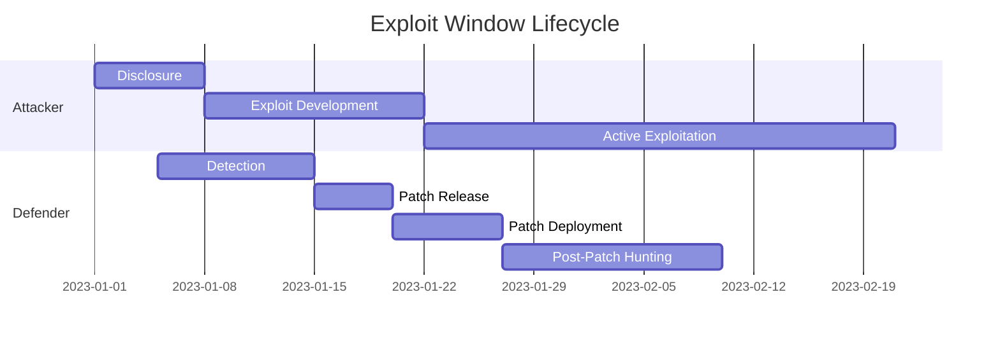
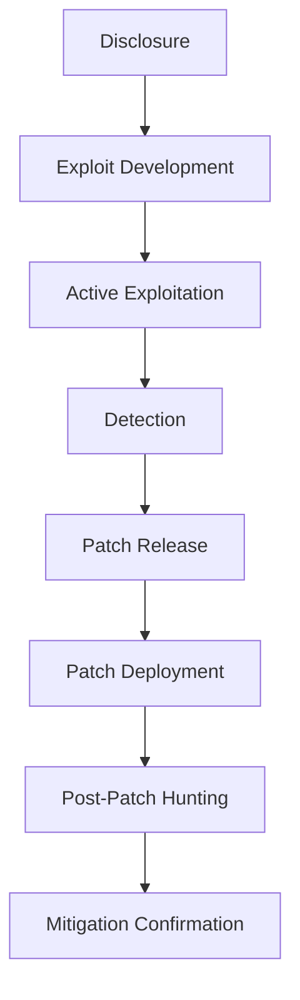

# THE EXPLOIT WINDOW PARADOX
## From Vulnerability Disclosure to Confirmed Compromise: Why Patching Does Not Prove Security

**Abstract**

The time between a vulnerability being disclosed and the moment an attacker successfully exploits it—commonly called the *exploit window*—remains a critical blind spot for most organisations.  Even after a patch is released, the window often persists because of delayed detection, uneven rollout, and insufficient post‑patch hunting.  This paper analyses the lifecycle of an exploit window, visualises the attacker‑defender timeline with a Gantt chart, and presents a flow‑based model of the processes required to close the gap.

---

### 1. Introduction

Traditional security metrics treat patch deployment as the endpoint of a mitigation effort.  In practice, attackers frequently operate within the interval before the patch is fully applied, and they may even exploit systems that appear patched due to configuration drift or incomplete coverage.  Understanding the temporal dynamics of this interval is essential for designing effective detection, response, and post‑patch verification strategies.

---

### 2. Exploit Window Timeline

The exploit window can be broken into four overlapping phases:

1. **Disclosure** – The vulnerability is publicly disclosed or privately reported.
2. **Exploit Development** – Threat actors create reliable exploit code.
3. **Active Exploitation** – The exploit is deployed against vulnerable assets.
4. **Defender Response** – Detection, patch release, deployment, and post‑patch hunting occur.

---

### 3. Gantt Chart: Attacker vs Defender Timeline

The chart highlights the overlap where attackers can succeed while defenders are still detecting or rolling out patches.

---

### 4. Flowchart of the Exploit Window Process

The flowchart maps the logical sequence of activities and decision points that organisations should monitor.

---

### 5. Post‑Patch Hunting Protocol

1. **Telemetry Collection** – Aggregate logs from endpoints, firewalls, and IDS.
2. **Indicator Generation** – Search for known exploit signatures and anomalous behaviour.
3. **Threat‑Intel Correlation** – Align internal findings with external threat feeds.
4. **Remediation Validation** – Verify that the patch removes the vulnerable code path.
5. **Continuous Monitoring** – Maintain vigilance for resurgence or variant attacks.

---

### 6. Recommendations

| Area                     | Action                                                                      |
|--------------------------|-----------------------------------------------------------------------------|
| Detection                | Deploy behavioural analytics that flag exploitation attempts before patching |
| Patch Management         | Automate staged roll‑out with forced verification and rollback capability |
| Post‑Patch Verification  | Implement a 14‑day hunting window using the protocol above                    |
| Communication            | Share timeline metrics across engineering, SOC, and risk teams               |

---

### 7. Conclusion

Patching alone does not guarantee security.  By visualising the exploit window with Gantt and flow diagrams, organisations can recognise the temporal gaps that attackers exploit.  A disciplined post‑patch hunting programme, combined with rapid detection and coordinated communication, reduces the likelihood that a confirmed compromise occurs after a patch is released.

---

### 8. References

1. **CVE‑2023‑XXXXX** – Public disclosure and patch timeline analysis.
2. **MITRE ATT&CK** – Tactics used during the active exploitation phase.
3. **NIST SP 800‑40 Rev. 3** – Guidance on patch management and verification.
4. **SANS Critical Security Controls** – Control 4.6 (Patch Management) and 6.1 (Incident Response).
5. **Recent industry reports** – Demonstrating exploit window durations in 2022‑2024.