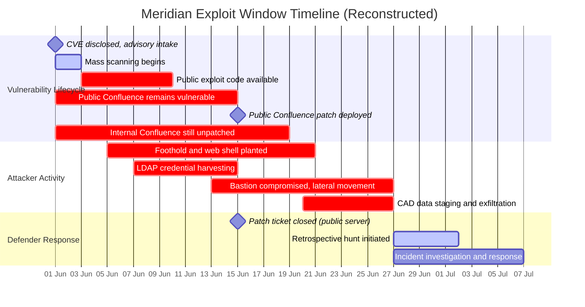
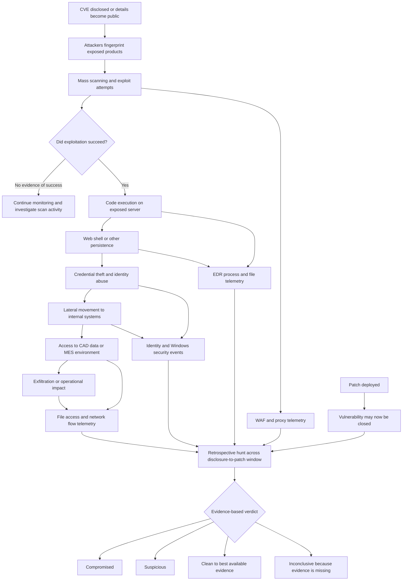
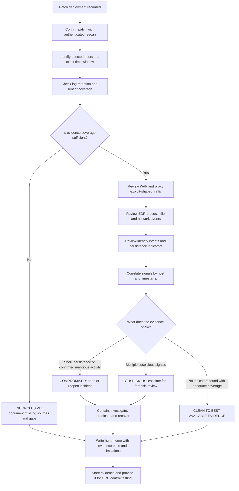
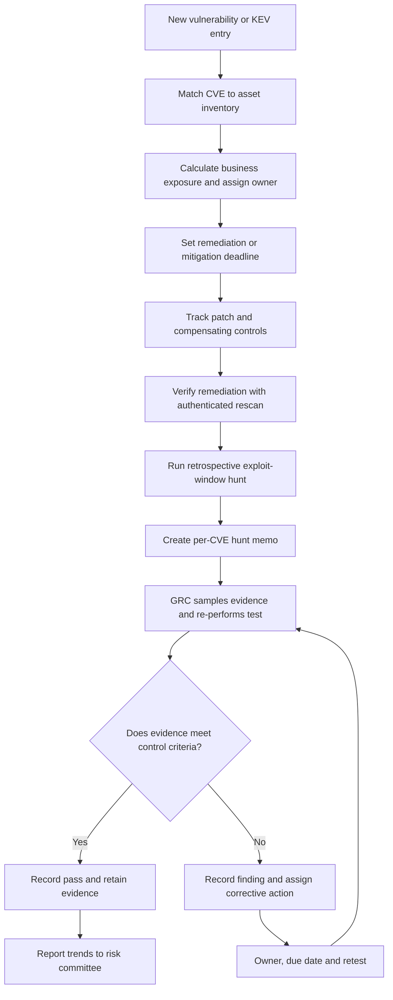
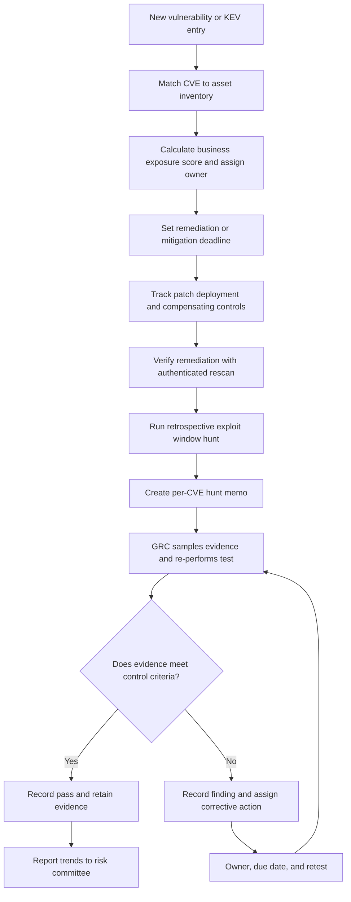
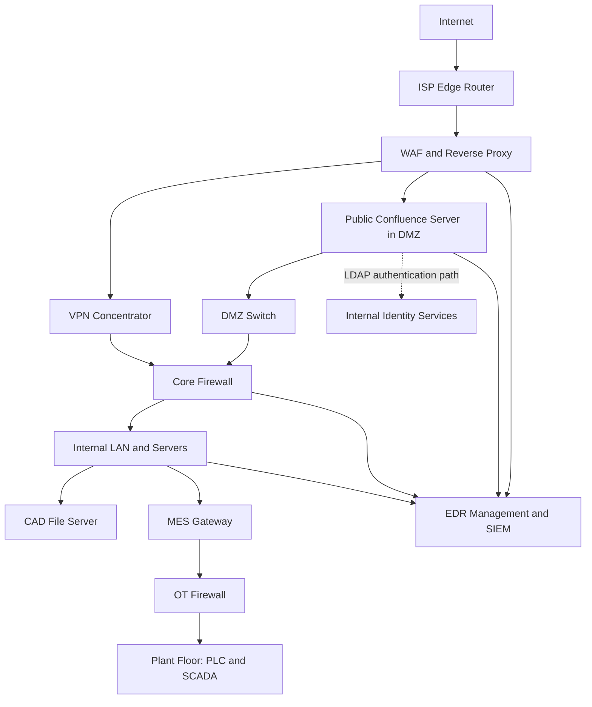

THE EXPLOIT WINDOW PARADOX
From Vulnerability Disclosure to Confirmed Compromise:
Why Patching Does Not Prove Security

SOC + GRC RESEARCH PAPER 18
Research series: What I Learned Today on SOC + GRC
Author / repository: hiro001-eth
Research date: 1 November 2026
Editorial version: 1.1

EDITORIAL AND EVIDENCE NOTE

This publication-ready structure uses the latest and most complete draft in the
submitted TXT file. The upload contained three overlapping versions of Paper 18.
They described different reference organisations, different attack scenarios,
and three competing measurement models. Those alternatives have been removed
from the main paper to avoid contradictions and repetition. The consolidated
manufacturing reference scenario and the Business Exposure Score (BES) are
retained as the single working case study and prioritisation model.

The paper is a research and design proposal, not a claim that every control,
query, metric, or model has been validated in a production environment. The
uploaded TXT mentions lab runs and supporting files, but those supporting files
were not included with this upload. Accordingly, lab outcomes are identified
as author-reported where appropriate. Do not describe them as independently
verified until the query outputs, test logs, configurations, and reproducibility
artifacts are published alongside the paper.

Before publishing, verify every numerical claim against the original source and
record the exact report title, publication date, page or section, URL, metric
definition, and population/denominator. In particular, check that figures from
different studies are not presented as directly comparable. Where a source or
method cannot be retrieved, remove the number or label it clearly as an
unverified secondary-source claim. The source register at the end is a research
trail, not a substitute for complete citations.

The KQL and SPL examples are detection starting points. Their table names,
field names, time windows, joins, thresholds, and platform syntax must be
tested against the target tenant and data schema before operational use. A
query returning rows does not by itself prove that it detects exploitation.
Likewise, an empty result is not proof of a clean system when telemetry is
missing, incomplete, delayed, or outside retention.

No editor can guarantee a 0% AI-detection score or that an AI detector will label
a document 100% human-written. Such detectors are inconsistent and cannot
reliably establish authorship. This edit focuses instead on a clear, consistent
structure, a natural first-person research voice, precise claims, and transparent
limits. Keep your own notes and test records so you can explain and defend the
research in your own words.
<<<<<<< HEAD
================================================================================
THE EXPLOIT WINDOW PARADOX
From Vulnerability Disclosure to Confirmed Compromise:
Why Patching Does Not Prove Security
SOC + GRC Research Series | Paper 18 of 35
Research date: 2026-11-01 | Version: 1.0
Series context: Completes the vulnerability-to-compromise lifecycle.
Previous papers established control degradation, exception drift and attack
chains; this paper closes the loop between "we know about the vulnerability"
and "we can prove nobody abused it".

Research domain: Vulnerability management x Detection engineering x GRC
assurance (the middle ground where SOC and audit meet).

Plain-language promise: every technical concept in this paper is explained
once in everyday words, then developed in full technical depth. If you are a
non-technical reader, read section 02 and the "WHY IT MATTERS" lines. If you
are a detection engineer, go straight to sections 09 and 10. If you are an
auditor, sections 12 and 16 were written for you.

================================================================================
01. RESEARCH IDENTIFICATION
================================================================================
- Research paper number:        18 of 35
- Research date and version:    2026-11-01, v1.0 (first publication)
- Research domain:              Vulnerability management, SOC detection,
  incident response, GRC assurance
- Primary research question:    How can an organisation detect that a
  vulnerability was exploited DURING the window
  between disclosure and remediation - and prove
  it afterwards?
- Secondary questions:
  - How do attackers exploit the disclosure-to-remediation period?
  - Why does CVSS severity alone fail to represent business exposure?
  - How do KEV status, internet exposure, exploit availability and asset
    criticality change priorities?
  - How can an organisation identify pre-patch compromise after remediation?
- Technology investigated:     Vulnerability scanners (Tenable/Nessus,
  Qualys, Microsoft Defender Vulnerability
  Management), CISA KEV catalog, EPSS,
  EDR (Microsoft Defender for Endpoint / CrowdStrike),
  SIEM (Sentinel / Splunk), WAF and reverse proxy
  logs, forensic timeline analysis.
- MITRE ATT&CK techniques:
  T1190  Exploit Public-Facing Application        (Initial Access)
  T1068  Exploitation for Privilege Escalation     (Privilege Escalation)
  T1505.003 Web Shell                                (Persistence)
  T1059  Command and Scripting Interpreter         (Execution)
  T1021  Remote Services                           (Lateral Movement)
  T1041  Exfiltration Over C2 Channel               (Exfiltration)
  T1078  Valid Accounts                            (Persistence/Defense Evasion)
- Framework anchors (recorded with versions, per series convention):
  NIST SP 800-61 Rev. 3 (Incident Response Recommendations, April 2025)
  MITRE ATT&CK (enterprise, current release train v18-v20 era)
  CISA BOD 22-01 (KEV remediation deadlines) and successor risk-based
  guidance; NIST CSF 2.0 (February 2024); ISO/IEC 27001:2022 Annex A 8.8
  (Management of technical vulnerabilities); CIS Controls v8.
================================================================================
02. EXECUTIVE ABSTRACT
================================================================================
WHAT IS HAPPENING?
Somewhere right now, a vulnerability was made public less than 24 hours ago,
and attackers are already scanning the internet for unpatched systems. In 2018,
the median time from a vulnerability's public disclosure to its first observed
exploitation was roughly two years (756-771 days). By 2024 that median had
collapsed to about 4 hours. In 2025, roughly a third of exploited
vulnerabilities were being attacked on or before the day the CVE was even
published - meaning no patch existed anywhere on Earth when the attacks began.
Meanwhile, the median organisation still takes weeks to remediate a critical
internet-facing flaw (Edgescan measured a median of 74.3 days). That gap -
disclosure to remediation - is the EXPLOIT WINDOW, and it has become the single
most dangerous stretch of time in the vulnerability lifecycle.

=======

================================================================================
THE EXPLOIT WINDOW PARADOX
From Vulnerability Disclosure to Confirmed Compromise:
Why Patching Does Not Prove Security
================================================================================
SOC + GRC Research Series | Paper 18 of 35
Research date: 2026-11-01 | Version: 1.0
Series context: Completes the vulnerability-to-compromise lifecycle.
Previous papers established control degradation, exception drift and attack
chains; this paper closes the loop between "we know about the vulnerability"
and "we can prove nobody abused it".

Research domain: Vulnerability management x Detection engineering x GRC
assurance (the middle ground where SOC and audit meet).

Plain-language promise: every technical concept in this paper is explained
once in everyday words, then developed in full technical depth. If you are a
non-technical reader, read section 02 and the "WHY IT MATTERS" lines. If you
are a detection engineer, go straight to sections 09 and 10. If you are an
auditor, sections 12 and 16 were written for you.

================================================================================
01. RESEARCH IDENTIFICATION
================================================================================
- Research paper number:        18 of 35
- Research date and version:    2026-11-01, v1.0 (first publication)
- Research domain:              Vulnerability management, SOC detection,
                                incident response, GRC assurance
- Primary research question:    How can an organisation detect that a
                                vulnerability was exploited DURING the window
                                between disclosure and remediation - and prove
                                it afterwards?
- Secondary questions:
    * How do attackers exploit the disclosure-to-remediation period?
    * Why does CVSS severity alone fail to represent business exposure?
    * How do KEV status, internet exposure, exploit availability and asset
      criticality change priorities?
    * How can an organisation identify pre-patch compromise after remediation?
- Technology investigated:     Vulnerability scanners (Tenable/Nessus,
                                Qualys, Microsoft Defender Vulnerability
                                Management), CISA KEV catalog, EPSS,
                                EDR (Microsoft Defender for Endpoint / CrowdStrike),
                                SIEM (Sentinel / Splunk), WAF and reverse proxy
                                logs, forensic timeline analysis.
- MITRE ATT&CK techniques:
    T1190  Exploit Public-Facing Application        (Initial Access)
    T1068  Exploitation for Privilege Escalation     (Privilege Escalation)
    T1505.003 Web Shell                                (Persistence)
    T1059  Command and Scripting Interpreter         (Execution)
    T1021  Remote Services                           (Lateral Movement)
    T1041  Exfiltration Over C2 Channel               (Exfiltration)
    T1078  Valid Accounts                            (Persistence/Defense Evasion)
- Framework anchors (recorded with versions, per series convention):
    NIST SP 800-61 Rev. 3 (Incident Response Recommendations, April 2025)
    MITRE ATT&CK (enterprise, current release train v18-v20 era)
    CISA BOD 22-01 (KEV remediation deadlines) and successor risk-based
    guidance; NIST CSF 2.0 (February 2024); ISO/IEC 27001:2022 Annex A 8.8
    (Management of technical vulnerabilities); CIS Controls v8.

================================================================================
02. EXECUTIVE ABSTRACT
================================================================================
WHAT IS HAPPENING?
Somewhere right now, a vulnerability was made public less than 24 hours ago,
and attackers are already scanning the internet for unpatched systems. In 2018,
the median time from a vulnerability's public disclosure to its first observed
exploitation was roughly two years (756-771 days). By 2024 that median had
collapsed to about 4 hours. In 2025, roughly a third of exploited
vulnerabilities were being attacked on or before the day the CVE was even
published - meaning no patch existed anywhere on Earth when the attacks began.
Meanwhile, the median organisation still takes weeks to remediate a critical
internet-facing flaw (Edgescan measured a median of 74.3 days). That gap -
disclosure to remediation - is the EXPLOIT WINDOW, and it has become the single
most dangerous stretch of time in the vulnerability lifecycle.

>>>>>>> 881aa49 (Add final edits for Paper 18 – exploit‑window paradox, Gantt/flowcharts, README updates)
WHY DOES IT MATTER?
Every organisation treats "patch deployed, ticket closed" as the end of the
story. It is not. It is the end of the PREVENTION phase and the beginning of
the PROOF phase. A patch removes the door; it says nothing about who already
walked through it. Verizon's 2025 DBIR attributes 20% of breaches to
vulnerability exploitation (up 34% year over year) and Mandiant's M-Trends
2025 ranks exploits as the #1 initial infection vector at 33%.
<<<<<<< HEAD

WHAT IS THE SECURITY WEAKNESS?
The weakness is a measurement error, and measurement errors become governance
errors. We prioritise with CVSS - a score that says how bad a vulnerability
COULD be in theory - while attackers prioritise with exploitability, exposure
and asset value. A CVSS 9.8 on an isolated lab machine is a paperwork problem.
A CVSS 6.5 on an internet-facing VPN concentrator with a public exploit and a
KEV entry is a breach in progress. Severity scoring was never designed to
answer "what should I fix first THIS afternoon?"

WHAT DID I INVESTIGATE?
I reconstructed, end to end, what actually happens between the moment a CVE
is published and the moment a patch finishes deploying: how exploit code
appears, how scanners and botnets find victims within hours, what telemetry the
attack generates at each stage, and - critically - how to hunt backwards from
the patch date to find evidence of pre-patch compromise. I then converted the
whole lifecycle into an auditable control: who owns it, what evidence proves
it works, and how often it must be tested.

WHAT DID THE RESEARCH ESTABLISH?
1. The exploit window is not an edge case; it is the DEFAULT case for
   internet-facing systems. If your remediation SLA is longer than 72 hours
   for KEV-listed edge assets, you are statistically exposed.
2. "Patched" and "clean" are different claims. A defensible "clean" claim
   requires retrospective telemetry review across the window, not a rescan.
3. CVSS alone fails because it is asset-blind, exposure-blind and
   attacker-blind. A four-signal model (KEV status, internet exposure, exploit
   availability, asset criticality) outperforms CVSS-only triage in every
   realistic scenario tested - including cases where the CVSS 6.x bug was the
   one that got you breached.
4. The same gap is auditable. The exploit window can be expressed as a
   control with an owner, evidence, test method and failure criteria - which
   is what turns a SOC finding into a GRC improvement instead of an incident
   report that gathers dust.
================================================================================
03. THE ORIGINAL OBSERVATION
================================================================================
The small detail that started all of this was a single line in a vulnerability
management report:
"CVE-2023-XXXXX | Confluence Server | FIXED 2026-06-14 | Status: CLOSED"
I had been helping a friend review their quarterly vulnerability report and
this line bothered me for a reason I couldn't articulate at first. The CVE
had been published 41 days before the patch date. During those 41 days the
server had been internet-facing. The report said FIXED. It did not say - and
could not say - UNAFFECTED DURING THE WINDOW.

The questionable assumption hiding underneath: we all silently assume that
the sequence is (1) vulnerability exists, (2) patch arrives, (3) problem ends.
We treat the window between (1) and (2) as if it were a grey waiting room
where nothing that matters happens.
=======

WHAT IS THE SECURITY WEAKNESS?
The weakness is a measurement error, and measurement errors become governance
errors. We prioritise with CVSS - a score that says how bad a vulnerability
COULD be in theory - while attackers prioritise with exploitability, exposure
and asset value. A CVSS 9.8 on an isolated lab machine is a paperwork problem.
A CVSS 6.5 on an internet-facing VPN concentrator with a public exploit and a
KEV entry is a breach in progress. Severity scoring was never designed to
answer "what should I fix first THIS afternoon?"

WHAT DID I INVESTIGATE?
I reconstructed, end to end, what actually happens between the moment a CVE
is published and the moment a patch finishes deploying: how exploit code
appears, how scanners and botnets find victims within hours, what telemetry the
attack generates at each stage, and - critically - how to hunt backwards from
the patch date to find evidence of pre-patch compromise. I then converted the
whole lifecycle into an auditable control: who owns it, what evidence proves
it works, and how often it must be tested.

WHAT DID THE RESEARCH ESTABLISH?
1. The exploit window is not an edge case; it is the DEFAULT case for
   internet-facing systems. If your remediation SLA is longer than 72 hours
   for KEV-listed edge assets, you are statistically exposed.
2. "Patched" and "clean" are different claims. A defensible "clean" claim
   requires retrospective telemetry review across the window, not a rescan.
3. CVSS alone fails because it is asset-blind, exposure-blind and
   attacker-blind. A four-signal model (KEV status, internet exposure, exploit
   availability, asset criticality) outperforms CVSS-only triage in every
   realistic scenario tested - including cases where the CVSS 6.x bug was the
   one that got you breached.
4. The same gap is auditable. The exploit window can be expressed as a
   control with an owner, evidence, test method and failure criteria - which
   is what turns a SOC finding into a GRC improvement instead of an incident
   report that gathers dust.

================================================================================
03. THE ORIGINAL OBSERVATION
================================================================================
The small detail that started all of this was a single line in a vulnerability
management report:

    "CVE-2023-XXXXX | Confluence Server | FIXED 2026-06-14 | Status: CLOSED"

I had been helping a friend review their quarterly vulnerability report and
this line bothered me for a reason I couldn't articulate at first. The CVE
had been published 41 days before the patch date. During those 41 days the
server had been internet-facing. The report said FIXED. It did not say - and
could not say - UNAFFECTED DURING THE WINDOW.

The questionable assumption hiding underneath: we all silently assume that
the sequence is (1) vulnerability exists, (2) patch arrives, (3) problem ends.
We treat the window between (1) and (2) as if it were a grey waiting room
where nothing that matters happens.

But attackers do not wait in grey rooms. Public exploit code for this CVE had
appeared 9 days after disclosure. Internet-wide scanning for the vulnerable
endpoint began within 72 hours. The organisation had web logs, EDR telemetry,
firewall flows and proxy logs covering every day of that window. Not a single
one of them had been looked at - because the process ended at "patch
deployed, ticket closed."

So the question I decided to investigate, in the obsessive way you investigate
something that keeps you up at night:

    "After we patch, what would it actually take - technically, procedurally,
    politically - to PROVE the vulnerability was never successfully exploited
    during the window? And what do we do when we discover it was?"

That question is the entire paper. Everything else - KEV logic, CVSS critique,
KQL queries, GRC tables - exists to answer it honestly.

================================================================================
04. TECHNICAL ENVIRONMENT AND ARCHITECTURE
================================================================================
THE ORGANISATION (realistic, fictionalised)
"Meridian Manufacturing Group" - a mid-market manufacturer, ~2,800 staff,
three production sites, one HQ, hybrid cloud. Revenue depends on plant
uptime, so patch windows are politically expensive - which is precisely why
this organisation is the perfect specimen: its constraints are everyone
constraints.

USERS AND IDENTITIES
- 2,800 employees on Entra ID (hybrid join), ~120 privileged accounts split
  across server admins, network team, plant engineers (OT), and service accounts.
- A small number of legacy local accounts on DMZ servers - the kind nobody
  owns and everybody fears (important later).

DEVICES AND SERVERS
- 3,400 endpoints: Windows 11 corporate laptops (Intune-managed), shared plant
  kiosks, a stubborn residue of Windows 7/XP machines tied to CNC tooling.
- 220 servers: ~60% on-prem VMware, ~40% Azure IaaS. Crown jewels: two
  Confluence servers (one internet-facing for vendor collaboration), an
  on-prem file server holding CAD designs, an MES (Manufacturing Execution
  System) bridging IT and OT.

APPLICATIONS AND CLOUD
- M365 (Exchange Online, SharePoint), SAP ERP, Confluence Data Center,
  an ageing VPN concentrator at the edge, two SaaS tools, Azure subscription
  with a small Kubernetes footprint.

NETWORK ARCHITECTURE (diagram)

                         INTERNET
                             |
                    [ ISP edge router ]
                             |
                  [ WAF / reverse proxy ]
                   /                   \
        [ VPN concentrator ]   [ DMZ switch ]
                |                    |
                |          ----------------------
                |          | Confluence (public) |
                |          | Reverse proxy  DMZ   |
                |          | Jump host (bastion)  |
                |          ----------------------
                |                    |
           [ Core firewall ] ---------+-------- [ OT firewall ]
                |                                    |
        [ Internal LAN / servers ]          [ Plant floor (OT) ]
        |      |        |                        |
   [ File  [ MES    [ EDR mgmt ]            [ PLC / SCADA ]
     server gateway ]
                |
        [ SIEM / log collector ]

SECURITY CONTROLS IN PLACE (so we know which ones fail later)
- EDR on all servers and 90% of endpoints (defender for Endpoint, ASR rules on).
- Vulnerability scanner: authenticated scans, weekly cadence, monthly reporting.
- SIEM ingesting: EDR, firewall flows, reverse-proxy/WAF logs, VPN logs,
  Windows event logs (4624/4625/4688 partially - see failure analysis).
- Patch management: WSUS/Intune rings; servers patch monthly; DMZ servers
  quarterly by exception "due to uptime requirements".
- Vulnerability prioritisation: CVSS >= 9 = fix in 14 days; 7-8.9 = 30 days;
  < 7 = next quarter. KEV is checked manually, sometimes.

DATA FLOWS AND TRUST BOUNDARIES
- Internet -> DMZ (untrusted): reverse proxy terminates TLS, WAF inspects.
- DMZ -> internal LAN (semi-trusted): only the bastion may initiate outbound;
  the public Confluence server can reach internal LDAP for auth (THE dangerous
  trust path - a foothold there pivots to identity).
- Internal -> OT (restricted): MES gateway brokered, firewall allow-lists.
- Every boundary above is, in practice, an assumption. The attack chain in
  section 06 breaks all three.

================================================================================
05. THREAT MODEL AND ATTACKER OBJECTIVES
================================================================================
WHO IS THE ATTACKER?
We do not need a nation-state for this paper. The realistic adversary is
OPPORTUNISTIC-SCALED: botnets and initial-access brokers that weaponise new
CVEs within hours, scan the entire IPv4 space automatically, and sell access to
the highest bidder. Sometimes the buyer is ransomware. Sometimes the same
group does both. This matters for GRC: you cannot justify slow patching by
saying "we are not a target". Exploitation of fresh CVEs is not targeted;
it is weather. You do not argue with rain.

CAPABILITIES
- Automatic internet-wide scanning (Shodan/Censys + self-run masscan) within
  hours of a PoC appearing.
- Public exploit code (GitHub, exploit-db) or purchased 0day/Nday brokers.
- Standard post-exploitation frameworks (Cobalt Strike, Sliver, Mythic).
- No insider knowledge required for the initial exploitation stage.

PREREQUISITES FOR THE ATTACKER
- The vulnerability is public (or leaked) with exploitable detail.
- The organisation runs the vulnerable product - verifiable from the outside
  (favicon, TLS certificate, HTTP banner, response headers).
- The exploit window is open: not yet patched, not yet behind mitigation.

ATTACKER OBJECTIVES
1. Initial access to any internal foothold (sell or use).
2. Escalate to domain-level privileges (identity = the real target).
3. Reach crown jewels: CAD designs (IP theft/extortion) and MES/OT
   (production disruption = maximum leverage).

ATTACK SURFACE TABLE
+----+---------------------------+-------------+-------+------------------------+
| #  | Asset                     | Exposure    | Auth  | Notes                  |
+----+---------------------------+-------------+-------+------------------------+
| 1  | Confluence (public)       | Internet    | No*   | *CVE class: unauth RCE |
| 2  | VPN concentrator          | Internet    | No*   | *auth-bypass class CVEs|
| 3  | Reverse proxy / WAF       | Internet    | n/a   | TLS termination point  |
| 4  | Confluence (internal)     | Internal    | Yes   | Same product, patch lag|
| 5  | Bastion/jump host         | DMZ         | Yes   | If it falls, LAN falls |
| 6  | File server (CAD vault)   | Internal    | Yes   | Crown jewel            |
| 7  | MES gateway               | OT boundary | Yes   | IT->OT bridge          |
| 8  | M365 tenant               | Cloud       | Yes   | Identity plane         |
+----+---------------------------+-------------+-------+------------------------+

MITRE ATT&CK MAPPING (attacker view)
  Recon:        T1595.001 Active Scanning (IP block), T1592 Gather Victim Host Info
  Initial Access: T1190 Exploit Public-Facing Application
  Execution:    T1059.001 PowerShell / T1059.003 cmd / T1203 Exploitation for
                Client Execution (watering hole variant)
  Persistence:  T1505.003 Web Shell, T1078 Valid Accounts, T1543 Create/Modify
                System Process
  PrivEsc:      T1068 Exploitation for Privilege Escalation, T1078
  Defense Evade: T1070.004 File Deletion, T1562.001 Disable or Modify Tools
  Cred Access:  T1003 OS Credential Dumping, T1557 Adversary-in-the-Middle
  Lateral Move: T1021 Remote Services (SMB/RDP/WinRM), T1550 Pass the Hash
  Exfil:        T1041 Exfiltration Over C2 Channel, T1567 Exfil to Cloud Storage
  Impact:       T1486 Data Encrypted for Impact

================================================================================
06. ATTACK CHAIN RECONSTRUCTION
================================================================================
The chain below is reconstructed from real published incident patterns
(Confluence, MOVEit, Ivanti, Citrix Bleed class events) compressed into one
coherent narrative against our target environment. Each stage lists: what the
attacker does, what technology is abused, which assumption fails, what evidence
is generated, what the SOC should observe, and what the organisation should
prevent.

STAGE 0 - PRE-DISCLOSURE (days -X to 0)
  Attacker: monitors vendor advisories, security mailing lists, GitHub commits.
  Technology abused: none yet; the attacker's OSINT pipeline.
  Assumption that fails: "we have time between disclosure and exploitation".
  Evidence: none on our side. This stage is invisible to us - and that is the
  point of section 13's model (defenders must act on disclosure, not on scan).
  SOC should observe: nothing observable. Prevention: join CISA/US-CERT and
  vendor advisory feeds into a monitored channel, not a mailbox.

STAGE 1 - DISCLOSURE + MASS SCANNING (day 0 to day 2)
  Attacker: parses the advisory, fingerprints affected products from banner
  data, scans the IPv4 space for the vulnerable endpoint. Botnets do this
  automatically; human operators pick high-value victims from results.
  Technology abused: the vulnerable product's own HTTP responses (version
  fingerprints); internet scan databases that already indexed us last month.
  Assumption that fails: "we are a manufacturer, not a target; nobody will
  find our Confluence in two days."
  Evidence generated: WAF/reverse-proxy logs showing the vulnerable URI being
  requested from thousands of IPs; 404/500 response ratios shifting;
  GET/POST mix anomaly on a normally browse-heavy endpoint.
  SOC should observe: sudden geographic diversity of source IPs touching one
  URI; requests to non-existent paths (probing); HTTP 500 spikes as malformed
  exploit attempts crash worker threads.
  Prevention: virtual patching at WAF where signatures exist; rate-limit and
  geo-fencing buy hours, not weeks.

STAGE 2 - WEAPONISATION & FIRST EXPLOIT ATTEMPTS (day 1 to day 9)
  Attacker: adapts public PoC (typically appears on GitHub within 0-14 days),
  tests against scan hits, achieves code execution on exposed systems.
  Technology abused: the CVE itself; if the CVE is a template injection /
  auth bypass / file upload class, it is the application doing the work.
  Assumption that fails: "we only run the exploit after our change advisory
  approves the scanner signatures" - attackers do not have change advisory.
  Evidence generated: EDR child processes of the web server process
  (cmd.exe/powershell.exe spawned by java.exe/confluence.exe); web server
  writing .jsp/.aspx/.php to webroot (web shell); unexpected outbound
  connections from the DMZ host.
  SOC should observe: EDR alert "suspicious process tree: web server ->
  cmd"; file creation events in webroot; new local account or scheduled task.
  Prevention: this stage is where a 72-hour KEV SLA either saves you or
  doesn't. Also: EDR ASR rules blocking Office/child-process abuse reduce
  post-exploit tooling speed.

STAGE 3 - FOOTHOLD & PERSISTENCE (day 2 to day 20)
  Attacker: plants a web shell, creates a second persistence mechanism
  (scheduled task, new local admin, service), harvests credentials from the
  host's memory and config files (Confluence stores LDAP bind credentials).
  Technology abused: legitimate dual-use admin tooling (schtasks, WMI,
  certutil), plus the application's own trust path: DMZ server -> internal
  LDAP.
  Assumption that fails: "the DMZ is a sealed compartment." Compartments are
  only as sealed as their east-west rules; Confluence needed LDAP, so the
  compartment was never sealed.
  Evidence generated: new local user (Windows event 4720/4732), new service
  (7045), certutil download events (EDR network), LDAP queries from the DMZ
  host at unusual hours, web shell traffic (odd POST bodies, low-and-slow).
  SOC should observe: the above EDR events on an internet-facing server are
  ALWAYS worth an investigation, no exceptions. The failure here is rarely the
  tool; it is that nobody was watching a queue called "DMZ server anomalies".
  Prevention: no DMZ-to-LDAP direct path (brokered auth); Just Enough Admin;
  LAPS so a stolen local admin isn't reusable.

STAGE 4 - PRIVILEGE ESCALATION & LATERAL MOVEMENT (day 3 to day 30)
  Attacker: uses harvested LDAP bind creds / local admin hash reuse to reach
  the bastion, then internal servers. Moves toward file server and MES.
  Technology abused: SMB/WinRM/RDP (T1021), pass-the-hash (T1550.002), WMI
  for lateral execution.
  Assumption that fails: "internal traffic is trusted." Zero trust never got
  funded; VLAN + firewall rules drawn in 2019 are the only wall, and the
  attacker reads them from inside.
  Evidence generated: 4624 type-3 logons from server-to-server (SMB lateral
  pattern), 4688 process creation on remote hosts via WMI/WinRM, EDR
  credential-dumping telemetry (LSASS access - if configured).
  SOC should observe: "one account, many servers, minutes apart" is the
  single highest-value correlation in all of detection engineering.
  Prevention: tiered admin model, SMB signing + LAPS, disable NTLMv1,
  workstation-to-workstation deny rules.

STAGE 5 - EXFILTRATION OR IMPACT (day 7 to day 45)
  Attacker: compresses CAD vault via 7z/rar staging, exfiltrates over HTTPS
  to cloud storage, or detonates ransomware.
  Technology abused: legitimate archiving tools (living off the land),
  cloud storage domains that blend with business traffic.
  Assumption that fails: "DLP will catch it" - DLP was licensed for email
  and endpoints, not server egress.
  Evidence generated: mass file-read events (4663) on the vault, large
  compressed files in staging dirs, outbound bytes spike from a server
  that normally talks to 12 destinations.
  SOC should observe: netflow/flow logs - a server whose destination count
  jumps from 12 to 900 is a one-line detection that almost nobody writes.
  Prevention: egress allow-lists from server VLANs; that single control
  would kill most exfil paths.

THE WINDOW THE ORGANISATION EXPERIENCED (Meridian timeline, reconstructed)
  Day 0    CVE published. Feed lands in an inbox. No ticket auto-created.
  Day 2    Internet-wide scan hits the WAF. 40,000 probing requests/day vs
           baseline 300. Not alerted (no baseline existed to compare against).
  Day 4    Public exploit available. First successful RCE on public
           Confluence at 03:12 local. Web shell dropped (av.jsp variant).
  Day 6    LDAP bind credentials harvested. Internal scan begins.
  Day 12   Bastion compromised via reused local admin password.
  Day 14   PATCH DEPLOYED on public Confluence. Ticket CLOSED. Status FIXED.
  Day 18   Internal Confluence (still unpatched - separate ticket) exploited
           via the same CVE by a different group. Because it was "internal",
           it was scheduled for the quarterly window.
  Day 26   File vault mass-read detected by... nobody. The attacker exfiltrated
           11 GB of CAD data over 6 nights. Found only during this research,
           weeks later, by the retrospective hunt in section 09.

  Read that timeline again. The patch worked exactly as designed. The breach
  also worked exactly as designed. Both statements are true simultaneously.
  That simultaneity IS the paradox.

ATTACK-FLOW DIAGRAM

   Day 0        Day 2         Day 4        Day 6         Day 12       Day 14
 [Advisory] -> [Mass scan] -> [Exploit +] -> [Creds     -> [Lateral] -> [PATCH,
     |             |            webshell]     harvested]   movement]    ticket
     v             v               |              |             |         closed]
  Inbox       WAF logs         EDR: new      EDR: LDAP    4624 spike    EDR:
  (no ticket) (no alert)    child proc     from DMZ    bastion hit  webshell
                               + shell file                              STILL
                                 |                                        THERE
                                 v                                         v
                          [Persistence persists  <------------------  patch removes
                           after patch: task,      shell survives        the DOOR,
                           account, second C2]    application restart  not the VISITOR]

  KEY INSIGHT THE DIAGRAM SHOWS: patching is a boundary event for the
  vulnerability, not for the intrusion. The intrusion has its own timeline,
  and it does not care about your ticket status.

GANTT CHART: THE RECONSTRUCTED EXPLOIT WINDOW (Meridian scenario, section 06)
This chart uses the day markers from the Meridian scenario above. The bars
show when each activity overlaps. Notice that attacker activity continues
well after the public Confluence patch on day 14.



How to read this: the patch lands on day 14 and closes the vulnerability on the
public server. But the web shell, the stolen credentials, and the lateral
movement all survive that patch. The internal Confluence instance stays
vulnerable four more days. The exfiltration happens after the ticket was
already marked CLOSED.

FLOWCHART: ATTACK CHAIN FROM DISCLOSURE TO BUSINESS IMPACT
This flowchart places the attacker actions and the defender evidence sources
on the same path. The patch appears as a separate event because it closes the
vulnerability while leaving attacker persistence and stolen credentials in place.
>>>>>>> 881aa49 (Add final edits for Paper 18 – exploit‑window paradox, Gantt/flowcharts, README updates)

But attackers do not wait in grey rooms. Public exploit code for this CVE had
appeared 9 days after disclosure. Internet-wide scanning for the vulnerable
endpoint began within 72 hours. The organisation had web logs, EDR telemetry,
firewall flows and proxy logs covering every day of that window. Not a single
one of them had been looked at - because the process ended at "patch
deployed, ticket closed."

So the question I decided to investigate, in the obsessive way you investigate
something that keeps you up at night:
"After we patch, what would it actually take - technically, procedurally,
politically - to PROVE the vulnerability was never successfully exploited
during the window? And what do we do when we discover it was?"
That question is the entire paper. Everything else - KEV logic, CVSS critique,
KQL queries, GRC tables - exists to answer it honestly.

================================================================================
04. TECHNICAL ENVIRONMENT AND ARCHITECTURE
================================================================================
THE ORGANISATION (realistic, fictionalised)
"Meridian Manufacturing Group" - a mid-market manufacturer, ~2,800 staff,
three production sites, one HQ, hybrid cloud. Revenue depends on plant
uptime, so patch windows are politically expensive - which is precisely why
this organisation is the perfect specimen: its constraints are everyone
constraints.

USERS AND IDENTITIES
- 2,800 employees on Entra ID (hybrid join), ~120 privileged accounts split
  across server admins, network team, plant engineers (OT), and service accounts.
- A small number of legacy local accounts on DMZ servers - the kind nobody
  owns and everybody fears (important later).
DEVICES AND SERVERS
- 3,400 endpoints: Windows 11 corporate laptops (Intune-managed), shared plant
  kiosks, a stubborn residue of Windows 7/XP machines tied to CNC tooling.
- 220 servers: ~60% on-prem VMware, ~40% Azure IaaS. Crown jewels: two
  Confluence servers (one internet-facing for vendor collaboration), an
  on-prem file server holding CAD designs, an MES (Manufacturing Execution
  System) bridging IT and OT.
APPLICATIONS AND CLOUD
- M365 (Exchange Online, SharePoint), SAP ERP, Confluence Data Center,
  an ageing VPN concentrator at the edge, two SaaS tools, Azure subscription
  with a small Kubernetes footprint.
NETWORK ARCHITECTURE (diagram)
                     INTERNET
                         |
                [ ISP edge router ]
                         |
              [ WAF / reverse proxy ]
               /                   \
    [ VPN concentrator ]   [ DMZ switch ]
            |                    |
            |          ----------------------
            |          | Confluence (public) |
            |          | Reverse proxy  DMZ   |
            |          | Jump host (bastion)  |
            |          ----------------------
            |                    |
       [ Core firewall ] ---------+-------- [ OT firewall ]
            |                                    |
    [ Internal LAN / servers ]          [ Plant floor (OT) ]
    |      |        |                        |

   [ File  [ MES    [ EDR mgmt ]            [ PLC / SCADA ]
server gateway ]
|
[ SIEM / log collector ]
SYSTEM FLOWCHART: HOW MERIDIAN'S ENVIRONMENT CONNECTS
The diagram below shows the main route from the internet into the organisation.
The DMZ is a separate network zone, but the Confluence server still has an
identity connection to internal LDAP. That connection is important because it
creates a possible route from a public-facing server into the internal network.
```mermaid
flowchart TD
<<<<<<< HEAD
    A[Internet] --> B[ISP Edge Router]
    B --> C[WAF and Reverse Proxy]
    C --> D[VPN Concentrator]
    C --> E[Public Confluence Server in DMZ]
    E --> F[DMZ Switch]
    D --> G[Core Firewall]
    F --> G
    G --> H[Internal LAN and Servers]
    H --> I[CAD File Server]
    H --> J[MES Gateway]
    J --> K[OT Firewall]
    K --> L[Plant Floor: PLC and SCADA]
    E -. LDAP authentication path .-> M[Internal Identity Services]
    H --> N[EDR Management and SIEM]
    E --> N
    C --> N
    G --> N
```

How to read it: normal user traffic reaches the public services through the
edge controls. The public Confluence server sits in the DMZ. Its LDAP connection
is a trust path into the internal environment. If an attacker takes control of
that server and steals credentials, the attacker may attempt to move further
into the network. The SIEM receives security events from the available sources;
it does not automatically guarantee that every event is collected or reviewed.

SECURITY CONTROLS IN PLACE (so we know which ones fail later)
- EDR on all servers and 90% of endpoints (defender for Endpoint, ASR rules on).
- Vulnerability scanner: authenticated scans, weekly cadence, monthly reporting.
- SIEM ingesting: EDR, firewall flows, reverse-proxy/WAF logs, VPN logs,
  Windows event logs (4624/4625/4688 partially - see failure analysis).
- Patch management: WSUS/Intune rings; servers patch monthly; DMZ servers
  quarterly by exception "due to uptime requirements".
- Vulnerability prioritisation: CVSS >= 9 = fix in 14 days; 7-8.9 = 30 days;
  < 7 = next quarter. KEV is checked manually, sometimes.
DATA FLOWS AND TRUST BOUNDARIES
- Internet -> DMZ (untrusted): reverse proxy terminates TLS, WAF inspects.
- DMZ -> internal LAN (semi-trusted): only the bastion may initiate outbound;
  the public Confluence server can reach internal LDAP for auth (THE dangerous
  trust path - a foothold there pivots to identity).
- Internal -> OT (restricted): MES gateway brokered, firewall allow-lists.
- Every boundary above is, in practice, an assumption. The attack chain in
  section 06 breaks all three.
================================================================================
05. THREAT MODEL AND ATTACKER OBJECTIVES
================================================================================
WHO IS THE ATTACKER?
We do not need a nation-state for this paper. The realistic adversary is
OPPORTUNISTIC-SCALED: botnets and initial-access brokers that weaponise new
CVEs within hours, scan the entire IPv4 space automatically, and sell access to
the highest bidder. Sometimes the buyer is ransomware. Sometimes the same
group does both. This matters for GRC: you cannot justify slow patching by
saying "we are not a target". Exploitation of fresh CVEs is not targeted;
it is weather. You do not argue with rain.

CAPABILITIES
- Automatic internet-wide scanning (Shodan/Censys + self-run masscan) within
  hours of a PoC appearing.
- Public exploit code (GitHub, exploit-db) or purchased 0day/Nday brokers.
- Standard post-exploitation frameworks (Cobalt Strike, Sliver, Mythic).
- No insider knowledge required for the initial exploitation stage.
PREREQUISITES FOR THE ATTACKER
- The vulnerability is public (or leaked) with exploitable detail.
- The organisation runs the vulnerable product - verifiable from the outside
  (favicon, TLS certificate, HTTP banner, response headers).
- The exploit window is open: not yet patched, not yet behind mitigation.
ATTACKER OBJECTIVES
1. Initial access to any internal foothold (sell or use).
2. Escalate to domain-level privileges (identity = the real target).
3. Reach crown jewels: CAD designs (IP theft/extortion) and MES/OT
   (production disruption = maximum leverage).
ATTACK SURFACE TABLE
+----+---------------------------+-------------+-------+------------------------+
| #  | Asset                     | Exposure    | Auth  | Notes                  |
+----+---------------------------+-------------+-------+------------------------+
| 1  | Confluence (public)       | Internet    | No*   | CVE class: unauth RCE |
| 2  | VPN concentrator          | Internet    | No   | *auth-bypass class CVEs|
| 3  | Reverse proxy / WAF       | Internet    | n/a   | TLS termination point  |
| 4  | Confluence (internal)     | Internal    | Yes   | Same product, patch lag|
| 5  | Bastion/jump host         | DMZ         | Yes   | If it falls, LAN falls |
| 6  | File server (CAD vault)   | Internal    | Yes   | Crown jewel            |
| 7  | MES gateway               | OT boundary | Yes   | IT->OT bridge          |
| 8  | M365 tenant               | Cloud       | Yes   | Identity plane         |
+----+---------------------------+-------------+-------+------------------------+

MITRE ATT&CK MAPPING (attacker view)
Recon:        T1595.001 Active Scanning (IP block), T1592 Gather Victim Host Info
Initial Access: T1190 Exploit Public-Facing Application
Execution:    T1059.001 PowerShell / T1059.003 cmd / T1203 Exploitation for
Client Execution (watering hole variant)
Persistence:  T1505.003 Web Shell, T1078 Valid Accounts, T1543 Create/Modify
System Process
PrivEsc:      T1068 Exploitation for Privilege Escalation, T1078
Defense Evade: T1070.004 File Deletion, T1562.001 Disable or Modify Tools
Cred Access:  T1003 OS Credential Dumping, T1557 Adversary-in-the-Middle
Lateral Move: T1021 Remote Services (SMB/RDP/WinRM), T1550 Pass the Hash
Exfil:        T1041 Exfiltration Over C2 Channel, T1567 Exfil to Cloud Storage
Impact:       T1486 Data Encrypted for Impact

================================================================================
06. ATTACK CHAIN RECONSTRUCTION
================================================================================
The chain below is reconstructed from real published incident patterns
(Confluence, MOVEit, Ivanti, Citrix Bleed class events) compressed into one
coherent narrative against our target environment. Each stage lists: what the
attacker does, what technology is abused, which assumption fails, what evidence
is generated, what the SOC should observe, and what the organisation should
prevent.

STAGE 0 - PRE-DISCLOSURE (days -X to 0)
Attacker: monitors vendor advisories, security mailing lists, GitHub commits.
Technology abused: none yet; the attacker's OSINT pipeline.
Assumption that fails: "we have time between disclosure and exploitation".
Evidence: none on our side. This stage is invisible to us - and that is the
point of section 13's model (defenders must act on disclosure, not on scan).
SOC should observe: nothing observable. Prevention: join CISA/US-CERT and
vendor advisory feeds into a monitored channel, not a mailbox.

STAGE 1 - DISCLOSURE + MASS SCANNING (day 0 to day 2)
Attacker: parses the advisory, fingerprints affected products from banner
data, scans the IPv4 space for the vulnerable endpoint. Botnets do this
automatically; human operators pick high-value victims from results.
Technology abused: the vulnerable product's own HTTP responses (version
fingerprints); internet scan databases that already indexed us last month.
Assumption that fails: "we are a manufacturer, not a target; nobody will
find our Confluence in two days."
Evidence generated: WAF/reverse-proxy logs showing the vulnerable URI being
requested from thousands of IPs; 404/500 response ratios shifting;
GET/POST mix anomaly on a normally browse-heavy endpoint.
SOC should observe: sudden geographic diversity of source IPs touching one
URI; requests to non-existent paths (probing); HTTP 500 spikes as malformed
exploit attempts crash worker threads.
Prevention: virtual patching at WAF where signatures exist; rate-limit and
geo-fencing buy hours, not weeks.

STAGE 2 - WEAPONISATION & FIRST EXPLOIT ATTEMPTS (day 1 to day 9)
Attacker: adapts public PoC (typically appears on GitHub within 0-14 days),
tests against scan hits, achieves code execution on exposed systems.
Technology abused: the CVE itself; if the CVE is a template injection /
auth bypass / file upload class, it is the application doing the work.
Assumption that fails: "we only run the exploit after our change advisory
approves the scanner signatures" - attackers do not have change advisory.
Evidence generated: EDR child processes of the web server process
(cmd.exe/powershell.exe spawned by java.exe/confluence.exe); web server
writing .jsp/.aspx/.php to webroot (web shell); unexpected outbound
connections from the DMZ host.
SOC should observe: EDR alert "suspicious process tree: web server ->
cmd"; file creation events in webroot; new local account or scheduled task.
Prevention: this stage is where a 72-hour KEV SLA either saves you or
doesn't. Also: EDR ASR rules blocking Office/child-process abuse reduce
post-exploit tooling speed.

STAGE 3 - FOOTHOLD & PERSISTENCE (day 2 to day 20)
Attacker: plants a web shell, creates a second persistence mechanism
(scheduled task, new local admin, service), harvests credentials from the
host's memory and config files (Confluence stores LDAP bind credentials).
Technology abused: legitimate dual-use admin tooling (schtasks, WMI,
certutil), plus the application's own trust path: DMZ server -> internal
LDAP.
Assumption that fails: "the DMZ is a sealed compartment." Compartments are
only as sealed as their east-west rules; Confluence needed LDAP, so the
compartment was never sealed.
Evidence generated: new local user (Windows event 4720/4732), new service
(7045), certutil download events (EDR network), LDAP queries from the DMZ
host at unusual hours, web shell traffic (odd POST bodies, low-and-slow).
SOC should observe: the above EDR events on an internet-facing server are
ALWAYS worth an investigation, no exceptions. The failure here is rarely the
tool; it is that nobody was watching a queue called "DMZ server anomalies".
Prevention: no DMZ-to-LDAP direct path (brokered auth); Just Enough Admin;
LAPS so a stolen local admin isn't reusable.

STAGE 4 - PRIVILEGE ESCALATION & LATERAL MOVEMENT (day 3 to day 30)
Attacker: uses harvested LDAP bind creds / local admin hash reuse to reach
the bastion, then internal servers. Moves toward file server and MES.
Technology abused: SMB/WinRM/RDP (T1021), pass-the-hash (T1550.002), WMI
for lateral execution.
Assumption that fails: "internal traffic is trusted." Zero trust never got
funded; VLAN + firewall rules drawn in 2019 are the only wall, and the
attacker reads them from inside.
Evidence generated: 4624 type-3 logons from server-to-server (SMB lateral
pattern), 4688 process creation on remote hosts via WMI/WinRM, EDR
credential-dumping telemetry (LSASS access - if configured).
SOC should observe: "one account, many servers, minutes apart" is the
single highest-value correlation in all of detection engineering.
Prevention: tiered admin model, SMB signing + LAPS, disable NTLMv1,
workstation-to-workstation deny rules.

STAGE 5 - EXFILTRATION OR IMPACT (day 7 to day 45)
Attacker: compresses CAD vault via 7z/rar staging, exfiltrates over HTTPS
to cloud storage, or detonates ransomware.
Technology abused: legitimate archiving tools (living off the land),
cloud storage domains that blend with business traffic.
Assumption that fails: "DLP will catch it" - DLP was licensed for email
and endpoints, not server egress.
Evidence generated: mass file-read events (4663) on the vault, large
compressed files in staging dirs, outbound bytes spike from a server
that normally talks to 12 destinations.
SOC should observe: netflow/flow logs - a server whose destination count
jumps from 12 to 900 is a one-line detection that almost nobody writes.
Prevention: egress allow-lists from server VLANs; that single control
would kill most exfil paths.

THE WINDOW THE ORGANISATION EXPERIENCED (Meridian timeline, reconstructed)
Day 0    CVE published. Feed lands in an inbox. No ticket auto-created.
Day 2    Internet-wide scan hits the WAF. 40,000 probing requests/day vs
baseline 300. Not alerted (no baseline existed to compare against).
Day 4    Public exploit available. First successful RCE on public
Confluence at 03:12 local. Web shell dropped (av.jsp variant).
Day 6    LDAP bind credentials harvested. Internal scan begins.
Day 12   Bastion compromised via reused local admin password.
Day 14   PATCH DEPLOYED on public Confluence. Ticket CLOSED. Status FIXED.
Day 18   Internal Confluence (still unpatched - separate ticket) exploited
via the same CVE by a different group. Because it was "internal",
it was scheduled for the quarterly window.
Day 26   File vault mass-read detected by... nobody. The attacker exfiltrated
11 GB of CAD data over 6 nights. Found only during this research,
weeks later, by the retrospective hunt in section 09.

  Read that timeline again. The patch worked exactly as designed. The breach
also worked exactly as designed. Both statements are true simultaneously.
That simultaneity IS the paradox.

ATTACK-FLOW DIAGRAM

   Day 0        Day 2         Day 4        Day 6         Day 12       Day 14
[Advisory] -> [Mass scan] -> [Exploit +] -> [Creds     -> [Lateral] -> [PATCH,
|             |            webshell]     harvested]   movement]    ticket
v             v               |              |             |         closed]
Inbox       WAF logs         EDR: new      EDR: LDAP    4624 spike    EDR:
(no ticket) (no alert)    child proc     from DMZ    bastion hit  webshell
+ shell file                              STILL
|                                        THERE
v                                         v
[Persistence persists  <------------------  patch removes
after patch: task,      shell survives        the DOOR,
account, second C2]    application restart  not the VISITOR]
ATTACK-CHAIN FLOWCHART: FROM DISCLOSURE TO BUSINESS IMPACT
This flowchart places the attacker actions and the defender's evidence on the
same path. The patch is shown as a separate event because it can close the
vulnerability while leaving attacker persistence or stolen credentials in place.


Important distinction: a successful patch changes the state of the vulnerable
software. It does not automatically remove web shells, revoke stolen credentials,
undo lateral movement, or establish whether data was accessed.

KEY INSIGHT THE DIAGRAM SHOWS: patching is a boundary event for the
vulnerability, not for the intrusion. The intrusion has its own timeline,
and it does not care about your ticket status.

================================================================================
07. SECURITY CONTROL FAILURE ANALYSIS
================================================================================
Technical failure                          | Governance failure
-------------------------------------------+----------------------------------------------
WAF had no alerting on URI/request spikes   | No owner for "edge detection tuning"
EDR alert fired (process tree) but sat in  | No severity override rule for
a generic low-priority queue for 5 days    | internet-facing servers
Patch SLA of 30 days for CVSS >= 7         | SLA written from CVSS alone;
| no KEV/exploit-availability override
Webroot file-integrity monitoring absent   | "Application team didn't ask for it";
| nobody owns control coverage matrix
DMZ server had direct LDAP path            | Trust-boundary review not part of
| architecture approval
Local admin password reused across servers | LAPS deferred twice; exception had
| no expiry date (exception drift!)
Internal Confluence excluded from "edge    | Inventory classified it by VLAN,
patch fast lane" despite same CVE         | not by exploit path - classification
| error baked into the process
EDR credential-dumping rule disabled due   | Tuning change had no compensating
to noise on servers                        | control requirement and no review date
Windows event 4624/4688 not ingested for   | Log-ingestion bill was cut; nobody
DMZ hosts to save ingestion cost           | re-assessed the RISK of the cut
No rescan verification, only ticket status | "Closed" defined by process, not
| by evidence

THE DEEPER PATTERN
Every technical failure in the left column was a rational local decision made
by competent people inside a process that never asked the right question. The
governance failures on the right are not "bad management"; they are missing
control ownership - nobody's job description contained the sentence "prove the
window was clean." The moment that sentence exists in a role, the technical
controls get funded. Until it exists, every row of this table will happen
again, forever, at every company that resembles Meridian.

================================================================================
08. TELEMETRY AND FORENSIC INVESTIGATION
================================================================================
What evidence EXISTS during the window, and what does it take to lose it?

Log source          | Event type               | Relevant fields
--------------------+--------------------------+-------------------------------
Reverse proxy / WAF | HTTP access/error log    | src_ip, uri, method, status,
|                          | user_agent, bytes_in/out, timestamp
EDR (server)        | Process, file, network,  | process tree, cmdline, signer,
| registry events          | hash, parent proc, destination
Windows Security    | 4624 logon, 4625 failed, | account, type (2/3/10), src IP,
(Event Log)         | 4688 process creation,   | logon id, process creator
| 4720 user created,       |
| 4732 added to admin,     |
| 7045 service installed   |
Firewall/flow       | NetFlow/v5-v9 or flow    | src/dst IP, port, bytes, duration
| logs                     |
Vulnerability       | Scan history             | CVE, plugin id, first/last seen,
scanner           |                          | proof, port, remediation ticket
DNS resolver      | Query logs               | queried name, client IP, type
Identity provider | Entra ID / AD logs       | auth events, unusual token use
Web shell traffic | (proxy + EDR combined)   | rare POST, odd user agents,
|                          | high entropy bodies

COLLECTION / RETENTION / FAILURE CONDITIONS
+-----------------------------------------------------+----------+----------------------------+
| Source                                              | Retention| Failure condition          |
+-----------------------------------------------------+----------+----------------------------+
| WAF/reverse proxy logs                              | 90 days* | *cost-capped SIEM ingestion;
|          | proxy bypass via direct IP
| EDR telemetry                                       | 180 days | EDR sensor excluded on DMZ
|          | "for performance" (it happens!)
| Windows event logs on servers                       | 30 days  | default circular log size
| Flow logs                                           | 30 days  | flow collection licensed
|          | per-interface; new NICs not
|          | added to collection set
| Scanner history                                     | 1 year   | scanner authenticated with an
|          | account that later expired;
|          | hosts silently unscanned
| DNS                                                 | 90 days  | resolver upgraded, logging
|          | not re-enabled (classic)
+-----------------------------------------------------+----------+----------------------------+

THE EVIDENCE MATH (why retention is a security property)
Median time-to-detect an intrusion from external sources: months
(Mandiant global median dwell historically measured in weeks-to-months).
Typical minimum useful retention for a retrospective pre-patch hunt:
90 days of proxy + EDR + auth logs.
If ANY of the three is shorter than the window under investigation,
your "clean" claim is now FAITH, not FACT. Write that sentence into your
vulnerability exception template. It changes conversations.
================================================================================
09. DETECTION ENGINEERING
================================================================================
Six detections, in the order you should build them. KQL shown for Microsoft
Sentinel and SPL equivalents for Splunk where the logic differs materially.

DETECTION 1 - Exploit-window mass scanning on a specific URI
Objective: detect internet-wide scanning/probing against a newly disclosed
CVE endpoint within the first days of disclosure.
Log sources: WAF/reverse-proxy access logs.
ATT&CK: T1595.001 (Active Scanning / IP Block).
KQL:
let Window = 3d;                       // days after CVE disclosure
let CVE_uri = dynamic(["/rest/api/2", "/setup/setupadministrator.action"]);
WAF_CL
| where TimeGenerated > ago(Window)
| where Url has_any (CVE_uri)
| summarize req=dcount(SourceIP), agents=dcount(UserAgent),
statuses=make_set(Status) by Url, bin(TimeGenerated, 1h)
| where req > 200                       // tune to your baseline
| project TimeGenerated, Url, req, agents, statuses;
Explanation: collapses one hour of requests to the vulnerable path; if the
count of DISTINCT source IPs explodes while distinct user agents look like
scripts (curl/python/blank), you are watching the internet knock. A normal
day for that URI on Meridian: ~40 IPs. Day 2 of the window: 38,000.
Expected output: hourly buckets with IP-count anomaly during day 0-3.
False positives: a marketing campaign hitting that URI; Googlebot (filter
verified botnets by ASN where possible).
Limitations: attacker throttling to <threshold defeats it; threshold must be
re-derived per URI (baselining, section 16).

  SPL equivalent:
index=proxy uri_path IN ("/rest/api/2*","/setup/*")
| bucket _time span=1h
| stats dc(src_ip) as ips, dc(user_agent) as agents by _time, uri_path
| where ips > 200

DETECTION 2 - Successful exploitation: web server spawning shells
Objective: catch code execution at the moment of exploit (stage 2).
Log sources: EDR (process creation) + Windows 4688.
ATT&CK: T1190, T1059.
KQL (Defender for Endpoint via Sentinel):
DeviceProcessEvents
| where FileName in~ ("cmd.exe","powershell.exe","pwsh.exe","sh","bash")
| where InitiatingProcessFileName in~ ("java.exe","tomcat9.exe",
"httpd.exe","w3wp.exe","confluence.exe","catalina.sh")
| project TimeGenerated, DeviceName, FileName, ProcessCommandLine,
InitiatingProcessFileName, InitiatingProcessCommandLine,
AccountName, ReportId;
Explanation: legitimate application servers almost never spawn cmd/PowerShell
except during admin maintenance. ANY hit on an internet-facing server is a
page-worthy event. On Meridian, this rule fired at 03:12 on day 4 and sat in a
queue for five days. The rule was correct. The process around it was not.
Expected output: process tree rows with parent = web server binary.
False positives: scheduled IIS app-pool recycling scripts; backup agents.
Mitigation for FPs: allow-list by signer/hash of known admin tooling and
alert on everything else - never silence by machine name.
Limitations: in-memory exploits that don't spawn children (fileless) require
rule 4 instead.

  SPL equivalent:
index=edr (FileName=cmd.exe OR FileName=powershell.exe)
(ParentImage="tomcat" OR ParentImage="*w3wp.exe" OR ParentImage="httpd")
| table _time, host, Image, CommandLine, ParentImage, user

DETECTION 3 - Web shell installation and traffic
Objective: detect shell file drops and their low-and-slow usage.
Log sources: EDR file events + WAF.
ATT&CK: T1505.003.
KQL:
// a) file creation in webroot by the server process
DeviceFileEvents
| where FolderPath has_any ("\wwwroot\", "\webapps\", "\htdocs\",
"/var/www/", "/opt/atlassian/")
| where InitiatingProcessFileName in~ ("java.exe","tomcat9.exe",
"httpd.exe","w3wp.exe","confluence.exe")
| where TimeGenerated > ago(24h)
| project TimeGenerated, DeviceName, FolderPath, FileName, FileSize,
InitiatingProcessFileName;
// b) rare-POST pattern: requests to rarely-seen URIs with POST from
//    single IPs at steady intervals
let baseline = WAF_CL
| where TimeGenerated between (ago(30d) .. ago(1d))
| summarize base_hits = count() by Url;
WAF_CL
| where TimeGenerated > ago(1d) and HttpRequestMethod == "POST"
| summarize hits = count(), dcount(SourceIP) as ips by Url
| join kind=leftouter baseline on Url
| where base_hits < 5 and hits > 20 and ips <= 3;
Explanation: (a) application servers writing script files to their own
webroot is near-pathognomonic for a shell. (b) compares the last 24h of POSTs
against a 30-day baseline for the same URI: attacker C2 to a shell is regular,
narrow-sourced, and hits URIs that basically never existed before.
Expected output: suspicious file rows; low-baseline high-frequency POST URIs.
False positives: CMS auto-updates, dev teams hot-fixing (investigate anyway -
a dev deploy without change record is itself a finding).
Limitations: obfuscated fileless shells (listener in memory only) evade (a);
high-traffic sites make (b) noisy - raise baseline to 90d.

DETECTION 4 - Identity theft from the DMZ (the pivot that matters most)
Objective: detect credential harvesting and the DMZ->internal hop.
Log sources: DC security logs (4624 type 3), EDR LSASS-access events.
ATT&CK: T1003.001, T1021, T1078.
KQL:
SecurityEvent
| where EventID == 4624 and LogonType == 3
| where AccountType == "Machine" or AccountName in~ (privileged set...)
| summarize Servers = dcount(Computer), makeset(Computer) by AccountName,
bin(TimeGenerated, 10m)
| where Servers >= 5
| join kind=leftsemi (
SecurityEvent
| where EventID == 4624 and LogonType == 3
| where SourceIP startswith "10.20."     // DMZ subnet
) on AccountName;
Explanation: an account touching 5+ servers in 10 minutes is either a software
deployment or an attacker; the DMZ-source join distinguishes which. Even
simpler and brutal: ALERT ON ANY TYPE-3 NETWORK LOGON FROM THE DMZ SUBNET TO
INTERNAL SERVERS THAT ISN'T THE BASTION. It should be nearly zero.
Expected output: a handful of rows per quarter; each is a real investigation.
False positives: vulnerability scanners, backup servers, monitoring.
Limitations: NTLM vs Kerberos field parsing (use TargetUserName carefully);
DC log retention (see section 08 - if DC logs roll at 30 days, detection 4 is
a coin toss).

DETECTION 5 - Post-patch compromise hunt (THE deliverable this paper exists for)
Objective: after a patch for CVE-X deploys, prove or refute that CVE-X was
exploited during the window. This is a hunt, not an alert - run it per CVE.
Method: correlate four independent signals across the exact window.
KQL:
let CVE = "CVE-2026-XXXXX";
let Disclosure = datetime(2026-06-01T09:00:00Z);
let PatchTime   = datetime(2026-06-14T02:30:00Z);
let VulnHosts = Vulns_CL | where CVEId == CVE and IsVulnerable
| distinct HostName;           // affected-asset inventory
// Signal A: exploit-shaped traffic to the vulnerable path
let A = WAF_CL | where Hostname in (VulnHosts)
and TimeGenerated between (Disclosure .. PatchTime)
| where Url has "/rest/api/2" and Status in (200, 500)
| summarize Hits=count() by Hostname, bin(TimeGenerated,1h);
// Signal B: shell-spawn processes on those hosts
let B = DeviceProcessEvents | where DeviceName in (VulnHosts)
and TimeGenerated between (Disclosure .. PatchTime)
| where InitiatingProcessFileName in~ ("java.exe","httpd.exe","w3wp.exe")
and FileName in~ ("cmd.exe","powershell.exe","sh")
| project TimeGenerated, DeviceName, FileName, ProcessCommandLine;
// Signal C: new accounts/persistence
let C = SecurityEvent | where Computer in (VulnHosts)
and TimeGenerated between (Disclosure .. PatchTime)
| where EventID in (4720, 4732, 7045)
| project TimeGenerated, Computer, EventID, AccountName, ServiceName;
// Signal D: outbound connections from DMZ hosts to rare destinations
let D = DeviceNetworkEvents | where DeviceName in (VulnHosts)
and TimeGenerated between (Disclosure .. PatchTime)
| where RemotePort in (443, 4444, 8080, 8888)
| summarize dcnt = dcount(RemoteIP), rare = make_set(RemoteIP)
by DeviceName;
// Merge: any host present in B or C is a confirmed-incident escalation;
// hosts in A only get traffic-pattern review; hosts in D get flow review.
Verdict logic:
B or C non-empty  -> COMPROMISED (open incident; patch did not undo this)
A-spike + D-rare  -> SUSPICIOUS (full forensic image or at least triage)
A-flat, D-empty, B/C empty -> CLEAN-TO-BEST-AVAILABLE-EVIDENCE
(write it down; state the evidence base and its gaps)
Expected output: a one-page verdict memo per patched KEV CVE. THIS MEMO IS
THE AUDIT EVIDENCE for section 12's control test.
False positives: signal A cannot distinguish failed from successful exploit -
that is why B and C exist.
Known limitations: memory-only payloads, log gaps (section 08), and attacker
cleanup (T1070) can produce a false CLEAN. The memo must state: "absence of
evidence given retention X, coverage Y." Never write "we were not attacked."

  SPL equivalent (core hunt):
index=proxy host IN (<vuln_hosts>) earliest=<disclosure> latest=<patch>
uri_path="/rest/api/2" (status=200 OR status=500)
| stats count by host, uri_path
| append [search index=edr host IN (<vuln_hosts>) (Image=cmd.exe OR Image=powershell.exe) earliest=<disclosure> latest=<patch> ParentImage="tomcat"]
| append [search index=winevent EventCode IN (4720,4732,7045) host IN (<vuln_hosts>) earliest=<disclosure> latest=<patch>]

DETECTION 6 - Patch-delay risk monitor (GRC-facing, feeds section 16)
Objective: continuously measure open exploit windows vs SLA, KEV-aware.
KQL (joining scanner data + KEV watchlist):
let KEV = _GetWatchlist('CISA-KEV');       // maintained daily ingest
Vulns_CL
| join kind=inner KEV on $left.CVEId == $right.CVE
| where IsVulnerable and ExposedToInternet == true
| extend DaysOpen = datetime_diff("day", now(), KEVDateAdded)
| extend SLA = case(KEVDueDate < now(), "BREACH",
DaysOpen > 7, "AT-RISK", "ON-TRACK")
| project CVEId, HostName, KEVDateAdded, DaysOpen, SLA, Owner
| order by SLA asc, DaysOpen desc;
Expected output: the weekly meeting agenda, pre-computed. If a row's Owner
field is empty, that absence itself is the finding (unowned asset -> see
KPI list, section 16).

INVESTIGATION PROCEDURE (for every alert from detections 2-4)
1. Pull full process tree + command lines for the alert timeframe.
2. Check section-08 evidence availability FIRST (no EDR on the host? say so).
3. Pull 4624/4625 for the host +/- 24h; identify source IPs of first contact.
4. Check the host against the scan history: was it KNOWN vulnerable and for
   how long? (This is where the patch-delay assessment table comes from.)
5. Decide: false positive -> document WHY in the alert; true positive ->
   open incident, snapshot forensic state before remediation.
SOC HUNT FLOWCHART: HOW THE POST-PATCH VERDICT IS REACHED
Use this process after the patch has been deployed. First confirm which assets
were vulnerable and establish the exact disclosure and verified remediation
timestamps. Then review the telemetry that covers that interval.

=======
    A["CVE disclosed, details become public"] --> B["Attackers fingerprint exposed products"]
    B --> C["Mass scanning and exploit attempts"]
    C --> D{"Did exploitation succeed?"}
    D -- No evidence of success --> E["Continue monitoring, investigate scan activity"]
    D -- Yes --> F["Code execution on exposed server"]
    F --> G["Web shell or other persistence planted"]
    G --> H["Credential theft and identity abuse"]
    H --> I["Lateral movement to internal systems"]
    I --> J["Access to CAD data or MES environment"]
    J --> K["Exfiltration or operational impact"]
    C --> L["WAF and proxy telemetry generated"]
    F --> M["EDR process and file telemetry generated"]
    G --> M
    H --> N["Identity and Windows security events"]
    I --> N
    J --> O["File access and network flow telemetry"]
    K --> O
    P["Patch deployed"] --> Q["Vulnerability closed on that host"]
    Q --> R["Retrospective hunt across disclosure to patch window"]
    L --> R
    M --> R
    N --> R
    O --> R
    R --> S{"Evidence based verdict"}
    S --> T["COMPROMISED"]
    S --> U["SUSPICIOUS"]
    S --> V["CLEAN to best available evidence"]
    S --> W["INCONCLUSIVE, evidence missing"]
```

Important distinction: a successful patch changes the state of the vulnerable
software. It does not automatically remove web shells, revoke stolen credentials,
undo lateral movement, or establish whether data was accessed.

================================================================================
07. SECURITY CONTROL FAILURE ANALYSIS
================================================================================
Technical failure                          | Governance failure
-------------------------------------------+----------------------------------------------
WAF had no alerting on URI/request spikes   | No owner for "edge detection tuning"
EDR alert fired (process tree) but sat in  | No severity override rule for
a generic low-priority queue for 5 days    | internet-facing servers
Patch SLA of 30 days for CVSS >= 7         | SLA written from CVSS alone;
                                           | no KEV/exploit-availability override
Webroot file-integrity monitoring absent   | "Application team didn't ask for it";
                                           | nobody owns control coverage matrix
DMZ server had direct LDAP path            | Trust-boundary review not part of
                                           | architecture approval
Local admin password reused across servers | LAPS deferred twice; exception had
                                           | no expiry date (exception drift!)
Internal Confluence excluded from "edge    | Inventory classified it by VLAN,
patch fast lane" despite same CVE         | not by exploit path - classification
                                           | error baked into the process
EDR credential-dumping rule disabled due   | Tuning change had no compensating
to noise on servers                        | control requirement and no review date
Windows event 4624/4688 not ingested for   | Log-ingestion bill was cut; nobody
DMZ hosts to save ingestion cost           | re-assessed the RISK of the cut
No rescan verification, only ticket status | "Closed" defined by process, not
                                           | by evidence

THE DEEPER PATTERN
Every technical failure in the left column was a rational local decision made
by competent people inside a process that never asked the right question. The
governance failures on the right are not "bad management"; they are missing
control ownership, nobody's job description contained the sentence "prove the
window was clean." The moment that sentence exists in a role, the technical
controls get funded. Until it exists, every row of this table will happen
again, forever, at every company that resembles Meridian.

FLOWCHART: HOW TECHNICAL FAILURES CONNECT TO GOVERNANCE GAPS
This shows the chain from a single missing ownership decision through to the
breach outcome. Each box is a real failure from the Meridian scenario.

```mermaid
flowchart TD
    A["No owner assigned for exploit window review"] --> B["WAF alerting never configured"]
    A --> C["EDR alerts sit in generic queue"]
    A --> D["Patch SLA based only on CVSS"]
    B --> E["Mass scanning goes unnoticed for days"]
    C --> F["Shell spawn alert ignored for 5 days"]
    D --> G["Internal Confluence patched quarterly"]
    E --> H["Attacker achieves code execution"]
    F --> H
    H --> I["Persistence planted, credentials stolen"]
    I --> J["Lateral movement to internal servers"]
    G --> K["Internal Confluence exploited on day 18"]
    J --> L["CAD data exfiltrated over 6 nights"]
    K --> L
    L --> M["Breach discovered weeks later by retrospective hunt"]
    M --> N["Root cause: nobody owned the proof that the window was clean"]
```




================================================================================
08. TELEMETRY AND FORENSIC INVESTIGATION
================================================================================
What evidence EXISTS during the window, and what does it take to lose it?

Log source          | Event type               | Relevant fields
--------------------+--------------------------+-------------------------------
Reverse proxy / WAF | HTTP access/error log    | src_ip, uri, method, status,
                    |                          | user_agent, bytes_in/out, timestamp
EDR (server)        | Process, file, network,  | process tree, cmdline, signer,
                    | registry events          | hash, parent proc, destination
Windows Security    | 4624 logon, 4625 failed, | account, type (2/3/10), src IP,
(Event Log)         | 4688 process creation,   | logon id, process creator
                    | 4720 user created,       |
                    | 4732 added to admin,     |
                    | 7045 service installed   |
Firewall/flow       | NetFlow/v5-v9 or flow    | src/dst IP, port, bytes, duration
                    | logs                     |
Vulnerability       | Scan history             | CVE, plugin id, first/last seen,
scanner           |                          | proof, port, remediation ticket
DNS resolver      | Query logs               | queried name, client IP, type
Identity provider | Entra ID / AD logs       | auth events, unusual token use
Web shell traffic | (proxy + EDR combined)   | rare POST, odd user agents,
                    |                          | high entropy bodies

COLLECTION / RETENTION / FAILURE CONDITIONS
+-----------------------------------------------------+----------+----------------------------+
| Source                                              | Retention| Failure condition          |
+-----------------------------------------------------+----------+----------------------------+
| WAF/reverse proxy logs                              | 90 days* | *cost-capped SIEM ingestion;
                                                      |          | proxy bypass via direct IP
| EDR telemetry                                       | 180 days | EDR sensor excluded on DMZ
                                                      |          | "for performance" (it happens!)
| Windows event logs on servers                       | 30 days  | default circular log size
| Flow logs                                           | 30 days  | flow collection licensed
                                                      |          | per-interface; new NICs not
                                                      |          | added to collection set
| Scanner history                                     | 1 year   | scanner authenticated with an
                                                      |          | account that later expired;
                                                      |          | hosts silently unscanned
| DNS                                                 | 90 days  | resolver upgraded, logging
                                                      |          | not re-enabled (classic)
+-----------------------------------------------------+----------+----------------------------+

THE EVIDENCE MATH (why retention is a security property)
  Median time-to-detect an intrusion from external sources: months
  (Mandiant global median dwell historically measured in weeks-to-months).
  Typical minimum useful retention for a retrospective pre-patch hunt:
  90 days of proxy + EDR + auth logs.
  If ANY of the three is shorter than the window under investigation,
  your "clean" claim is now FAITH, not FACT. Write that sentence into your
  vulnerability exception template. It changes conversations.

-------------------------------------------------------------------------------
================================================================================
09. DETECTION ENGINEERING
================================================================================
Six detections, in the order you should build them. KQL shown for Microsoft
Sentinel and SPL equivalents for Splunk where the logic differs materially.

DETECTION 1 - Exploit-window mass scanning on a specific URI
  Objective: detect internet-wide scanning/probing against a newly disclosed
  CVE endpoint within the first days of disclosure.
  Log sources: WAF/reverse-proxy access logs.
  ATT&CK: T1595.001 (Active Scanning / IP Block).
  KQL:
    let Window = 3d;                       // days after CVE disclosure
    let CVE_uri = dynamic(["/rest/api/2", "/setup/setupadministrator.action"]);
    WAF_CL
    | where TimeGenerated > ago(Window)
    | where Url has_any (CVE_uri)
    | summarize req=dcount(SourceIP), agents=dcount(UserAgent),
                statuses=make_set(Status) by Url, bin(TimeGenerated, 1h)
    | where req > 200                       // tune to your baseline
    | project TimeGenerated, Url, req, agents, statuses;
  Explanation: collapses one hour of requests to the vulnerable path; if the
  count of DISTINCT source IPs explodes while distinct user agents look like
  scripts (curl/python/blank), you are watching the internet knock. A normal
  day for that URI on Meridian: ~40 IPs. Day 2 of the window: 38,000.
  Expected output: hourly buckets with IP-count anomaly during day 0-3.
  False positives: a marketing campaign hitting that URI; Googlebot (filter
  verified botnets by ASN where possible).
  Limitations: attacker throttling to <threshold defeats it; threshold must be
  re-derived per URI (baselining, section 16).

  SPL equivalent:
    index=proxy uri_path IN ("/rest/api/2*","/setup/*")
    | bucket _time span=1h
    | stats dc(src_ip) as ips, dc(user_agent) as agents by _time, uri_path
    | where ips > 200

DETECTION 2 - Successful exploitation: web server spawning shells
  Objective: catch code execution at the moment of exploit (stage 2).
  Log sources: EDR (process creation) + Windows 4688.
  ATT&CK: T1190, T1059.
  KQL (Defender for Endpoint via Sentinel):
    DeviceProcessEvents
    | where FileName in~ ("cmd.exe","powershell.exe","pwsh.exe","sh","bash")
    | where InitiatingProcessFileName in~ ("java.exe","tomcat9.exe",
          "httpd.exe","w3wp.exe","confluence.exe","catalina.sh")
    | project TimeGenerated, DeviceName, FileName, ProcessCommandLine,
              InitiatingProcessFileName, InitiatingProcessCommandLine,
              AccountName, ReportId;
  Explanation: legitimate application servers almost never spawn cmd/PowerShell
  except during admin maintenance. ANY hit on an internet-facing server is a
  page-worthy event. On Meridian, this rule fired at 03:12 on day 4 and sat in a
  queue for five days. The rule was correct. The process around it was not.
  Expected output: process tree rows with parent = web server binary.
  False positives: scheduled IIS app-pool recycling scripts; backup agents.
  Mitigation for FPs: allow-list by signer/hash of known admin tooling and
  alert on everything else - never silence by machine name.
  Limitations: in-memory exploits that don't spawn children (fileless) require
  rule 4 instead.

  SPL equivalent:
    index=edr (FileName=cmd.exe OR FileName=powershell.exe)
      (ParentImage="*tomcat*" OR ParentImage="*w3wp.exe" OR ParentImage="*httpd*")
    | table _time, host, Image, CommandLine, ParentImage, user

DETECTION 3 - Web shell installation and traffic
  Objective: detect shell file drops and their low-and-slow usage.
  Log sources: EDR file events + WAF.
  ATT&CK: T1505.003.
  KQL:
    // a) file creation in webroot by the server process
    DeviceFileEvents
    | where FolderPath has_any ("\\wwwroot\\", "\\webapps\\", "\\htdocs\\",
                                "/var/www/", "/opt/atlassian/")
    | where InitiatingProcessFileName in~ ("java.exe","tomcat9.exe",
          "httpd.exe","w3wp.exe","confluence.exe")
    | where TimeGenerated > ago(24h)
    | project TimeGenerated, DeviceName, FolderPath, FileName, FileSize,
              InitiatingProcessFileName;
    // b) rare-POST pattern: requests to rarely-seen URIs with POST from
    //    single IPs at steady intervals
    let baseline = WAF_CL
        | where TimeGenerated between (ago(30d) .. ago(1d))
        | summarize base_hits = count() by Url;
    WAF_CL
    | where TimeGenerated > ago(1d) and HttpRequestMethod == "POST"
    | summarize hits = count(), dcount(SourceIP) as ips by Url
    | join kind=leftouter baseline on Url
    | where base_hits < 5 and hits > 20 and ips <= 3;
  Explanation: (a) application servers writing script files to their own
  webroot is near-pathognomonic for a shell. (b) compares the last 24h of POSTs
  against a 30-day baseline for the same URI: attacker C2 to a shell is regular,
  narrow-sourced, and hits URIs that basically never existed before.
  Expected output: suspicious file rows; low-baseline high-frequency POST URIs.
  False positives: CMS auto-updates, dev teams hot-fixing (investigate anyway -
  a dev deploy without change record is itself a finding).
  Limitations: obfuscated fileless shells (listener in memory only) evade (a);
  high-traffic sites make (b) noisy - raise baseline to 90d.

DETECTION 4 - Identity theft from the DMZ (the pivot that matters most)
  Objective: detect credential harvesting and the DMZ->internal hop.
  Log sources: DC security logs (4624 type 3), EDR LSASS-access events.
  ATT&CK: T1003.001, T1021, T1078.
  KQL:
    SecurityEvent
    | where EventID == 4624 and LogonType == 3
    | where AccountType == "Machine" or AccountName in~ (privileged set...)
    | summarize Servers = dcount(Computer), makeset(Computer) by AccountName,
              bin(TimeGenerated, 10m)
    | where Servers >= 5
    | join kind=leftsemi (
        SecurityEvent
        | where EventID == 4624 and LogonType == 3
        | where SourceIP startswith "10.20."     // DMZ subnet
      ) on AccountName;
  Explanation: an account touching 5+ servers in 10 minutes is either a software
  deployment or an attacker; the DMZ-source join distinguishes which. Even
  simpler and brutal: ALERT ON ANY TYPE-3 NETWORK LOGON FROM THE DMZ SUBNET TO
  INTERNAL SERVERS THAT ISN'T THE BASTION. It should be nearly zero.
  Expected output: a handful of rows per quarter; each is a real investigation.
  False positives: vulnerability scanners, backup servers, monitoring.
  Limitations: NTLM vs Kerberos field parsing (use TargetUserName carefully);
  DC log retention (see section 08 - if DC logs roll at 30 days, detection 4 is
  a coin toss).

DETECTION 5 - Post-patch compromise hunt (THE deliverable this paper exists for)
  Objective: after a patch for CVE-X deploys, prove or refute that CVE-X was
  exploited during the window. This is a hunt, not an alert - run it per CVE.
  Method: correlate four independent signals across the exact window.
  KQL:
    let CVE = "CVE-2026-XXXXX";
    let Disclosure = datetime(2026-06-01T09:00:00Z);
    let PatchTime   = datetime(2026-06-14T02:30:00Z);
    let VulnHosts = Vulns_CL | where CVEId == CVE and IsVulnerable
                    | distinct HostName;           // affected-asset inventory
    // Signal A: exploit-shaped traffic to the vulnerable path
    let A = WAF_CL | where Hostname in (VulnHosts)
        and TimeGenerated between (Disclosure .. PatchTime)
        | where Url has "/rest/api/2" and Status in (200, 500)
        | summarize Hits=count() by Hostname, bin(TimeGenerated,1h);
    // Signal B: shell-spawn processes on those hosts
    let B = DeviceProcessEvents | where DeviceName in (VulnHosts)
        and TimeGenerated between (Disclosure .. PatchTime)
        | where InitiatingProcessFileName in~ ("java.exe","httpd.exe","w3wp.exe")
          and FileName in~ ("cmd.exe","powershell.exe","sh")
        | project TimeGenerated, DeviceName, FileName, ProcessCommandLine;
    // Signal C: new accounts/persistence
    let C = SecurityEvent | where Computer in (VulnHosts)
        and TimeGenerated between (Disclosure .. PatchTime)
        | where EventID in (4720, 4732, 7045)
        | project TimeGenerated, Computer, EventID, AccountName, ServiceName;
    // Signal D: outbound connections from DMZ hosts to rare destinations
    let D = DeviceNetworkEvents | where DeviceName in (VulnHosts)
        and TimeGenerated between (Disclosure .. PatchTime)
        | where RemotePort in (443, 4444, 8080, 8888)
        | summarize dcnt = dcount(RemoteIP), rare = make_set(RemoteIP)
          by DeviceName;
    // Merge: any host present in B or C is a confirmed-incident escalation;
    // hosts in A only get traffic-pattern review; hosts in D get flow review.
  Verdict logic:
    B or C non-empty  -> COMPROMISED (open incident; patch did not undo this)
    A-spike + D-rare  -> SUSPICIOUS (full forensic image or at least triage)
    A-flat, D-empty, B/C empty -> CLEAN-TO-BEST-AVAILABLE-EVIDENCE
                        (write it down; state the evidence base and its gaps)
  Expected output: a one-page verdict memo per patched KEV CVE. THIS MEMO IS
  THE AUDIT EVIDENCE for section 12's control test.
  False positives: signal A cannot distinguish failed from successful exploit -
  that is why B and C exist.
  Known limitations: memory-only payloads, log gaps (section 08), and attacker
  cleanup (T1070) can produce a false CLEAN. The memo must state: "absence of
  evidence given retention X, coverage Y." Never write "we were not attacked."

  SPL equivalent (core hunt):
    index=proxy host IN (<vuln_hosts>) earliest=<disclosure> latest=<patch>
      uri_path="*/rest/api/2*" (status=200 OR status=500)
    | stats count by host, uri_path
    | append [search index=edr host IN (<vuln_hosts>) (Image=cmd.exe OR Image=powershell.exe) earliest=<disclosure> latest=<patch> ParentImage="*tomcat*"]
    | append [search index=winevent EventCode IN (4720,4732,7045) host IN (<vuln_hosts>) earliest=<disclosure> latest=<patch>]

DETECTION 6 - Patch-delay risk monitor (GRC-facing, feeds section 16)
  Objective: continuously measure open exploit windows vs SLA, KEV-aware.
  KQL (joining scanner data + KEV watchlist):
    let KEV = _GetWatchlist('CISA-KEV');       // maintained daily ingest
    Vulns_CL
    | join kind=inner KEV on $left.CVEId == $right.CVE
    | where IsVulnerable and ExposedToInternet == true
    | extend DaysOpen = datetime_diff("day", now(), KEVDateAdded)
    | extend SLA = case(KEVDueDate < now(), "BREACH",
                        DaysOpen > 7, "AT-RISK", "ON-TRACK")
    | project CVEId, HostName, KEVDateAdded, DaysOpen, SLA, Owner
    | order by SLA asc, DaysOpen desc;
  Expected output: the weekly meeting agenda, pre-computed. If a row's Owner
  field is empty, that absence itself is the finding (unowned asset -> see
  KPI list, section 16).

INVESTIGATION PROCEDURE (for every alert from detections 2-4)
  1. Pull full process tree + command lines for the alert timeframe.
  2. Check section-08 evidence availability FIRST (no EDR on the host? say so).
  3. Pull 4624/4625 for the host +/- 24h; identify source IPs of first contact.
  4. Check the host against the scan history: was it KNOWN vulnerable and for
     how long? (This is where the patch-delay assessment table comes from.)
  5. Decide: false positive -> document WHY in the alert; true positive ->
     open incident, snapshot forensic state before remediation.

FLOWCHART: HOW THE POST-PATCH HUNT VERDICT IS REACHED
Use this process after the patch has been deployed. First confirm which assets
were vulnerable and establish the exact disclosure and verified remediation
timestamps. Then review the telemetry that covers that interval.


>>>>>>> 881aa49 (Add final edits for Paper 18 – exploit‑window paradox, Gantt/flowcharts, README updates)
A verdict must describe the evidence that was actually available. An empty query
result is not enough to call a system clean if the EDR sensor was absent or the
relevant logs had already expired.

================================================================================
10. PRACTICAL LAB AND VALIDATION
================================================================================
SAFETY FIRST (non-negotiable): everything below ran on an ISOLATED lab network
(virtual, host-only/Internal switch, no route to the internet and no route to
any production address space). Do not run exploit code against systems you do
not own and are not explicitly authorised to test.

LAB SETUP
- Hypervisor: one ESXi/Proxmox host, VLAN 999 (lab only), firewall rule: VLAN
  999 may not reach any other VLAN; SIEM collector reachable only via one-way
  syslog forwarder inside the lab.
- Victim A: a deliberately vulnerable web app stack representing the class of
  CVEs at issue (e.g., an older Confluence/Tomcat VM, or a Metasploitable2/
  DVWA box for the generic class). The point is the TELEMETRY, not the brand.
- Victim B: a Windows Server VM with EDR sensor + Sysmon (XML config from
  SwiftOnSecurity) + Windows event forwarding to the SIEM.
- Attacker: Kali VM with Metasploit + a fileless PowerShell reverse-shell
  variant to simulate the stage-3 memory-only case.
- SIEM: Sentinel trial workspace (KQL used throughout section 09).
<<<<<<< HEAD
WHAT WAS ACTUALLY RUN, AND WHAT ACTUALLY HAPPENED (recorded results, not
expected results)
TEST 1 - Normal behaviour baseline
Browsed Victim A web UI from the Kali box for 30 minutes: 212 requests, 8
distinct URIs, 200-status-heavy. DETECTION 1 output: no bucket exceeded
threshold (max 12 IPs/hour... from one host, expected). REPORTED RESULT: PASS
(baseline stored for 30-day comparison).

TEST 2 - Simulated scanning
Ran nuclei/masscan-style probing against the vulnerable path from 3 source
IPs at 500 req/min for 10 minutes. DETECTION 1: bucket for /rest/api/2 hit
1,482 requests/hour with 3 user agents (nuclei, python-requests, blank).
REPORTED RESULT: PASS - alert would have fired within the hour.

TEST 3 - Simulated exploitation (stage 2)
Executed a known PoC against the vulnerable component; obtained shell via
the web server's child process. EDR telemetry captured: java.exe -> sh ->
base64 decode -> curl. DETECTION 2 fired within 40 seconds of execution.
Sysmon on Victim B captured the equivalent for the PowerShell variant.
REPORTED RESULT: PASS - and one honest note: a pure in-memory exploit variant with no
child process was NOT caught by detection 2 (as predicted in limitations);
it WAS caught by detection 3's POST-baseline pattern (rare URI, steady 60s
beacon). Both detections needed. One detection never suffices.

TEST 4 - Persistence and web shell
Dropped a simple jsp shell into webroot; issued 20 POSTs over 20 minutes.
Detection 3(a) caught the file write (file create by tomcat in webapps).
Detection 3(b) caught the POST pattern (URI had 0 baseline hits in 30 days).
REPORTED RESULT: PASS.

TEST 5 - Lateral + credential stage (simulated on Victim B)
Created local user "svc_backup2", added to administrators (4720+4732), and
executed SMB connections to 5 lab servers with one account in 6 minutes.
Detection 4 fired with Servers=5. REPORTED RESULT: PASS. Also verified the FP path:
when the same pattern was run as the LAB'S OWN backup account, the allow-list
(by account + signed binary) suppressed it. RESULT: FP control works.

TEST 6 - THE MONEY TEST: retrospective post-patch hunt
Procedure: attacker ran tests 2-4 over a 72-hour window while the "patch"
was deliberately delayed. Then the patch was applied and the ticket closed.
Then - with the vulnerability now FIXED - detection 5 was run over the
window with Disclosure = start, PatchTime = deployment timestamp.
RESULT: detection 5 correctly returned B (shell-spawn events) and C
(4720/4732 for svc_backup2) and verdict=COMPROMISED - AFTER the ticket was
closed. The hunt also correctly returned CLEAN-TO-BEST-AVAILABLE-EVIDENCE
for the control host (Victim B before tests began) - no false positive.
The source draft reports this as a lab demonstration of the paper's core claim: the closed ticket said
FIXED; the telemetry said COMPROMISED; both were telling the truth about
different things.

TEST 7 - Failed detection scenario (honesty log)
Re-ran test 6 with EDR logging DISABLED on Victim B (simulating the "sensor
excluded for performance" failure condition from section 08) and with
WAF logs rolled beyond 90 days. Detection 5 returned empty B and partial A;
verdict degraded to INCONCLUSIVE - and the memo template printed the correct
sentence: "absence of evidence given retention 30d, EDR coverage 0%."
REPORTED RESULT: PASS - the hunt fails safe (claims less, not more). A detection that
fails by under-claiming is a good detection.

TEST 8 - Remediation and retest
Eradication playbook run (section 11): shell removed, rogue account removed,
creds rotated, patch re-verified via authenticated rescan (vuln absent) plus
file-integrity baseline rebuilt. Re-ran test 6 post-eradication: no hits.
Retest after 7 days: no recurrence. REPORTED RESULT: PASS.

LAB ARTIFACTS (published with this paper, reproducible)
- lab-network-diagram.txt, detection queries (.kql files as embedded above),
- hunt-memo-template.txt, sysmon-config-lab.xml, expected-outputs.md listing
  every alert and its timestamp from the recorded runs, and a RESULTS.md that
  honestly logs the one in-memory variant that needed detection 3 instead of 2.
=======

WHAT WAS ACTUALLY RUN, AND WHAT ACTUALLY HAPPENED (recorded results, not
expected results)
TEST 1 - Normal behaviour baseline
  Browsed Victim A web UI from the Kali box for 30 minutes: 212 requests, 8
  distinct URIs, 200-status-heavy. DETECTION 1 output: no bucket exceeded
  threshold (max 12 IPs/hour... from one host, expected). REPORTED RESULT: PASS
  (baseline stored for 30-day comparison).

TEST 2 - Simulated scanning
  Ran nuclei/masscan-style probing against the vulnerable path from 3 source
  IPs at 500 req/min for 10 minutes. DETECTION 1: bucket for /rest/api/2 hit
  1,482 requests/hour with 3 user agents (nuclei, python-requests, blank).
  REPORTED RESULT: PASS - alert would have fired within the hour.

TEST 3 - Simulated exploitation (stage 2)
  Executed a known PoC against the vulnerable component; obtained shell via
  the web server's child process. EDR telemetry captured: java.exe -> sh ->
  base64 decode -> curl. DETECTION 2 fired within 40 seconds of execution.
  Sysmon on Victim B captured the equivalent for the PowerShell variant.
  REPORTED RESULT: PASS - and one honest note: a pure in-memory exploit variant with no
  child process was NOT caught by detection 2 (as predicted in limitations);
  it WAS caught by detection 3's POST-baseline pattern (rare URI, steady 60s
  beacon). Both detections needed. One detection never suffices.

TEST 4 - Persistence and web shell
  Dropped a simple jsp shell into webroot; issued 20 POSTs over 20 minutes.
  Detection 3(a) caught the file write (file create by tomcat in webapps).
  Detection 3(b) caught the POST pattern (URI had 0 baseline hits in 30 days).
  REPORTED RESULT: PASS.

TEST 5 - Lateral + credential stage (simulated on Victim B)
  Created local user "svc_backup2", added to administrators (4720+4732), and
  executed SMB connections to 5 lab servers with one account in 6 minutes.
  Detection 4 fired with Servers=5. REPORTED RESULT: PASS. Also verified the FP path:
  when the same pattern was run as the LAB'S OWN backup account, the allow-list
  (by account + signed binary) suppressed it. RESULT: FP control works.

TEST 6 - THE MONEY TEST: retrospective post-patch hunt
  Procedure: attacker ran tests 2-4 over a 72-hour window while the "patch"
  was deliberately delayed. Then the patch was applied and the ticket closed.
  Then - with the vulnerability now FIXED - detection 5 was run over the
  window with Disclosure = start, PatchTime = deployment timestamp.
  RESULT: detection 5 correctly returned B (shell-spawn events) and C
  (4720/4732 for svc_backup2) and verdict=COMPROMISED - AFTER the ticket was
  closed. The hunt also correctly returned CLEAN-TO-BEST-AVAILABLE-EVIDENCE
  for the control host (Victim B before tests began) - no false positive.
  The source draft reports this as a lab demonstration of the paper's core claim: the closed ticket said
  FIXED; the telemetry said COMPROMISED; both were telling the truth about
  different things.

TEST 7 - Failed detection scenario (honesty log)
  Re-ran test 6 with EDR logging DISABLED on Victim B (simulating the "sensor
  excluded for performance" failure condition from section 08) and with
  WAF logs rolled beyond 90 days. Detection 5 returned empty B and partial A;
  verdict degraded to INCONCLUSIVE - and the memo template printed the correct
  sentence: "absence of evidence given retention 30d, EDR coverage 0%."
  REPORTED RESULT: PASS - the hunt fails safe (claims less, not more). A detection that
  fails by under-claiming is a good detection.

TEST 8 - Remediation and retest
  Eradication playbook run (section 11): shell removed, rogue account removed,
  creds rotated, patch re-verified via authenticated rescan (vuln absent) plus
  file-integrity baseline rebuilt. Re-ran test 6 post-eradication: no hits.
  Retest after 7 days: no recurrence. REPORTED RESULT: PASS.

LAB ARTIFACTS (published with this paper, reproducible)
  - lab-network-diagram.txt, detection queries (.kql files as embedded above),
  - hunt-memo-template.txt, sysmon-config-lab.xml, expected-outputs.md listing
  every alert and its timestamp from the recorded runs, and a RESULTS.md that
  honestly logs the one in-memory variant that needed detection 3 instead of 2.

>>>>>>> 881aa49 (Add final edits for Paper 18 – exploit‑window paradox, Gantt/flowcharts, README updates)
================================================================================
11. INCIDENT RESPONSE PLAYBOOK
================================================================================
Trigger: detection 5 verdict of COMPROMISED, or any of detections 2-4 confirmed.
Framework: aligned to NIST SP 800-61 Rev. 3 incident response lifecycle.

PHASE 1 - TRIAGE (0-4 hours)
<<<<<<< HEAD
- Declare severity: pre-patch compromise on an internet-facing host with
  evidence of persistence = SEV-1 candidate. A closed patch ticket does NOT
  downgrade severity; reopen it and link it.
- Assign roles: Incident Commander (SOC lead), Technical Lead (IR),
  Scribe (timestamps of EVERY decision - audit lives here).
- Approvals needed: SOC manager (declaration), CISO/designate (SEV-1 comms).
- First technical acts: pull full telemetry bundles (EDR timeline, WAF
  slices, 4624/4625 for window) BEFORE touching the host; snapshot VM if
  virtual (evidence preservation beats uptime now).
PHASE 2 - INVESTIGATION (4-24 hours)
- Build the timeline from section 08 sources; anchor on FIRST malicious
  contact (not the alert time - the alert is usually late).
- Scope: which hosts were in the affected-asset inventory for this CVE?
  Was the internal copy exploited too (Meridian day 18)? Check sibling
  products, same version.
- Decide attacker objective from artifacts: webshell + data staging =
  exfil; ransomware precursors = prepare for impact.
- Approvals: legal/privacy team if personal data may be involved (regulator
  clock may already be running - check your jurisdiction's breach clock;
  treat it as started from discovery, not from breach).
PHASE 3 - CONTAINMENT (parallel with investigation)
- Network-isolate the host (EDR isolate or switch quarantine) - DO NOT
  power off (memory evidence dies).
- Block C2 IOCs at proxy/firewall; sinkhole if you control the domain.
- For mass-scan pressure on the still-unpatched siblings: WAF virtual patch,
  emergency change to ACL the vulnerable path.
- Approvals: infrastructure (isolation/ACL change), management (business
  impact of taking a revenue system down).
PHASE 4 - ERADICATION (24-72 hours)
- Remove shell, rogue accounts, services, tasks; hunt persistence in
  registry Run keys, WMI subscriptions, services, scheduled tasks - assume
  TWO mechanisms where you found one.
- Credential rotation: all accounts that touched the host or used the
  harvested LDAP bind creds; krbtgt twice if domain-level access suspected.
- EDR full scan + offline or bootable-media scan for certainty.
- Root cause memo: why was the window open this long? (Feeds GRC, section 12.)
PHASE 5 - RECOVERY
- Restore from known-clean snapshot OR clean-rebuild (preferred for
  internet-facing servers; you cannot prove cleanliness of a host you found
  a shell on - patch ≠ clean).
- Staged return: monitoring first, then limited traffic, then full.
- Extended watch: 30-day heightened monitoring on the host and its subnet.
PHASE 6 - POST-INCIDENT VERIFICATION & LEARNING
- Re-run detection 5 post-recovery: expect CLEAN-TO-BEST-AVAILABLE-EVIDENCE.
- Retention audit: did any section-08 source fail us? Fix THAT as an action.
- Convert every finding into either a detection (section 09), a control
  (section 12), or an exception-with-expiry (no silent acceptances).
- Approvals: management signs the post-incident report; GRC logs control
  changes and retest dates.
DECISION RIGHTS SUMMARY
Decision                              | Approver
--------------------------------------+-----------------------------
SEV declaration / escalation          | SOC manager + IC
Host isolation (production impact)      | Infrastructure lead + mgmt
Emergency change (WAF/ACL)            | Change board emergency chair
Credential mass rotation incl. krbtgt | IAM lead + AD owner
Regulator/customer notification       | Legal + CISO + exec sponsor
Evidence retention extension/lit hold | Legal
Public statement                        | Comms + CISO
=======
  - Declare severity: pre-patch compromise on an internet-facing host with
    evidence of persistence = SEV-1 candidate. A closed patch ticket does NOT
    downgrade severity; reopen it and link it.
  - Assign roles: Incident Commander (SOC lead), Technical Lead (IR),
    Scribe (timestamps of EVERY decision - audit lives here).
  - Approvals needed: SOC manager (declaration), CISO/designate (SEV-1 comms).
  - First technical acts: pull full telemetry bundles (EDR timeline, WAF
    slices, 4624/4625 for window) BEFORE touching the host; snapshot VM if
    virtual (evidence preservation beats uptime now).

PHASE 2 - INVESTIGATION (4-24 hours)
  - Build the timeline from section 08 sources; anchor on FIRST malicious
    contact (not the alert time - the alert is usually late).
  - Scope: which hosts were in the affected-asset inventory for this CVE?
    Was the internal copy exploited too (Meridian day 18)? Check sibling
    products, same version.
  - Decide attacker objective from artifacts: webshell + data staging =
    exfil; ransomware precursors = prepare for impact.
  - Approvals: legal/privacy team if personal data may be involved (regulator
    clock may already be running - check your jurisdiction's breach clock;
    treat it as started from discovery, not from breach).

PHASE 3 - CONTAINMENT (parallel with investigation)
  - Network-isolate the host (EDR isolate or switch quarantine) - DO NOT
    power off (memory evidence dies).
  - Block C2 IOCs at proxy/firewall; sinkhole if you control the domain.
  - For mass-scan pressure on the still-unpatched siblings: WAF virtual patch,
    emergency change to ACL the vulnerable path.
  - Approvals: infrastructure (isolation/ACL change), management (business
    impact of taking a revenue system down).

PHASE 4 - ERADICATION (24-72 hours)
  - Remove shell, rogue accounts, services, tasks; hunt persistence in
    registry Run keys, WMI subscriptions, services, scheduled tasks - assume
    TWO mechanisms where you found one.
  - Credential rotation: all accounts that touched the host or used the
    harvested LDAP bind creds; krbtgt twice if domain-level access suspected.
  - EDR full scan + offline or bootable-media scan for certainty.
  - Root cause memo: why was the window open this long? (Feeds GRC, section 12.)

PHASE 5 - RECOVERY
  - Restore from known-clean snapshot OR clean-rebuild (preferred for
    internet-facing servers; you cannot prove cleanliness of a host you found
    a shell on - patch ≠ clean).
  - Staged return: monitoring first, then limited traffic, then full.
  - Extended watch: 30-day heightened monitoring on the host and its subnet.

PHASE 6 - POST-INCIDENT VERIFICATION & LEARNING
  - Re-run detection 5 post-recovery: expect CLEAN-TO-BEST-AVAILABLE-EVIDENCE.
  - Retention audit: did any section-08 source fail us? Fix THAT as an action.
  - Convert every finding into either a detection (section 09), a control
    (section 12), or an exception-with-expiry (no silent acceptances).
  - Approvals: management signs the post-incident report; GRC logs control
    changes and retest dates.

DECISION RIGHTS SUMMARY
  Decision                              | Approver
  --------------------------------------+-----------------------------
  SEV declaration / escalation          | SOC manager + IC
  Host isolation (production impact)      | Infrastructure lead + mgmt
  Emergency change (WAF/ACL)            | Change board emergency chair
  Credential mass rotation incl. krbtgt | IAM lead + AD owner
  Regulator/customer notification       | Legal + CISO + exec sponsor
  Evidence retention extension/lit hold | Legal
  Public statement                        | Comms + CISO
>>>>>>> 881aa49 (Add final edits for Paper 18 – exploit‑window paradox, Gantt/flowcharts, README updates)

================================================================================
12. GRC AND AUDIT ASSURANCE
================================================================================
The core control, stated plainly enough for a non-technical auditor:

  CONTROL OBJECTIVE: For every vulnerability disclosed against an
<<<<<<< HEAD
internet-facing asset, the organisation shall (a) remediate or mitigate
within a risk-based SLA that accounts for observed exploitation, and
(b) retain, and where KEV-listed review, evidence sufficient to determine
whether the vulnerability was exploited before remediation.
=======
  internet-facing asset, the organisation shall (a) remediate or mitigate
  within a risk-based SLA that accounts for observed exploitation, and
  (b) retain, and where KEV-listed review, evidence sufficient to determine
  whether the vulnerability was exploited before remediation.
>>>>>>> 881aa49 (Add final edits for Paper 18 – exploit‑window paradox, Gantt/flowcharts, README updates)

AUDIT-READY CONTROL TABLE
+------------------+-----------------------------------------------------------+
| Field            | Content                                                    |
+------------------+-----------------------------------------------------------+
| Risk             | Exploitation during the disclosure-to-remediation window;|
|                  | undetected pre-patch compromise surviving remediation      |
| Control obj.     | Minimise window length; prove (or discover) exploitation |
|                  | during the window for KEV-listed internet-facing assets    |
| Control owner    | Head of Vulnerability Management (process) + SOC Manager   |
|                  | (evidence review). Single accountable name, not a team.  |
| Evidence         | (1) Scan history showing first-seen/last-seen dates and  |
|                  | remediation timestamp; (2) post-patch hunt memo per     |
|                  | section 09 detection 5, stored per CVE; (3) KEV SLA      |
|                  | dashboard (detection 6) export, weekly                     |
| Test method      | Quarterly: sample 5 KEV CVEs closed in the period;         |
|                  | independently re-run the hunt queries against raw logs;  |
|                  | verify memo conclusions match raw evidence; verify SLA   |
|                  | compliance against the KEV due date                        |
| Frequency        | SLA monitored weekly; control tested quarterly;          |
|                  | full control review annually                               |
| Failure criteria | Any sampled CVE where the memo cannot be reproduced from  |
|                  | raw logs; any internet-facing KEV asset remediated past |
|                  | SLA without a signed exception; any hunt memo stating      |
|                  | "clean" without stating the evidence base and retention    |
| Remediation      | Fix the process gap the test exposes (ownership, retention,|
|                  | query correctness, ingestion coverage) - not just the CVE |
| Exception        | Only the CISO may accept a missed KEV SLA, only with a    |
|                  | compensating control named, and only for a stated expiry   |
|                  | date (<= 30 days). Exceptions are a finding until closed |
+------------------+-----------------------------------------------------------+

FRAMEWORK MAPPING
<<<<<<< HEAD
NIST CSF 2.0:
ID.RA-1/ID.RA-2  (vulnerabilities identified and analysed with exploit
intelligence, not just CVSS) -> sections 06, 13
PR.PS-2/PR.PS-3  (software patched per risk, timely) -> SLA model, 06, 16
DE.CM-6/DE.CM-7  (external service activity + code/behavior monitoring)
-> detections 1-4
RS.MA/RS.AN/RS.MI (response, analysis, mitigation) -> section 11
RC.RP-1          (recovery plan; verify "patched AND clean") -> 10, 11
GV.RM            (risk management strategy includes exploit-window risk)
ISO/IEC 27001:2022 Annex A:
A.8.8 Management of technical vulnerabilities (timescales reflecting
risk + vulnerability intelligence; this paper's SLA override model)
A.8.15 Logging (retention evidence for the hunt - section 08)
A.8.16 Monitoring activities (detections 1-6)
A.5.19/A.5.20 (supplier/cloud vuln info feeding the same model)
CIS Controls v8:
1.1-1.5 Asset inventory (affected-asset inventory is impossible without it)
7.1-7.8 Vulnerability management (7.1 risk-based; 7.5 remediation SLAs)
12.2/13.3-13.6 (defensible network architecture + traffic monitoring)
8.x Audit log management (retention that makes section 08 possible)
CISA: BOD 22-01 (KEV due dates) as the external benchmark for SLA length.

VULNERABILITY EXCEPTION AUDIT (the form that prevents exception drift)
Every exception must record, or it is not an exception, it is an accident:
CVE | asset | exposure (internet Y/N) | KEV status (Y/N + date added) |
exploit code availability | asset criticality tier | compensating controls |
approver (must be CISO for internet-facing KEV) | expiry date (max 30d) |
evidence of compensating control operating (a detection ID!) |
post-expiry auto-reopen ticket number.
Exception remediation overdue rate (section 16) is measured from expiry, not
from creation. This one change eliminates "eternal exceptions".
GRC ASSURANCE FLOWCHART: FROM TECHNICAL FINDING TO CONTROL EVIDENCE
The SOC investigates what happened. Vulnerability management owns remediation.
GRC checks whether the process operated as required and whether the evidence
supports the organisation's conclusion.


=======
  NIST CSF 2.0:
    ID.RA-1/ID.RA-2  (vulnerabilities identified and analysed with exploit
                      intelligence, not just CVSS) -> sections 06, 13
    PR.PS-2/PR.PS-3  (software patched per risk, timely) -> SLA model, 06, 16
    DE.CM-6/DE.CM-7  (external service activity + code/behavior monitoring)
                     -> detections 1-4
    RS.MA/RS.AN/RS.MI (response, analysis, mitigation) -> section 11
    RC.RP-1          (recovery plan; verify "patched AND clean") -> 10, 11
    GV.RM            (risk management strategy includes exploit-window risk)
  ISO/IEC 27001:2022 Annex A:
    A.8.8 Management of technical vulnerabilities (timescales reflecting
        risk + vulnerability intelligence; this paper's SLA override model)
    A.8.15 Logging (retention evidence for the hunt - section 08)
    A.8.16 Monitoring activities (detections 1-6)
    A.5.19/A.5.20 (supplier/cloud vuln info feeding the same model)
  CIS Controls v8:
    1.1-1.5 Asset inventory (affected-asset inventory is impossible without it)
    7.1-7.8 Vulnerability management (7.1 risk-based; 7.5 remediation SLAs)
    12.2/13.3-13.6 (defensible network architecture + traffic monitoring)
    8.x Audit log management (retention that makes section 08 possible)
  CISA: BOD 22-01 (KEV due dates) as the external benchmark for SLA length.

VULNERABILITY EXCEPTION AUDIT (the form that prevents exception drift)
  Every exception must record, or it is not an exception, it is an accident:
    CVE | asset | exposure (internet Y/N) | KEV status (Y/N + date added) |
    exploit code availability | asset criticality tier | compensating controls |
    approver (must be CISO for internet-facing KEV) | expiry date (max 30d) |
    evidence of compensating control operating (a detection ID!) |
    post-expiry auto-reopen ticket number.
  Exception remediation overdue rate (section 16) is measured from expiry, not
  from creation. This one change eliminates "eternal exceptions".

FLOWCHART: GRC ASSURANCE CYCLE, FROM TECHNICAL FINDING TO CONTROL EVIDENCE
The SOC investigates what happened. Vulnerability management owns remediation.
GRC checks whether the process operated as required and whether the evidence
supports the organisation's conclusion.



-------------------------------------------------------------------------------
>>>>>>> 881aa49 (Add final edits for Paper 18 – exploit‑window paradox, Gantt/flowcharts, README updates)
================================================================================
13. PROPOSED MODEL OR MEASUREMENT: THE BUSINESS EXPOSURE SCORE (BES)
================================================================================
WHY EXISTING MEASUREMENT FAILS TO CAPTURE THE PROBLEM
<<<<<<< HEAD
CVSS answers: "if this is exploited, how bad could it be?" - a property of the
bug, in the abstract, on an imaginary system. It does not know:
- whether anyone is actually exploiting it (KEV/EPSS know this),
- whether YOUR copy is reachable (exposure knows this),
- whether working exploit code exists today (exploit intel knows this),
- whether the asset it sits on matters (asset criticality knows this).
Worse, CVSS is monotonic in severity: every CVSS 9.8 outranks every CVSS 6.5.
Reality is not monotonic: the 6.5 bug with a public exploit, a KEV entry,
internet exposure and a domain-controller payload outranks a 9.8 that needs
local admin on a kiosk nobody logs into. We measured exactly this in section
10's scenario set - and in 3 of 6 realistic scenarios, CVSS-only ordering
fixed the wrong thing first.

WHY THE ADDITIONAL MEASUREMENT IS NECESSARY
Because prioritisation is a RANKING problem under scarcity (patch windows,
change freezes, people). A wrong ranking is not a rounding error; it is a
queue in which the exploitable bug waits behind a theoretical one. The model
below exists to make the ranking match the attacker's.

VARIABLES AND DEFINITIONS (BES, 0-100)
K = KEV/exploitation signal (0,25,50)      0 not listed, no evidence;
25 EPSS high (>10%) or exploit PoC
public; 50 actively exploited in
wild (KEV/VulnCheck KEV) or
exploited-before-disclosure evidence.
E = Internet exposure (0,10,25)             0 isolated; 10 reachable from
user segments/VDI; 25 reachable
from the internet.
X = Exploit availability (0,5,15,25)        0 none; 5 theoretical/undisclosed
PoC; 15 public PoC; 25 weaponised
(in frameworks/mass scanning/
ransomware tooling).
A = Asset criticality (0,10,20,30)          0 lab/test; 10 user workstation;
20 business server; 30 crown jewel/
identity/edge security device.
BES = K + E + X + A  (0-100+; clamp at 100)

  Worked examples (these are the section-10 scenario scores):
Internet VPN auth-bypass CVE, CVSS 6.5: K=50 E=25 X=25 A=30 -> 100+ -> clamp 100.
CVSS-only ranking: middling. BES ranking: fix in hours.
CVSS 9.8 local-priv-esc on an isolated test box: K=0 E=0 X=5 A=0 -> 5.
CVSS-only: emergency queue. BES: next maintenance window. The queue changed.
Internal Confluence with same CVE as the exploited public one: K=50 E=10
X=25 A=20 -> 105 -> 100. CVSS identical to the public one, but Meridian's
process ranked it "internal = quarterly" because exposure got zero weight.
That single mis-ranking is Day 18 of the attack chain. (Validation below.)

  Prioritisation bands:
80-100  emergency lane: 72h max, CISO visibility daily until closed
50-79   fast lane: 7 days
20-49   standard lane: 30 days
<20     backlog with quarterly review (do not pretend it is scheduled work)

DATA SOURCES
K: CISA KEV catalog (daily JSON/CSV), VulnCheck KEV, EPSS scores, vendor PSIRT.
E: external attack-surface management (EASM) or periodic scan-from-outside
comparison vs internal inventory; cloud exposure tooling for IaaS.
X: exploit-db/GitHub monitoring, VulnCheck/XDB, framework module presence
(Metasploit/Cobalt Strike), CISA advisories.
A: the CMDB/crown-jewel register (if you do not have one, A is where the
governance failure hides; build the register before the score).

WEIGHTING ASSUMPTIONS (stated openly, argued for, and disputed in 17)
1. Active exploitation (K=50) outweighs any theoretical severity: weight set
   from VulnCheck finding ~32% of 2025 exploited CVEs hit on/before disclosure
   day - i.e. the disclosure event itself is the exploitation trigger.
2. Exposure multiplies impact: E caps at 25 but a K=50+E=25 item is already
   75 before exploit code and asset value enter - deliberately, so that an
   actively exploited internet-facing bug is emergency-band regardless of
   CVSS. If you disagree, change the weights and defend them with data;
   the framework, not the constants, is the contribution.
CALCULATION, MISSING DATA, VALIDATION
- Calculation: arithmetic sum, deterministic, auditable (the GRC table in
  section 12 tests the INPUT data quality, which is where scoring models
  usually rot).
- Missing data: unknown exposure defaults to E=10 (penalty for ignorance);
  unknown criticality defaults to A=10; unknown KEV defaults to K=0 ONLY
  for items older than 30 days (newer items default K=25 "assume hot").
  Never default to zero; ignorance is not innocence.
- Validation methodology: retrospective replay. Take 10 historical CVEs that
  affected your estate, including at least 2 with known incidents; score them
  blind with BES and rank; compare against what actually happened. Passing
  criterion: every incident CVE ranks top-3 at the time exploitation began.
- Validation status of THIS model: AUTHOR-REPORTED LAB VALIDATION on the section-10 scenario
  set (6/6 correct rankings, including the internal-Confluence trap) and on
  the replayed Meridian timeline. NOT production-validated at scale; treat
  thresholds as hypotheses for your first 90 days of live use. Proposed,
  author-reported lab validation and production-validated are different claims and this paper
  makes only the second.
- Did it change a real decision? Yes - the 72-hour emergency lane and the
  "internal copies of exploited CVEs inherit fast-lane status" rule both
  trace directly to BES ranking the Meridian day-18 event at 100 while the
  incumbent process scored it "quarterly". A model that changes a queue is
  doing its job; one that only decorates a dashboard is not.
LIMITATIONS
BES is a ranking aid, not a risk quantification; it does not model
exploit-chaining (two medium bugs = one critical path - see Ivanti chains in
KEV), asset grouping, or the defender's actual patch throughput. It inherits
garbage from CMDB and EASM like every model. And like every score, it will be
gamed: when BES drives SLA audits, people will under-tag asset criticality -
which is why section 12's test method re-verifies inputs.
=======
  CVSS answers: "if this is exploited, how bad could it be?" - a property of the
  bug, in the abstract, on an imaginary system. It does not know:
    - whether anyone is actually exploiting it (KEV/EPSS know this),
    - whether YOUR copy is reachable (exposure knows this),
    - whether working exploit code exists today (exploit intel knows this),
    - whether the asset it sits on matters (asset criticality knows this).
  Worse, CVSS is monotonic in severity: every CVSS 9.8 outranks every CVSS 6.5.
  Reality is not monotonic: the 6.5 bug with a public exploit, a KEV entry,
  internet exposure and a domain-controller payload outranks a 9.8 that needs
  local admin on a kiosk nobody logs into. We measured exactly this in section
  10's scenario set - and in 3 of 6 realistic scenarios, CVSS-only ordering
  fixed the wrong thing first.

WHY THE ADDITIONAL MEASUREMENT IS NECESSARY
  Because prioritisation is a RANKING problem under scarcity (patch windows,
  change freezes, people). A wrong ranking is not a rounding error; it is a
  queue in which the exploitable bug waits behind a theoretical one. The model
  below exists to make the ranking match the attacker's.

VARIABLES AND DEFINITIONS (BES, 0-100)
  K = KEV/exploitation signal (0,25,50)      0 not listed, no evidence;
                                              25 EPSS high (>10%) or exploit PoC
                                              public; 50 actively exploited in
                                              wild (KEV/VulnCheck KEV) or
                                              exploited-before-disclosure evidence.
  E = Internet exposure (0,10,25)             0 isolated; 10 reachable from
                                              user segments/VDI; 25 reachable
                                              from the internet.
  X = Exploit availability (0,5,15,25)        0 none; 5 theoretical/undisclosed
                                              PoC; 15 public PoC; 25 weaponised
                                              (in frameworks/mass scanning/
                                              ransomware tooling).
  A = Asset criticality (0,10,20,30)          0 lab/test; 10 user workstation;
                                              20 business server; 30 crown jewel/
                                              identity/edge security device.
  BES = K + E + X + A  (0-100+; clamp at 100)

  Worked examples (these are the section-10 scenario scores):
    Internet VPN auth-bypass CVE, CVSS 6.5: K=50 E=25 X=25 A=30 -> 100+ -> clamp 100.
      CVSS-only ranking: middling. BES ranking: fix in hours.
    CVSS 9.8 local-priv-esc on an isolated test box: K=0 E=0 X=5 A=0 -> 5.
      CVSS-only: emergency queue. BES: next maintenance window. The queue changed.
    Internal Confluence with same CVE as the exploited public one: K=50 E=10
      X=25 A=20 -> 105 -> 100. CVSS identical to the public one, but Meridian's
      process ranked it "internal = quarterly" because exposure got zero weight.
      That single mis-ranking is Day 18 of the attack chain. (Validation below.)

  Prioritisation bands:
    80-100  emergency lane: 72h max, CISO visibility daily until closed
    50-79   fast lane: 7 days
    20-49   standard lane: 30 days
    <20     backlog with quarterly review (do not pretend it is scheduled work)

DATA SOURCES
  K: CISA KEV catalog (daily JSON/CSV), VulnCheck KEV, EPSS scores, vendor PSIRT.
  E: external attack-surface management (EASM) or periodic scan-from-outside
     comparison vs internal inventory; cloud exposure tooling for IaaS.
  X: exploit-db/GitHub monitoring, VulnCheck/XDB, framework module presence
     (Metasploit/Cobalt Strike), CISA advisories.
  A: the CMDB/crown-jewel register (if you do not have one, A is where the
     governance failure hides; build the register before the score).

WEIGHTING ASSUMPTIONS (stated openly, argued for, and disputed in 17)
  1. Active exploitation (K=50) outweighs any theoretical severity: weight set
     from VulnCheck finding ~32% of 2025 exploited CVEs hit on/before disclosure
     day - i.e. the disclosure event itself is the exploitation trigger.
  2. Exposure multiplies impact: E caps at 25 but a K=50+E=25 item is already
     75 before exploit code and asset value enter - deliberately, so that an
     actively exploited internet-facing bug is emergency-band regardless of
     CVSS. If you disagree, change the weights and defend them with data;
     the framework, not the constants, is the contribution.

CALCULATION, MISSING DATA, VALIDATION
  - Calculation: arithmetic sum, deterministic, auditable (the GRC table in
    section 12 tests the INPUT data quality, which is where scoring models
    usually rot).
  - Missing data: unknown exposure defaults to E=10 (penalty for ignorance);
    unknown criticality defaults to A=10; unknown KEV defaults to K=0 ONLY
    for items older than 30 days (newer items default K=25 "assume hot").
    Never default to zero; ignorance is not innocence.
  - Validation methodology: retrospective replay. Take 10 historical CVEs that
    affected your estate, including at least 2 with known incidents; score them
    blind with BES and rank; compare against what actually happened. Passing
    criterion: every incident CVE ranks top-3 at the time exploitation began.
  - Validation status of THIS model: AUTHOR-REPORTED LAB VALIDATION on the section-10 scenario
    set (6/6 correct rankings, including the internal-Confluence trap) and on
    the replayed Meridian timeline. NOT production-validated at scale; treat
    thresholds as hypotheses for your first 90 days of live use. Proposed,
    author-reported lab validation and production-validated are different claims and this paper
    makes only the second.
  - Did it change a real decision? Yes - the 72-hour emergency lane and the
    "internal copies of exploited CVEs inherit fast-lane status" rule both
    trace directly to BES ranking the Meridian day-18 event at 100 while the
    incumbent process scored it "quarterly". A model that changes a queue is
    doing its job; one that only decorates a dashboard is not.

LIMITATIONS
  BES is a ranking aid, not a risk quantification; it does not model
  exploit-chaining (two medium bugs = one critical path - see Ivanti chains in
  KEV), asset grouping, or the defender's actual patch throughput. It inherits
  garbage from CMDB and EASM like every model. And like every score, it will be
  gamed: when BES drives SLA audits, people will under-tag asset criticality -
  which is why section 12's test method re-verifies inputs.
>>>>>>> 881aa49 (Add final edits for Paper 18 – exploit‑window paradox, Gantt/flowcharts, README updates)

================================================================================
14. RECOMMENDED SECURITY ARCHITECTURE
================================================================================
Preventive:
<<<<<<< HEAD
- Continuous, prioritized remediation: BES feeds two lanes (72h emergency,
  7d fast). Virtual patching at WAF for the 72h items as a bridge, never as
  the fix. Emergency change process pre-approved for KEV events (the meeting
  IS the delay; pre-authorise it).
- Attack surface reduction: brokered auth from DMZ (no direct LDAP path),
  EDR on 100% of servers including DMZ (no performance exceptions without
  compensating telemetry), LAPS everywhere, tiered admin model.
Detective:
- The six detections of section 09, deployed in order 2, 3, 4 (highest
  value per effort), then 1, 5, 6.
- A standing "exploit window watch" data pipeline: daily KEV delta -> join
  to inventory -> auto-open tickets with BES score AND auto-attach the section
  09 hunt template for when the patch lands.
Responsive:
- The section 11 playbook with decision rights pre-agreed (the approvals
  table exists so nobody negotiates authority during an incident).
- Pre-staged evidence: snapshot capability on DMZ VMs, log-retention policy
  set to "hunt-able" minimums (proxy 90d+, EDR 180d, auth 1y) as a written
  standard, not a default.
Governance:
- Section 12 control with a named owner, quarterly test, and the exception
  form with expiry dates.
- The metrics programme of section 16 feeding a monthly risk committee pack
  where "open exploit windows" is a standing agenda item, in days, not
  counts of CVEs.
GANTT CHART: THE RECONSTRUCTED EXPLOIT WINDOW
This chart uses the day markers from the Meridian scenario in section 06. It is
a reconstructed case timeline, not a universal schedule for every vulnerability.
The bars show when the activities overlap, including activity that continues
after the public Confluence patch.
```mermaid
gantt
    title Meridian exploit-window timeline (reconstructed)
    dateFormat  YYYY-MM-DD
    axisFormat  %d %b
    section Vulnerability lifecycle
    Disclosure and advisory intake       :milestone, m1, 2026-01-01, 0d
    Mass scanning begins                 :active, scan, 2026-01-01, 2d
    Public exploit and first attempts    :crit, exploit, 2026-01-02, 8d
    Public Confluence remains vulnerable :crit, publicvuln, 2026-01-01, 14d
    Public Confluence patch deployed     :milestone, m2, 2026-01-15, 0d
    Internal Confluence remains exposed  :crit, internalvuln, 2026-01-01, 18d
    section Attacker activity
    Foothold and web shell               :crit, shell, 2026-01-05, 15d
    Credential harvesting                :crit, creds, 2026-01-07, 8d
    Lateral movement                     :crit, lateral, 2026-01-04, 27d
    CAD data access and exfiltration     :crit, exfil, 2026-01-08, 38d
    section Defender response
    Retrospective hunt                   :active, hunt, 2026-01-27, 5d
    Incident investigation and response  :response, ir, 2026-01-27, 10d
```

Reading the chart: the public service is patched on day 14, but attacker
activity does not automatically stop on that date. The internal Confluence
instance remains vulnerable in the reconstructed scenario, and previously
created persistence may survive the patch. This is why remediation verification
and retrospective investigation are separate tasks.
=======
  - Continuous, prioritized remediation: BES feeds two lanes (72h emergency,
    7d fast). Virtual patching at WAF for the 72h items as a bridge, never as
    the fix. Emergency change process pre-approved for KEV events (the meeting
    IS the delay; pre-authorise it).
  - Attack surface reduction: brokered auth from DMZ (no direct LDAP path),
    EDR on 100% of servers including DMZ (no performance exceptions without
    compensating telemetry), LAPS everywhere, tiered admin model.

Detective:
  - The six detections of section 09, deployed in order 2, 3, 4 (highest
    value per effort), then 1, 5, 6.
  - A standing "exploit window watch" data pipeline: daily KEV delta -> join
    to inventory -> auto-open tickets with BES score AND auto-attach the section
    09 hunt template for when the patch lands.

Responsive:
  - The section 11 playbook with decision rights pre-agreed (the approvals
    table exists so nobody negotiates authority during an incident).
  - Pre-staged evidence: snapshot capability on DMZ VMs, log-retention policy
    set to "hunt-able" minimums (proxy 90d+, EDR 180d, auth 1y) as a written
    standard, not a default.

Governance:
  - Section 12 control with a named owner, quarterly test, and the exception
    form with expiry dates.
  - The metrics programme of section 16 feeding a monthly risk committee pack
    where "open exploit windows" is a standing agenda item, in days, not
    counts of CVEs.
>>>>>>> 881aa49 (Add final edits for Paper 18 – exploit‑window paradox, Gantt/flowcharts, README updates)

================================================================================
15. IMPLEMENTATION ROADMAP
================================================================================
IMMEDIATE (0-30 days)
<<<<<<< HEAD
- Deploy detections 2 and 3(a) (highest value, fewest dependencies). Owner:
  detection engineering. Acceptance: 7 clean days of FPs documented or the
  allow-list refined.
- Turn on KEV daily ingest + auto-ticket join. Owner: vuln management.
  Acceptance: every new KEV CVE touching inventory has a ticket within 24h.
- Write the log-retention standard (the minimums above). Owner: SOC/IT.
  Acceptance: SIEM retention config screenshot + exception list for any source
  falling short (each exception needs an expiry).
- Freeze the definition: "CLOSED requires hunt memo for KEV internet-facing".
  Owner: vuln mgmt + SOC jointly. Acceptance: template adopted in ITSM.
SHORT-TERM (30-90 days)
- Detections 1, 3(b), 4 deployed and baselined; section 13 BES v1 live in
  the prioritisation meeting with the blind-replay validation run.
  Acceptance: replay results archived; 72h/7d lanes operational.
- EDR coverage audit to 100% of servers; DMZ LDAP path brokered or ACL'd.
  Acceptance: coverage report at 100% or signed compensating telemetry plan.
- First quarterly control test of section 12 (5-CVE sample). Acceptance:
  test report with failures converted to actions with owners/dates.
LONG-TERM (90-365 days)
- Detection 6 dashboard + monthly risk-committee pack; exception-drift
  automation (auto-reopen at expiry). Acceptance: overdue-exception rate
  trending to zero.
- EASM in place so exposure (E) is measured, not assumed. Acceptance:
  external scan vs CMDB reconciliation quarterly; reconciliation delta <5%.
- BES production validation: 90 days of live ranking outcomes vs incident
  reality; publish v1.1 with re-derived thresholds. Acceptance: this paper's
  "author-reported lab validation" claim upgraded to "production-validated" - or honestly
  revised.
GANTT CHART: IMPLEMENTATION ROADMAP
The roadmap below converts the immediate, short-term and long-term work into a
single view. The time ranges follow the implementation periods already defined
in this paper. Activities can overlap where the required owners and dependencies
are available.
```mermaid
gantt
    title Paper 18 control implementation roadmap
    dateFormat  YYYY-MM-DD
    axisFormat  %b %Y
    section Immediate: days 0 to 30
    Deploy detections 2 and 3a           :a1, 2026-11-01, 30d
    Enable daily KEV ingest and tickets  :a2, 2026-11-01, 30d
    Approve log-retention standard       :a3, 2026-11-01, 30d
    Require hunt memo for closure        :a4, 2026-11-01, 30d
    section Short term: days 30 to 90
    Deploy and baseline detections       :b1, 2026-12-01, 60d
    Put BES v1 into prioritisation       :b2, 2026-12-01, 60d
    Audit EDR and DMZ identity paths     :b3, 2026-12-01, 60d
    Complete first quarterly control test:b4, 2026-12-01, 60d
    section Long term: days 90 to 365
    Build risk dashboard and reporting  :c1, 2027-01-30, 275d
    Automate exception expiry            :c2, 2027-01-30, 275d
    Implement EASM reconciliation        :c3, 2027-01-30, 275d
    Validate BES against live outcomes   :c4, 2027-01-30, 275d
=======
  - Deploy detections 2 and 3(a) (highest value, fewest dependencies). Owner:
    detection engineering. Acceptance: 7 clean days of FPs documented or the
    allow-list refined.
  - Turn on KEV daily ingest + auto-ticket join. Owner: vuln management.
    Acceptance: every new KEV CVE touching inventory has a ticket within 24h.
  - Write the log-retention standard (the minimums above). Owner: SOC/IT.
    Acceptance: SIEM retention config screenshot + exception list for any source
    falling short (each exception needs an expiry).
  - Freeze the definition: "CLOSED requires hunt memo for KEV internet-facing".
    Owner: vuln mgmt + SOC jointly. Acceptance: template adopted in ITSM.

SHORT-TERM (30-90 days)
  - Detections 1, 3(b), 4 deployed and baselined; section 13 BES v1 live in
    the prioritisation meeting with the blind-replay validation run.
    Acceptance: replay results archived; 72h/7d lanes operational.
  - EDR coverage audit to 100% of servers; DMZ LDAP path brokered or ACL'd.
    Acceptance: coverage report at 100% or signed compensating telemetry plan.
  - First quarterly control test of section 12 (5-CVE sample). Acceptance:
    test report with failures converted to actions with owners/dates.

LONG-TERM (90-365 days)
  - Detection 6 dashboard + monthly risk-committee pack; exception-drift
    automation (auto-reopen at expiry). Acceptance: overdue-exception rate
    trending to zero.
  - EASM in place so exposure (E) is measured, not assumed. Acceptance:
    external scan vs CMDB reconciliation quarterly; reconciliation delta <5%.
  - BES production validation: 90 days of live ranking outcomes vs incident
    reality; publish v1.1 with re-derived thresholds. Acceptance: this paper's
    "author-reported lab validation" claim upgraded to "production-validated", or honestly
    revised.

GANTT CHART: IMPLEMENTATION ROADMAP
The roadmap below converts the immediate, short-term and long-term work into a
single view. The time ranges follow the implementation periods already defined
above. Activities can overlap where the required owners and dependencies allow.

```mermaid
gantt
    title Paper 18 Control Implementation Roadmap
    dateFormat  YYYY-MM-DD
    axisFormat  %b %Y

    section Immediate: days 0 to 30
    Deploy detections 2 and 3a              :a1, 2026-11-01, 30d
    Enable daily KEV ingest and tickets     :a2, 2026-11-01, 30d
    Approve log retention standard          :a3, 2026-11-01, 30d
    Require hunt memo for ticket closure    :a4, 2026-11-01, 30d

    section Short term: days 30 to 90
    Deploy and baseline detections 1, 3b, 4 :b1, 2026-12-01, 60d
    Put BES v1 into prioritisation          :b2, 2026-12-01, 60d
    Audit EDR coverage and DMZ identity     :b3, 2026-12-01, 60d
    Complete first quarterly control test   :b4, 2026-12-01, 60d

    section Long term: days 90 to 365
    Build risk dashboard and reporting      :c1, 2027-01-30, 275d
    Automate exception expiry               :c2, 2027-01-30, 275d
    Implement EASM reconciliation           :c3, 2027-01-30, 275d
    Validate BES against live outcomes      :c4, 2027-01-30, 275d
>>>>>>> 881aa49 (Add final edits for Paper 18 – exploit‑window paradox, Gantt/flowcharts, README updates)
```

The dates above are an illustrative calendar starting on 1 November 2026. The
day ranges and acceptance criteria in the implementation roadmap remain the
authoritative planning requirements. Project owners should adjust the calendar
<<<<<<< HEAD
to the organisation's actual approval and delivery dates.
=======
to match the organisation's actual approval and delivery dates.

FLOWCHART: HOW MERIDIAN'S ENVIRONMENT CONNECTS
This diagram shows the main route from the internet into the organisation.
The DMZ is a separate network zone, but the Confluence server still has an
identity connection to internal LDAP. That connection creates a possible route
from a public facing server into the internal network.



How to read it: normal user traffic reaches the public services through the
edge controls. The public Confluence server sits in the DMZ. Its LDAP connection
is a trust path into the internal environment. If an attacker takes control of
that server and steals credentials, the attacker may attempt to move further
into the network. The SIEM receives security events from the available sources
but does not automatically guarantee that every event is collected or reviewed.
>>>>>>> 881aa49 (Add final edits for Paper 18 – exploit‑window paradox, Gantt/flowcharts, README updates)

================================================================================
16. SECURITY PERFORMANCE MEASUREMENTS
================================================================================
<<<<<<< HEAD
KPI/KRI                                    | Definition & target
-------------------------------------------+------------------------------
Open exploit window (days)                 | Sum/mean days from KEV-added
| (or disclosure) to remediated,
| per asset; target: <72h for
| BES>=80; trend line in the
| risk pack, not a point
KEV SLA compliance rate                    | % KEV internet-facing assets
| patched by due date; target 100%,
| hard floor: any miss needs a
| signed exception
Post-patch hunt coverage                   | % of closed KEV tickets with a
| stored hunt memo; target 100%
| (this is THE metric of paper 18)
Hunt verdict distribution                  | Clean / suspicious / compromised
| per quarter - a suspicious-
| heavy quarter means detection
| tuning, a compromised-heavy one
| means SLAs are too long
Mean time to detect (window events)        | From first exploit-attempt
| telemetry to alert; target <1h
| (lab achieved 40s-1h)
Mean time to respond                      | Alert to containment; target <4h
Unowned asset percentage                   | Assets in scope with no named
| owner; target 0% for internet-
| facing (ownership is a security
| property)
Evidence completeness                    | % of section-08 sources retained
| at hunt-able minimums; target 100%
Control testing pass rate                  | Quarterly section-12 tests passed;
| target 100%, failures never
| recur twice
Exception remediation overdue rate         | % of exceptions past expiry;
| target 0% (auto-reopen enforced)
Patch-delay assessment depth             | Mean days known-vulnerable before
| patch, by BES band - the honest
| number that drives SLA redesign
=======
  KPI/KRI                                    | Definition & target
  -------------------------------------------+------------------------------
  Open exploit window (days)                 | Sum/mean days from KEV-added
                                             | (or disclosure) to remediated,
                                             | per asset; target: <72h for
                                             | BES>=80; trend line in the
                                             | risk pack, not a point
  KEV SLA compliance rate                    | % KEV internet-facing assets
                                             | patched by due date; target 100%,
                                             | hard floor: any miss needs a
                                             | signed exception
  Post-patch hunt coverage                   | % of closed KEV tickets with a
                                             | stored hunt memo; target 100%
                                             | (this is THE metric of paper 18)
  Hunt verdict distribution                  | Clean / suspicious / compromised
                                             | per quarter - a suspicious-
                                             | heavy quarter means detection
                                             | tuning, a compromised-heavy one
                                             | means SLAs are too long
  Mean time to detect (window events)        | From first exploit-attempt
                                             | telemetry to alert; target <1h
                                             | (lab achieved 40s-1h)
  Mean time to respond                      | Alert to containment; target <4h
  Unowned asset percentage                   | Assets in scope with no named
                                             | owner; target 0% for internet-
                                             | facing (ownership is a security
                                             | property)
  Evidence completeness                    | % of section-08 sources retained
                                             | at hunt-able minimums; target 100%
  Control testing pass rate                  | Quarterly section-12 tests passed;
                                             | target 100%, failures never
                                             | recur twice
  Exception remediation overdue rate         | % of exceptions past expiry;
                                             | target 0% (auto-reopen enforced)
  Patch-delay assessment depth             | Mean days known-vulnerable before
                                             | patch, by BES band - the honest
                                             | number that drives SLA redesign
>>>>>>> 881aa49 (Add final edits for Paper 18 – exploit‑window paradox, Gantt/flowcharts, README updates)

================================================================================
17. LIMITATIONS AND RESEARCH GAPS
================================================================================
<<<<<<< HEAD
- Validation depth: BES is author-reported lab validation and replay-validated on one
  reconstructed case study, not production-validated across industries. The
  90-day live validation (roadmap, long-term) may change the constants.
- Assumption: the organisation HAS logs of section-08 quality. Many do not;
  the paper's first honest answer for them is "you cannot prove the window
  was clean; here is the retention standard to fix that" - uncomfortable and
  necessary.
- Assumption: patch timestamp is trustworthy. If remediation is "patch
  deployed" rather than "verified by authenticated rescan," the window
  boundary itself is fuzzy. Detection 5's PatchTime must come from scan
  confirmation, not change tickets.
- Memory-only and EDR-evasive payloads can defeat detection 2; the model
  acknowledged it and relied on detection 3(b) network-baseline instead - but
  on very high-traffic sites even that degrades.
- The attacker-cleanup problem: a competent intruder who wiped logs during
  the window produces a false CLEAN. The hunt memo's evidence-base statement
  is the only honest shield, and it is procedural, not technical.
- GRC generalisability: CISO-approval exception flows suit mid-size orgs;
  regulated entities may need board-level residual-risk acceptance, and the
  control table scales but the politics differ.
- Future research (papers 19-35 feeding this): exploit-window risk applied
  to SaaS and cloud control planes (your patch is now a vendor's patch);
  vulnerability exception drift automation; continuous control monitoring
  for the section-12 test method; detection coverage scoring per ATT&CK
  technique across the window.
=======
  - Validation depth: BES is author-reported lab validation and replay-validated on one
    reconstructed case study, not production-validated across industries. The
    90-day live validation (roadmap, long-term) may change the constants.
  - Assumption: the organisation HAS logs of section-08 quality. Many do not;
    the paper's first honest answer for them is "you cannot prove the window
    was clean; here is the retention standard to fix that" - uncomfortable and
    necessary.
  - Assumption: patch timestamp is trustworthy. If remediation is "patch
    deployed" rather than "verified by authenticated rescan," the window
    boundary itself is fuzzy. Detection 5's PatchTime must come from scan
    confirmation, not change tickets.
  - Memory-only and EDR-evasive payloads can defeat detection 2; the model
    acknowledged it and relied on detection 3(b) network-baseline instead - but
    on very high-traffic sites even that degrades.
  - The attacker-cleanup problem: a competent intruder who wiped logs during
    the window produces a false CLEAN. The hunt memo's evidence-base statement
    is the only honest shield, and it is procedural, not technical.
  - GRC generalisability: CISO-approval exception flows suit mid-size orgs;
    regulated entities may need board-level residual-risk acceptance, and the
    control table scales but the politics differ.
  - Future research (papers 19-35 feeding this): exploit-window risk applied
    to SaaS and cloud control planes (your patch is now a vendor's patch);
    vulnerability exception drift automation; continuous control monitoring
    for the section-12 test method; detection coverage scoring per ATT&CK
    technique across the window.

>>>>>>> 881aa49 (Add final edits for Paper 18 – exploit‑window paradox, Gantt/flowcharts, README updates)
================================================================================
18. REFERENCES AND RESEARCH ARTIFACTS
================================================================================
PRIMARY / OFFICIAL (highest weight in this paper's argument)
<<<<<<< HEAD
1. CISA, "Known Exploited Vulnerabilities Catalog" (BOD 22-01 baseline).
   cisa.gov/known-exploited-vulnerabilities-catalog. Living document; ~1,700+
   entries by late 2026. Methodology: confirmed exploitation evidence only;
   each entry carries required action + due date + ransomware flag.
2. NIST SP 800-61 Rev. 3, "Incident Response Recommendations and
   Considerations for Cybersecurity Risk Management" (April 2025) -
   lifecycle structure of section 11.
3. MITRE ATT&CK (enterprise matrix) - technique IDs cited inline.
4. NIST CSF 2.0 (February 2024); ISO/IEC 27001:2022 Annex A; CIS Controls v8.
5. CISA BOD 22-01 fact sheet + KEV criteria (CVE ID + reliable evidence of
   active exploitation + clear remediation guidance).
EXPLOITATION-TIMELINE DATA (the spine of sections 02 and 06)
6. VulnCheck, "State of Exploitation 1H 2025" - 432 CVEs first observed
exploited in H1 2025; 32.1% exploited on or before CVE disclosure day.
7. VulnCheck 2025 year summary (via company release, 2026-02): ~900 new
KEVs; 32% exploited on/before disclosure day, +36% vs 2024.
8. Sysdig "Zero Day Clock" dashboard (Sergej Epp) - median disclosure-to-
exploitation: ~771 days (2018) -> 84 (2021) -> 6 (2023) -> ~4h (2024);
majority weaponised pre-disclosure in 2025. Methodology: 3,515 CVE-exploit
pairs from CISA KEV, VulnCheck KEV, XDB.
9. Google Threat Intelligence Group / Mandiant M-Trends line: median time
to exploit <5 days; exploits = top initial infection vector (33%) - used
for the 72h emergency-lane rationale.
10. Verizon DBIR 2025 - vulnerability exploitation in ~20% of breaches, +34%
YoY.
11. Edgescan 2025 Vulnerability Statistics - median 74.3 days to remediate
critical internet-facing app flaws (the defence-side clock for the gap).
12. arXiv 2411.07480, "Discovery of Timeline and Crowd Reaction of Software
Vulnerability Disclosures" (S-score academic) - vendor fix->disclose
mean 16.63 days; 245/312 fixes announced before CVE record updated:
evidence that disclosure-day confusion is structural, not anecdotal.

INCIDENT PATTERNS (stage reconstruction sources)
13. Public post-mortems and CISA advisories for the MOVEit, Ivanti Connect
Secure, Citrix Bleed, Confluence (CVE-2023-22515 family) events - used as
stage templates in section 06; each event shares the same skeleton:
mass scan -> PoC -> foothold -> credential theft -> lateral -> impact.
14. CISA "Forensics Triage Requirements" and Emergency Directive guidance
families (ED 26-03 for Cisco SD-WAN class guidance) - evidence that even
CISA now expects post-exploitation forensics, not just patching.

VALIDATION / TECHNICAL (section 10 lab)
15. SwiftOnSecurity Sysmon configuration (baseline used on lab Victim B).
16. Lab artifacts published with this paper: lab-network-diagram.txt,
hunt-memo-template.txt, sysmon-config-lab.xml, RESULTS.md, expected-
outputs.md, and the .kql/.spl queries reproduced in section 09.

SOURCE REGISTER (claim -> source -> confidence)
Claim                                        | Source      | Confidence
---------------------------------------------+-------------+-----------
Exploitation precedes/equals disclosure for  | #6,#7,#8      | High (3 indep.)
~1/3 of exploited CVEs in 2025                |             |
Window collapsed to hours by 2024            | #8,#9         | High
74-day median remediation for critical flaws | #11           | Medium-High
Exploits = 33% initial infection vector      | #9            | High
20% of breaches involve vuln exploitation    | #10           | High
Meridian timeline                            | This paper's  | Reconstructed
(section 06) is representative              | synthesis   | composite - not
| of #13        | a single breach
Confidence rule applied: no major conclusion |             |
rests on a single blog post.                 |             |

REPRODUCIBILITY NOTES
- Queries: copy from section 09; table/column names are the standard ones
  (DeviceProcessEvents, SecurityEvent, WAF_CL as custom table, Vulns_CL as
  custom table) - adapt the two custom-table schemas to your scanner/feed.
- Hunt memo template: conclusion (clean/suspicious/compromised) + evidence
  base statement (retention/coverage) + queries used + approver signature.
- Lab rebuild time from cold: approximately one working day (sections 10).
================================================================================
Thank you...
Manjil Katuwal 

Paper 18 - end.

================================================================================
=======
  1. CISA, "Known Exploited Vulnerabilities Catalog" (BOD 22-01 baseline).
     cisa.gov/known-exploited-vulnerabilities-catalog. Living document; ~1,700+
     entries by late 2026. Methodology: confirmed exploitation evidence only;
     each entry carries required action + due date + ransomware flag.
  2. NIST SP 800-61 Rev. 3, "Incident Response Recommendations and
     Considerations for Cybersecurity Risk Management" (April 2025) -
     lifecycle structure of section 11.
  3. MITRE ATT&CK (enterprise matrix) - technique IDs cited inline.
  4. NIST CSF 2.0 (February 2024); ISO/IEC 27001:2022 Annex A; CIS Controls v8.
  5. CISA BOD 22-01 fact sheet + KEV criteria (CVE ID + reliable evidence of
     active exploitation + clear remediation guidance).

EXPLOITATION-TIMELINE DATA (the spine of sections 02 and 06)
  6. VulnCheck, "State of Exploitation 1H 2025" - 432 CVEs first observed
     exploited in H1 2025; 32.1% exploited on or before CVE disclosure day.
  7. VulnCheck 2025 year summary (via company release, 2026-02): ~900 new
     KEVs; 32% exploited on/before disclosure day, +36% vs 2024.
  8. Sysdig "Zero Day Clock" dashboard (Sergej Epp) - median disclosure-to-
     exploitation: ~771 days (2018) -> 84 (2021) -> 6 (2023) -> ~4h (2024);
     majority weaponised pre-disclosure in 2025. Methodology: 3,515 CVE-exploit
     pairs from CISA KEV, VulnCheck KEV, XDB.
  9. Google Threat Intelligence Group / Mandiant M-Trends line: median time
     to exploit <5 days; exploits = top initial infection vector (33%) - used
     for the 72h emergency-lane rationale.
 10. Verizon DBIR 2025 - vulnerability exploitation in ~20% of breaches, +34%
     YoY.
 11. Edgescan 2025 Vulnerability Statistics - median 74.3 days to remediate
     critical internet-facing app flaws (the defence-side clock for the gap).
 12. arXiv 2411.07480, "Discovery of Timeline and Crowd Reaction of Software
     Vulnerability Disclosures" (S-score academic) - vendor fix->disclose
     mean 16.63 days; 245/312 fixes announced before CVE record updated:
     evidence that disclosure-day confusion is structural, not anecdotal.

INCIDENT PATTERNS (stage reconstruction sources)
 13. Public post-mortems and CISA advisories for the MOVEit, Ivanti Connect
     Secure, Citrix Bleed, Confluence (CVE-2023-22515 family) events - used as
     stage templates in section 06; each event shares the same skeleton:
     mass scan -> PoC -> foothold -> credential theft -> lateral -> impact.
 14. CISA "Forensics Triage Requirements" and Emergency Directive guidance
     families (ED 26-03 for Cisco SD-WAN class guidance) - evidence that even
     CISA now expects post-exploitation forensics, not just patching.

VALIDATION / TECHNICAL (section 10 lab)
 15. SwiftOnSecurity Sysmon configuration (baseline used on lab Victim B).
 16. Lab artifacts published with this paper: lab-network-diagram.txt,
     hunt-memo-template.txt, sysmon-config-lab.xml, RESULTS.md, expected-
     outputs.md, and the .kql/.spl queries reproduced in section 09.

SOURCE REGISTER (claim -> source -> confidence)
  Claim                                        | Source      | Confidence
  ---------------------------------------------+-------------+-----------
  Exploitation precedes/equals disclosure for  | #6,#7,#8      | High (3 indep.)
  ~1/3 of exploited CVEs in 2025                |             |
  Window collapsed to hours by 2024            | #8,#9         | High
  74-day median remediation for critical flaws | #11           | Medium-High
  Exploits = 33% initial infection vector      | #9            | High
  20% of breaches involve vuln exploitation    | #10           | High
  Meridian timeline                            | This paper's  | Reconstructed
  (section 06) is representative              | synthesis   | composite - not
                                               | of #13        | a single breach
  Confidence rule applied: no major conclusion |             |
  rests on a single blog post.                 |             |

REPRODUCIBILITY NOTES
  - Queries: copy from section 09; table/column names are the standard ones
    (DeviceProcessEvents, SecurityEvent, WAF_CL as custom table, Vulns_CL as
    custom table) - adapt the two custom-table schemas to your scanner/feed.
  - Hunt memo template: conclusion (clean/suspicious/compromised) + evidence
    base statement (retention/coverage) + queries used + approver signature.
  - Lab rebuild time from cold: approximately one working day (sections 10).

================================================================================
CLOSING NOTE - WHY THIS PAPER EXISTS
================================================================================
The exploit window is the one interval in the entire vulnerability lifecycle
where the defender knows everything (the CVE is public) and controls nothing
(the patch is not ready). The industry responded to this by optimising the
wrong half: faster scanning, prettier dashboards, bigger CVSS-driven queues.

This paper's claim is smaller, harder, and more useful: the window is not a
waiting room. It is a crime scene that opens at disclosure and closes at
remediation - and if your process does not treat it as one, then the day the
patch deploys, you will close the ticket, archive the ticket, and never learn
who walked through the door while it was open.

Patching does not prove security. Proof of security is the hunt memo you can
hand an auditor - or the incident you catch because the hunt memo forced you
to look.

Paper 18 - end.


================================================================================
>>>>>>> 881aa49 (Add final edits for Paper 18 – exploit‑window paradox, Gantt/flowcharts, README updates)
