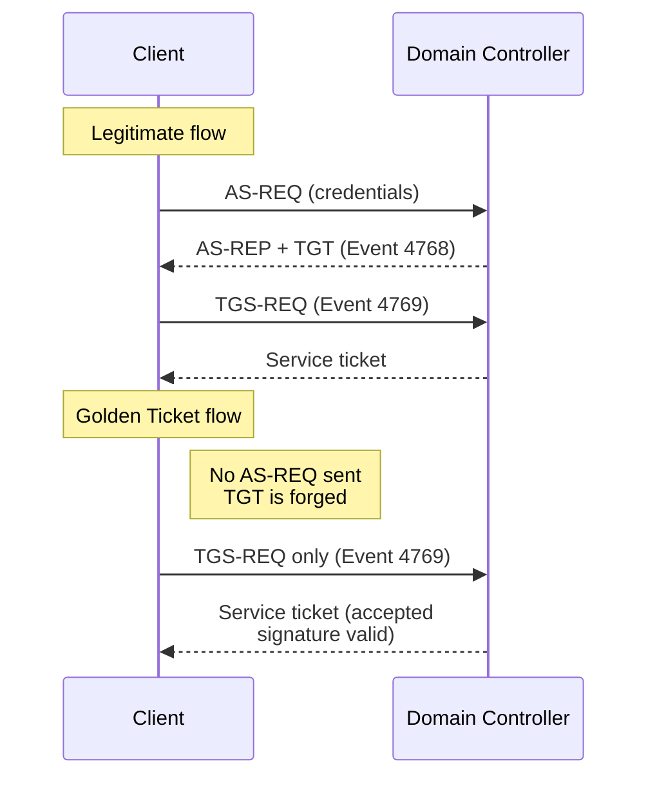
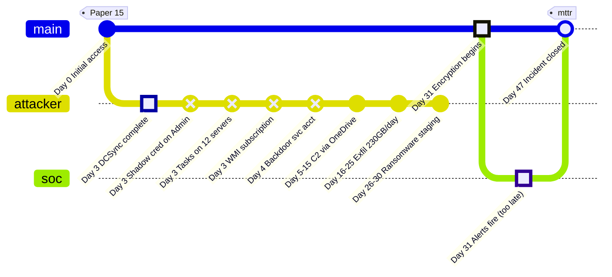
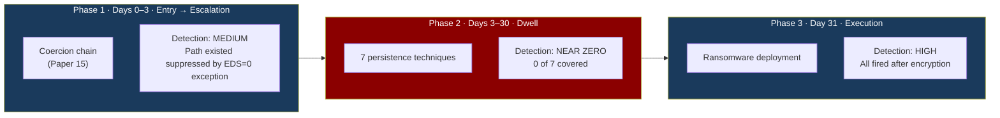
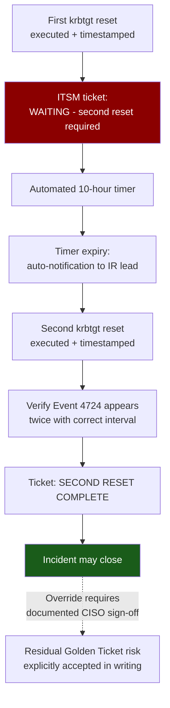

# The Invisible Tenant

## How Attackers Engineer Long Dwell Time After Initial Access

### The Middle of the Breach That Every Detection Program Is Built to Miss

---

**Author:** hiro001-eth (Manjil Katuwal)

**Series:** What I Learned Today on SOC+GRC  Paper 16

**Version:** 1.2 (Revised: prose rewritten for professional publication; diagrams added)

**Date:** 14 October 2026

**Preceding paper:** Paper 15 covered how attackers enter through coercion chains. This paper covers what they do for the next 14–247 days while nobody finds them.

---

## Abstract

Every incident report follows the same arc: initial access, privilege escalation, discovery, exfiltration, impact. The period between initial access and impact  the dwell time  is where the real adversary craft lives and where detection coverage is weakest, yet it is the least documented phase in practitioner literature. This paper examines that middle period as a practitioner problem: what an attacker who is already inside does, day after day, to remain invisible; and what a detection program built to catch that behavior looks like. Drawing on a structured review of more than fifty public incident reports and threat intelligence publications (2019–2025), the paper identifies seven long-dwell techniques consistently observed in extended-dwell forensics, derives four principles that govern invisible tenancy, and presents seven detection rules with an explicit validation protocol, data-source dependency matrix, and ATT&CK mapping. The central claim is falsifiable and empirically grounded: dwell time is not an adversary advantage earned through sophistication, but a governance failure produced by detection investment concentrated at the entry and exit of the breach while the middle receives nothing.

---

## 1. The Problem: Dwell Time Is the Least Watched Phase of the Breach

Read any incident report. The structure is always the same. Section one covers initial access  a phished credential, an exploited VPN, a poisoned software update. Section two covers privilege escalation  credential theft, Kerberoasting, delegation abuse. Section three covers discovery. Section four covers collection and exfiltration. Section five covers impact.

Somewhere between sections one and four sits a number: 14 days, 90 days, 247 days. Most reports handle that number with a single sentence  "the attacker maintained persistence and moved laterally during this period"  and move on. That sentence stands in for weeks or months of adversary activity. It is where the craft is. It is where the detection failure is deepest. And it is almost entirely undocumented in the practitioner literature.

The reason is structural, not accidental. Incident responders reconstruct breaches forward from initial-access artifacts and backward from exfiltration destinations. The middle  the long quiet period  is the hardest to reconstruct because it was engineered specifically to leave nothing to find.

### 1.1 The statistics, stated precisely

This paper's claims depend on getting the dwell-time numbers right, and the numbers are easy to misstate.

- **Mandiant M-Trends 2026** (2025 investigations): global median dwell time is **14 days**, up from 11 in 2024. For espionage intrusions specifically, the median is **122 days**.
- **IBM Cost of a Data Breach 2026**: mean breach lifecycle is **247 days**  183 days to identify plus 64 days to contain. This is a mean lifecycle including containment, not a median dwell time. The two figures measure different things and should not be conflated.

The corrected data strengthens the thesis rather than weakening it. The global median is short precisely because most reported breaches are ransomware that announces itself. The long tail   the stealthy, extended dwell  is exactly what this paper describes. When we say "long dwell," we mean the espionage median and the upper tail of the financially motivated distribution, not the global median.

---

## 2. The Attacker's Objective During Dwell Time

### 2.1 The wrong mental model

Most SOC analysts model a breach as a three-act sequence: the attacker gets in, does bad things, and gets caught. Detection programs built on this model concentrate their instrumentation at the beginning and the end  catch the entry, catch the impact.

A sophisticated attacker models the breach differently. For a ransomware affiliate, the objective is maximum payment, and payment comes from leverage. Leverage requires owning everything at once  every system, every backup, every credential store  so that recovery is impossible without paying. That objective has a specific operational requirement: **time**. Time to enumerate every system, to understand the backup architecture, to identify the data whose threatened release raises the ransom, and to map the credential hierarchy so access survives partial discovery. The 47-day dwell in Paper 15's incident was not hesitation. It was preparation, and every day of it was an investment in a higher ransom.

A nation-state operator pursuing intellectual property has a parallel requirement measured in months rather than weeks: read the research, the strategy, the communications  without ever triggering a response.

Both share one constraint: the dwell period must be invisible. Not undetected by chance  invisibility engineered deliberately, calibrated against an assessed model of the target's detection capability.

### 2.2 The attacker's visibility model

Before doing anything in the dwell period, a sophisticated attacker builds a model of what the target's SOC can see. Three questions drive it.

**What is logged?** Assessed through reconnaissance: LDAP queries for GPO audit policy, registry reads for Sysmon deployment, WMI event consumers for configuration, service listings for EDR agents, network traffic for SIEM collectors. The output is a map  on these systems, these actions are logged; on these systems, they are not. The attacker operates freely in the unlogged spaces and carefully in the logged ones.

**What generates alerts?** Harder to assess without triggering anything, but the attacker has an unusual resource: published detection content. Sigma rules, vendor threat reports, and penetration-testing guides collectively document what specific EDR products detect. An attacker who has read the public detection rules for a product knows which behaviors trigger automatic detection and designs operations to stay below those triggers. This is the Detection Paradox (Paper 6) operating in real time  published detection logic is the attacker's evasion guide.

**What does the analyst see and ignore?** This requires probing the SOC's alert-handling patterns directly. The attacker generates a borderline event  medium confidence, plausibly a false positive  and observes: does a ticket open? Does an analyst investigate? If a generated alert produces no response within 24 hours, the attacker knows that alert category sits in the analyst's close-without-investigation bucket. This is alert-fatigue exploitation: the attacker does not merely avoid detection, but locates the alerts that are generated but not investigated and operates inside those categories.

### 2.3 Four principles of invisible tenancy

Across more than fifty incident reports, extended-dwell operations converge on four principles. They are not written in any attacker manual; they emerge from observing what long-dwell attackers consistently did and did not do.

**Principle 1  Blend, do not hide.** Hiding is fragile: a hidden process can be found, an encrypted channel decrypted, an obscured key searched. Blending is robust. A beacon that looks like legitimate application telemetry forces the defender to distinguish it from ten thousand similar legitimate packets per day. A scheduled task that resembles a Windows Update task forces the defender to audit every scheduled task and judge legitimacy  work almost no organization performs systematically. Every malicious action should be indistinguishable from a legitimate equivalent at the granularity the SOC actually monitors.

**Principle 2  Operate in the seams.** Every detection program has gaps  between detection systems, between alert categories, between logging sources (Paper 9). Sophisticated attackers map these seams from the defense architecture itself. If the EDR ignores a legacy application agent, they inject into that agent. If SIEM collects from production but not development servers, they move through development. If DLP covers email and USB but not cloud sync, they use cloud sync. The seams are predictable without any testing.

**Principle 3  Calibrate to the threshold.** Every detection system has thresholds: alert if X happens more than Y times in Z seconds, if volume exceeds N gigabytes, if an account touches more than M systems. The attacker does not avoid the detected behavior entirely; they calibrate below it. One authentication per account per hour instead of ten per second. 230 GB exfiltrated per day instead of 2.3 TB. Three systems per week instead of thirty per day. Thresholds are often discoverable from vendor defaults, published guidance, or job postings; where they are not, they are probeable through graduated escalation  perform the action once, wait 48 hours, escalate.

**Principle 4  Plan for partial discovery.** Sophisticated attackers assume some part of the foothold will be found. The SOC, having found one persistence mechanism, will believe it found all of them. The attacker's job is to ensure the mechanism that is found is not the one that matters. Maintain multiple independent persistence mechanisms at different privilege levels, on different systems, using different techniques. Make one visible enough that a diligent investigation finds it. Ensure the others survive remediation. When the incident is declared contained, the attacker re-enters through what the IR team missed  and the organization believes the incident is over.

---

## 3. Methodology

The seven techniques in Section 4 were selected from a review of 50+ publicly available incident reports and threat intelligence publications from 2019–2025, including Mandiant M-Trends 2022–2026; CrowdStrike Global Threat Reports 2022–2025; Microsoft Threat Intelligence publications on NOBELIUM, APT28, and Storm-0558; FireEye/Mandiant WMI persistence research; SpecterOps research on Shadow Credentials (Shamir, 2021) and ADCS (Schroeder & Christensen, 2021); the CERT-EU Golden Ticket whitepaper; and MITRE ATT&CK procedure examples.

Selection criteria, all four of which a technique must meet:

1. **Frequency**  documented in at least ten independent incident reports or publications.
2. **Dwell relevance**  directly enables or extends the post-escalation, pre-impact period.
3. **Detection feasibility**  a single-event or simple correlation rule can identify it with acceptable false positives in a well-instrumented environment.
4. **Remediation survival**  known to survive at least one standard remediation step.

Techniques meeting criteria 1–2 but not 3–4 (bootkits, firmware- and hypervisor-level persistence) were excluded: they are not prevalent in the financially motivated population that produces most public reporting, and detection requires hardware-level instrumentation unavailable to most SOC programs.

**What this paper is and is not.** It is not original primary research: no data was collected, no rules were deployed against production telemetry, no incident was analyzed firsthand. It is a secondary synthesis of public reporting, red-team tooling documentation, and vendor research, organized around an original analytical frame  the three-phase detection investment model (Section 5) and the four invisibility principles (Section 2.3). That frame is the paper's contribution, and it is falsifiable (Section 6.4). The case study in Section 5 is a composite assembled from the reviewed reports, used illustratively and disclosed as such in Section 5.0.

---

## 4. The Seven Long-Dwell Techniques

Each technique is described the way an IR analyst actually meets it: the specific implementation, what it leaves in the forensic record, and why it survives standard remediation.

### 4.1 Scheduled tasks with legitimate appearance

The attacker registers a scheduled task executing their payload, camouflaged as routine maintenance. Public reporting on ransomware operators including BlackCat/ALPHV (2023–2024) documents masqueraded task names resembling legitimate maintenance tasks (MITRE T1053.005); the defensible claim is the general masquerading pattern, not any specific task name.

**Name selection.** Tasks registered under names such as `MicrosoftEdgeUpdateTaskMachineCore`, `Adobe Acrobat Update Task`, or `GoogleUpdateTaskMachineCore`, with descriptions copied from vendor documentation. An analyst reviewing a process list does not flag what looks like a normal update task. The mitigation is not name-pattern matching but inventory verification against a known-good baseline.

**Trigger design.** Rather than fixed schedules  whose regular execution times behavioral analytics can spot  sophisticated implementations trigger on user logon, on idle, or on a system event. Event-triggered tasks are especially valuable because they do not appear in task history at regular intervals; reconstructing their execution requires correlating event log timestamps with task execution logs, a multi-source correlation basic investigations miss.

**Payload indirection.** The task action is never a direct call to a suspicious binary:

```javascript
powershell.exe -enc [base64]
cmd.exe /c "start /min [innocuous script name]"
wscript.exe "[legitimate-looking VBS in a legitimate directory]"
```

**Forensic signature.** Event 4698 (Scheduled Task Created) fires at creation  carrying task name, action, and creator  but almost never alerts because the event fires hundreds of times daily from legitimate installers and updates. When the task triggers, Sysmon Event 1 records `svchost.exe` (Task Scheduler) as parent  a parent most environments whitelist for exactly this action. The task XML remains readable at `C:\Windows\System32\Tasks`.

**Survival through remediation.** The IR team deletes the task it found. If the attacker paired it with a WMI subscription (§4.4), the subscription recreates the task when its deletion condition fires. The artifact was remediated; the mechanism that maintains it was not.

### 4.2 Golden tickets, used carefully

The attacker holds the krbtgt hash (via DCSync, or from a backup). Golden Tickets  forged Kerberos TGTs  authenticate as any user, are generated on demand in memory, and are stored nowhere.

**Why this produces long dwell.** A Golden Ticket does not require a password. Password resets  the standard remediation  do not invalidate it. Only a double reset of the krbtgt account, with a ten-hour interval between resets, invalidates forged tickets. Every incident response playbook documents this. Under pressure to restore operations, the second reset is deferred or skipped, and CrowdStrike and Mandiant IR reporting (2022–2025) documents multiple organizations re-entering incident response two to six weeks after declaring containment for exactly this reason.

**Careful use.** The attacker does not authenticate everywhere with forged tickets. Golden Tickets are reserved for specific high-privilege operations; everyday work uses harvested service-account credentials, pass-the-hash, or attacker-created accounts that blend in. The forensic signature of Golden Ticket usage is accordingly rare.

**The reliable indicator.** Legitimate Kerberos flow requires an AS-REQ (Event 4768) before any TGS-REQ (Event 4769). A forged ticket arrives as a 4769 with no preceding 4768:



A 4769 without a preceding 4768 for the same user, within a window accounting for ticket caching, is the Golden Ticket signature. Secondary indicators: RC4 encryption (0x17) in an AES-enforced domain, Forwardable and Renewable flags set simultaneously, and a Mimikatz-default ten-year lifetime (per the CERT-EU whitepaper).

**GRC remediation gap.** The requirement is known; the execution failure is consistent. The fix is governance, not knowledge: the IR playbook for any incident involving domain credential exposure should carry a mandatory hold  *no incident closure until the krbtgt reset is confirmed complete (both resets, ten-hour interval, verified via Event 4724  password reset  appearing twice with correct timestamps)*  with sign-off required from the CISO. Without that sign-off mechanism, the hold is advisory, and advisory holds are skipped under pressure. (The previous version of this paper cited Event 4723; 4723 is a change with the old password supplied. A krbtgt reset logs as 4724.)

### 4.3 Legitimate cloud sync as command-and-control

The attacker uses OneDrive, SharePoint, Dropbox, Google Drive, or Box as the C2 channel. The beacon on the compromised endpoint authenticates to the cloud service with compromised or purpose-created credentials. The attacker writes commands to a file; the beacon polls, reads, executes, and writes results back. Microsoft documented NOBELIUM's use of legitimate SaaS for C2 (2021–2022); APT28's use of OneDrive is likewise documented; commodity malware adopted cloud-storage C2 broadly in 2023–2025. F-Secure's open-source C3 tool implements the pattern and is used by red teams and threat actors alike.

**Why it sustains dwell.** The connections are HTTPS to approved, content-rated infrastructure  indistinguishable from a user syncing a laptop. The polling interval can be stretched arbitrarily: a four-hour interval produces no beaconing anomaly, and the attacker accepts the latency because they are not in a hurry. Network-level C2 detection  tuned for short-interval beaconing to unknown domains  sees nothing.

**Forensic signature.** The defensible detection is process-based: outbound HTTPS to cloud storage APIs from a process that is not the expected sync client. (A note on schema: MDE's `DeviceNetworkEvents` does not reliably carry byte-count columns; connection count and unique-URL cardinality are sufficient, and byte-volume analysis belongs on NetFlow or flow logs.)

**The GRC failure.** Cloud-service C2 bypasses every control built around "outbound connection to unknown IP," because the destination is known-good. The control that addresses it is an application-layer egress policy defining which processes may reach which cloud services  conceptually present in most programs, almost never implemented for cloud services specifically, because the services themselves were always "approved" and the process restriction was never defined.

### 4.4 WMI subscriptions that outlive remediation

WMI event subscriptions are among the most durable persistence mechanisms in Windows. A properly configured subscription survives reboots, runs in SYSTEM context regardless of user changes, recreates its payload if the payload is deleted, and  a correction from the previous version  survives disk wipes only if the repository volume (`C:\Windows\System32\wbem\Repository`) is not wiped.

**The mechanism.** Three components: an `__EventFilter` (when to trigger), an `__EventConsumer` (what to execute), and a `__FilterToConsumerBinding` (the link). A subscription that recreates a deleted task looks like this:

```text
EventFilter:
  SELECT * FROM __InstanceDeletionEvent WITHIN 60
  WHERE TargetInstance ISA 'Win32_ScheduledJob'
    AND TargetInstance.Name = 'WindowsUpdateCheck'

EventConsumer (CommandLineEventConsumer):
  CommandLineTemplate: "powershell.exe -enc [recreate-task command]"
```

The IR team deletes the task; the deletion event fires within sixty seconds and recreates it. The team deletes it again; it reappears. Without knowing to look for the subscription, the team will delete the artifact indefinitely while the mechanism persists. FireEye/Mandiant reporting documents WMI subscriptions surviving "complete remediation" by teams that never checked for them.

**Why IR teams miss them.** Standard IR checklists cover processes, services, Run keys, scheduled tasks, startup folders, browser extensions, and DLL-hijack locations. WMI subscriptions are not on most junior and mid-level checklists; discovering them is a separate step (`Get-WMIObject` against `root\subscription`, or Autoruns' WMI tab). This is a different failure mode from missing tools: Autoruns is standard and has the tab  the tab simply was not checked before the incident was closed.

**Forensic signature.** Sysmon Events 19, 20, and 21 record filter, consumer, and binding creation  but only if Sysmon was deployed at creation time. Otherwise, discovery requires binary analysis of the WMI repository (e.g., FireEye/Mandiant's python-cim).

**GRC requirement.** Every IR remediation checklist must include a WMI subscription audit  enumerate all filters, consumers, and bindings; any consumer executing a scripting engine is malicious; remove filter, consumer, *and* binding  as a sign-off requirement before closure.

### 4.5 The service account that looks like it belongs

The attacker creates  or repurposes a dormant  service account that matches the organization's naming convention, group placement, password policy, and descriptive purpose. Its function is fallback authentication: when the initial foothold is discovered and known-compromised accounts are disabled, this account survives, because the IR team disabled everything it knew about and did not know this account was attacker-created.

**Implementation details from forensics.** Naming follows observed conventions (`svc_monitoring_backup`, `sa-azure-sync2`). Placement reaches needed rights through low-visibility paths  AdminSDHolder modification or nested groups  rather than direct Domain Admins addition. Most importantly, the account is created and left **dormant**: no authentications, no processes, no connections. A dormant service account in a sea of service accounts is invisible until activated  which may be three months after the "remediated" incident.

**Forensic signature.** Event 4720 (account created) followed shortly by 4728/4732 (added to group), then silence. Legitimate service-account creation involves testing and interaction shortly after creation; create-then-dormant is anomalous. So is a long-dormant account suddenly authenticating.

**GRC failure.** Quarterly account reviews enumerate accounts and flag dormant ones, but rarely cross-reference each account against the provisioning system. The fix is cheap: every service account must have a corresponding ITSM creation ticket, stored in the account description; the quarterly review flags any account created in the last 90 days without one. No ticket means unauthorized account means immediate investigation.

### 4.6 The certificate backdoor with a two-year lifetime

Building on the ADCS coercion chain from Paper 15: after obtaining a DC machine-account certificate, a sophisticated attacker requests a second certificate  for a high-privilege human account  from any ESC1-vulnerable template (one allowing the enrollee to supply the Subject Alternative Name). A certificate claiming to be "Administrator," valid for the template's lifetime (typically one to two years), enables passwordless PKINIT authentication as that user for its full validity period.

**The persistence arithmetic.** Requested on day 3, discovered on day 47: the certificate retains 1 year and 11 months of validity. Because the certificate exists only on the attacker's machine  outside any certificate store the organization manages  a remediation that revokes the known DC certificate never touches it. The attacker can return 23 months later and authenticate as Administrator using nothing that was reset.

**Discovery.** The CA issuance log (Event 4887) records every issuance; if forwarded to the SIEM  usually it is not (Paper 15)  a certificate for "Administrator" requested from a workstation is a critical alert. Post-incident, `certutil -view` exposes the full issuance database. And a necessary caveat: revocation works only if CRL/OCSP enforcement is configured for PKINIT, which it often is not. A revoked certificate accepted by a non-checking relying party is not revoked in any operational sense.

**Precision on mitigations.** The previous version treated AES-only Kerberos as making Golden Tickets non-persistent. That is overstated: RC4 forgery is blocked, but DCSync hands the attacker the AES krbtgt key, and AES tickets can be forged. AES enforcement raises cost; it does not restore safety. What works is krbtgt rotation cadence and certificate-validity reduction  short-lived certificates do not depend on revocation checking at all, which is why the 90-day validity proposal in Section 8 leads with them.

**GRC requirement.** Any incident involving credential access or privilege escalation triggers a complete ADCS audit: every certificate issued in the 90 days around the incident, each verified for authorized requester and purpose; unauthorized issuances revoked; CRL/OCSP enforcement for PKINIT verified; ESC1 templates disabled immediately. This audit is not standard in most IR engagements and requires ADCS expertise most IR teams lack  it belongs in the playbook as a mandatory step.

### 4.7 Shadow credentials

A Shadow Credential is an additional authentication credential written to an account's `msDS-KeyCredentialLink` attribute, enabling PKINIT authentication with the corresponding private key  equivalent to knowing the account's password. Original research: Shamir (SpecterOps, June 2021), building on Grafnetter's Black Hat Europe 2019 work; MITRE maps it to T1098.

**Why this is the most insidious mechanism.** Password reset is the universal response to credential compromise, and a Shadow Credential survives it untouched. Mandiant (2023) and SpecterOps document organizations performing complete privileged-password resets and being re-compromised weeks later through Shadow Credentials that no reset touched.

**Forensic signature.** Event 5136 (Directory Service Object Modified) with `AttributeLDAPDisplayName = msDS-KeyCredentialLink`. A precision caveat: the earlier version of this paper claimed zero false positives  overstated. Windows Hello for Business / Key Trust enrollment writes the same attribute legitimately. The defensible claim is narrower: the Administrator account's attribute is never legitimately modified. Scope the rule to specific high-value accounts that do not use WHfB, or baseline the writer accounts and alert on deviation.

**Post-remediation check.** For every privileged account:

```powershell
Get-ADUser [account] -Properties msDS-KeyCredentialLink |
  Select-Object msDS-KeyCredentialLink
```

Expected result: empty. Thirty seconds per account; twenty-five minutes for fifty accounts. Most IR teams do not run it because it is not on the standard checklist  and the attacker returns.

---

## 5. Anatomy of a 47-Day Dwell: A Composite Reconstruction

### 5.0 Disclosure

The narrative below is a composite constructed from the public reports reviewed in Section 3, used illustratively rather than as primary evidence. It is not a single anonymized engagement. Timestamps and volumes are constructed to show how the seven techniques interact, and the detectability table in §5.2 is a hypothesis about what the Section 6 rules would have caught  not a measured result. Section 6.4 specifies the protocol that would convert the hypothesis into a finding.

### 5.1 The timeline



The timeline reads as two histories. The attacker's branch is dense with activity from day 3 onward  persistence established within hours of DCSync, then a month of quiet preparation. The SOC's branch has a single commit on day 31, triggered by the encryption itself. Everything before that point happened on systems the SOC monitored, against log sources it collected, producing events its SIEM ingested.

**Day 3, mechanisms established in hours.** Shadow Credential added to Administrator (Event 5136  fires, unwatched). Scheduled task on twelve servers executing PowerShell download from OneDrive  cloud C2 (§4.3) triggered by task (§4.1); Event 4698 fires on each server, never aggregated. WMI subscription recreating the task if deleted; Sysmon 19/20/21 fire, unwatched.

**Day 4.** Service account `svc_azure_monitor2` created and added to a group with local admin on all servers, then left dormant. Events 4720 and 4728 in sequence  below the account-creation alert threshold.

**Days 5–15.** C2 via OneDrive, polling interval lengthened from 15 minutes to 4 hours after confirming no detection response. Enumeration of file shares, backup topology, VM inventory, and segmentation rules  all performed with legitimate DCSync-harvested service-account credentials, at volumes inside normal bounds. No alerts.

**Days 16–25.** Exfiltration begins: rclone to an attacker-controlled S3 bucket at 230 GB/day  below typical bulk thresholds, over a protocol (S3) the organization uses legitimately for backups. The destination differs; the traffic does not. Alert: none.

**Days 26–30.** Ransomware staging: testing backup-wipe capability in a non-production backup instance, confirming fastest-encrypting systems, deploying the binary to all targets through the existing task-and-C2 mechanism.

**Day 31.** Execution: backup wipe first, removing the recovery option, then simultaneous mass encryption via GPO.

### 5.2 The forensic record

| Day | Artifact | Present? | Alerted? |
| --- | --- | --- | --- |
| 3 | Event 4698 (task created) | Yes | No |
| 3 | Sysmon 19/20/21 (WMI subscription) | Yes | No |
| 3 | Event 5136 (Shadow Credential) | Yes | No |
| 4 | Events 4720 + 4728 (backdoor account) | Yes | Below threshold |
| 5–15 | OneDrive API calls from unexpected process | Yes | No |
| 16–25 | S3 traffic at 230 GB/day | Yes | Within threshold |
| 30 | Event 4698 (ransomware staging) | Yes | No |
| 31 | GPO modification for deployment | Yes | After encryption begins |

### 5.3 What was detectable  stated as a hypothesis

Three single-event or simple-correlation rules would have caught the long-dwell infrastructure on day 3 or 4: the Shadow Credential rule (Administrator's `msDS-KeyCredentialLink` is never legitimately modified), the WMI subscription rule (scripting-engine consumer, near-zero false positives), and the backdoor-account rule (created and group-added within five minutes). None requires behavioral analytics or ML. None existed. Whether they would have performed as claimed is testable; Section 6.4 defines the test.

---

## 6. Why the Detection Program Failed: A Design Problem

The failures above are not random. They share one structural property: the program was designed for Phase 1 (entry) and Phase 3 (impact), with almost nothing for Phase 2 (the dwell). This is a design failure, not a resource failure.

### 6.1 Three phases, three coverage levels



| Technique | Phase 2 detection status |
| --- | --- |
| Scheduled task (§4.1) | Query exists in principle; not deployed |
| Golden Ticket (§4.2) | RC4 rule existed; not tuned for AES environment |
| Cloud C2 (§4.3) | No detection for non-browser process to storage API |
| WMI subscription (§4.4) | Sysmon 19/20/21 in SIEM; no alert rule |
| Backdoor service account (§4.5) | 4720+4728 correlation not deployed |
| Certificate backdoor (§4.6) | CA log not in SIEM (Paper 15 gap) |
| Shadow Credential (§4.7) | 5136 `msDS-KeyCredentialLink` rule not deployed |

Phase 3 coverage deserves an honest note: the rules fired after encryption began. Execution-phase detection is forensic, not preventive.

### 6.2 The investment implication

Detection engineering effort concentrates in Phases 1 and 3 for a defensible-sounding reason: if Phase 1 works, there is no Phase 2. But the Verizon DBIR 2025 detection-source data shows a substantial proportion of breaches are discovered by external parties or by the attacker's own actions rather than internal detection  for any specific attack type, Phase 1 fails often enough that the middle phase determines outcomes. Investing only in Phase 1 and Phase 3 optimizes for the assumption that Phase 1 works; sophisticated attackers specifically engineer Phase 1 failures by targeting the gaps that published detection content reveals (Paper 6). When Phase 1 fails  and it fails  the entire program has no fallback.

### 6.3 The seven rules that close the gap

**Rule 1  Shadow Credential on a privileged account** (covers §4.7):

```spl
index=wineventlog EventCode=5136
| where match(AttributeLDAPDisplayName, "msDS-KeyCredentialLink")
| lookup privileged_accounts ObjectDN OUTPUT is_privileged
| where is_privileged = "true"
| eval risk = "CRITICAL: Shadow Credential added to privileged account"
| table _time, SubjectUserName, ObjectDN, risk
```

**Rule 2  WMI subscription with scripting consumer** (covers §4.4):

```spl
index=sysmon (EventCode=19 OR EventCode=20 OR EventCode=21)
| where EventCode=20 AND match(Consumer, "(cmd\.exe|powershell|wscript|cscript|mshta)")
| eval risk = "HIGH: WMI EventConsumer executing scripting engine"
| table _time, host, Consumer, risk
```

**Rule 3  Service account created and group-added within five minutes** (covers §4.5):

```spl
index=wineventlog (EventCode=4720 OR EventCode=4728 OR EventCode=4732)
| stats values(EventCode) AS event_codes, values(TargetUserName) AS modified_accounts,
    min(_time) AS first_event, max(_time) AS last_event,
    dc(EventCode) AS event_type_count by SubjectUserName
| where event_type_count >= 2 AND (last_event - first_event) < 300
| eval action = "Account created and added to group within 5 minutes - possible backdoor"
| table SubjectUserName, modified_accounts, event_codes, first_event, action
```

**Rule 4  Unexpected process authenticating to cloud storage APIs** (covers §4.3):

```kql
DeviceNetworkEvents
| where TimeGenerated > ago(7d)
| where RemoteUrl has_any (
    "graph.microsoft.com", "onedrive.live.com",
    "drive.google.com", "www.googleapis.com",
    "dropboxapi.com", "box.com/api")
| where InitiatingProcessFileName !in (
    "OneDrive.exe", "googledrivesync.exe", "googledrive.exe",
    "dropbox.exe", "box.exe", "msedge.exe", "chrome.exe",
    "firefox.exe", "iexplore.exe", "outlook.exe")
| summarize ConnectionCount = count(), UniqueURLs = dcount(RemoteUrl),
    FirstSeen = min(TimeGenerated), LastSeen = max(TimeGenerated)
  by InitiatingProcessFileName, DeviceName, InitiatingProcessAccountName
| where ConnectionCount > 5
| order by ConnectionCount desc
```

**Rule 5  Scheduled task created with scripting-engine action** (covers §4.1):

```kql
DeviceEvents
| where TimeGenerated > ago(7d)
| where ActionType == "ScheduledTaskCreated"
| extend TaskName = tostring(AdditionalFields.TaskName),
         TaskContent = tostring(AdditionalFields.TaskContent)
| where InitiatingProcessFileName !in (
    "svchost.exe", "mmc.exe", "taskschd.msc",
    "MpCmdRun.exe", "msiexec.exe", "setup.exe")
| where TaskContent has_any (
    "powershell", "cmd.exe", "wscript", "cscript", "mshta",
    "rundll32", "regsvr32", "certutil", "-enc", "-encoded")
| project TimeGenerated, DeviceName, InitiatingProcessFileName,
          InitiatingProcessAccountName, TaskName, TaskContent
| order by TimeGenerated desc
```

**Rule 6  Kerberos service ticket with no recent TGT** (covers §4.2):

```spl
index=wineventlog EventCode=4769
| join type=left TargetUserName [
    search index=wineventlog EventCode=4768
    | eval join_key=TargetUserName
    | stats latest(_time) AS last_tgt by join_key
    | rename join_key AS TargetUserName ]
| where isnull(last_tgt) OR (_time - last_tgt) > 36000
| where NOT match(TargetUserName, ".*\$$")
| where ServiceName != "krbtgt"
| eval risk = "HIGH: Kerberos service ticket with no recent TGT - possible Golden Ticket"
| table _time, TargetUserName, ServiceName, TicketEncryptionType, ClientAddress, risk
```

**Rule 7  Machine-account certificate via non-standard template** (covers §4.6):

```spl
index=ca_events EventCode=4887
| where match(SubjectKeyIdentifier, "CN=.*\$$")
| where NOT match(TemplateName, "^(DomainController|DomainControllerAuthentication|Machine)$")
| eval risk = "CRITICAL: Machine account certificate via non-standard template"
| table _time, SubjectKeyIdentifier, TemplateName, RequesterName, SerialNumber, risk
```

Deployment estimate: roughly eight hours of engineering for an experienced detection engineer with log sources in place, plus the Paper 15 prerequisite of CA log forwarding (30–60 minutes). A complete Phase 2 detection program fits in one focused sprint.

**ATT&CK mapping.** Scheduled task T1053.005; WMI subscription T1546.003; Golden Ticket T1558.001; Shadow Credentials T1098; domain account creation T1136.002; web-service C2 T1102; certificate theft/forgery T1649. The mapping exposes one honest gap: pass-the-hash (T1550.002), used throughout the narrative, has no dedicated rule here; organizations should add Event 4624 LogonType 3 with NTLM for accounts that should authenticate via Kerberos.

### 6.4 Validation protocol

None of the seven rules has been backtested against production data or exercised in simulation as of this writing; their efficacy claims are hypotheses. The protocol below converts them into findings.

| Rule | Technique | Simulation tool | Expected result |
| --- | --- | --- | --- |
| 1 | Shadow Credential | Whisker (add) | Event 5136 fires; rule alerts |
| 2 | WMI subscription | Atomic Red Team T1546.003 | Sysmon 19/20/21 fire; rule alerts |
| 3 | Backdoor account | Manual: create user + group-add | 4720+4728 fire; rule alerts |
| 4 | Cloud C2 | C3 with OneDrive config | DeviceNetworkEvents fires; rule alerts |
| 5 | Scheduled task | Atomic Red Team T1053.005 | 4698 + Sysmon 1 fire; rule alerts |
| 6 | Golden Ticket | ticketer.py / Mimikatz | 4769 without 4768; rule alerts |
| 7 | Certificate backdoor | Certipy with ESC1 template | 4887 fires; rule alerts |

Each rule additionally requires a 90-day backtest with per-rule false-positive sources documented (software deployment tools for Rule 5; WHfB environments for Rule 1 unless scoped; Kerberos ticket caching for Rule 6, whose ten-hour window needs per-environment calibration), and a measured MTTD from simulated technique execution to alert.

**Falsifiability.** If deploying all seven rules in N environments fails to surface the simulated Phase 2 activity  or if any rule produces false positives at a rate that makes it operationally unusable in a well-instrumented environment  the completeness claim fails for that rule. The model itself is falsified if a documented long-dwell technique meeting the Section 3 selection criteria is shown to have no corresponding detection in this set.

### 6.5 Data-source dependency matrix

A rule without its data source is a policy, not a detection. Verify prerequisites first.

| Rule | Required data source | Prerequisite | Blind spot |
| --- | --- | --- | --- |
| 1 | AD DS auditing; Event 5136 in SIEM | Audit policy: DS Access → Directory Service Changes = Success/Failure | Additions before auditing enabled are invisible |
| 2 | Sysmon 19/20/21 in SIEM | Sysmon deployed with WMI event logging | Subscriptions predating Sysmon have no creation record |
| 3 | Events 4720, 4728, 4732 in SIEM | Security auditing on DCs | Actions outside the 5-minute correlation window |
| 4 | MDE DeviceNetworkEvents or equivalent | MDE onboarded; network events collected | Process masquerading as an approved sync client |
| 5 | MDE DeviceEvents or Sysmon 1 + 4698 | MDE onboarded; task-creation auditing | Tasks created by legitimate installer binaries |
| 6 | Events 4768, 4769 in SIEM | Kerberos auditing on DCs | Long-lived cached tickets extend the window; tune per environment |
| 7 | CA Event 4887 in SIEM | CA log forwarded (Paper 15 prerequisite) | Issuances before log forwarding are invisible |

---

## 7. The GRC Failure Pattern

### 7.1 Audit cadence is predictable, and attackers plan around it

Every GRC control operates on a cadence  quarterly for most, annual for some  resting on the assumption that control state does not change materially between reviews. Long-dwell attacks violate that assumption deliberately. Forensic reconstruction in multiple IR cases shows attacker modification timing correlating with the organization's known review cadences, which are themselves inferable from the event logs: the consistency of rule creation and suppression-exception patterns reveals when the SOC looks and when it does not.

Two responses follow. **Randomize high-value control reviews**: a quarterly review with a fixed date is predictable; a randomized date within the quarter is not. **Move the highest-risk conditions from periodic review to continuous monitoring**: the seven conditions covered by the Section 6.3 rules are binary  present or absent  require no human judgment, and can be evaluated by machine continuously. Where continuous evaluation is feasible, periodic audit is the weaker substitute.

### 7.2 Remediation completeness is a governance problem

The finding that appears in almost every long-dwell post-mortem  "the incident was declared contained before all persistence mechanisms were identified and removed"  is not purely an IR failure. It is a governance failure: closure criteria do not require demonstrating that persistence mechanisms are absent. "Remove the identified malware" is reactive; "verify no persistence mechanism exists" is proactive, and the second requirement demands a systematic checklist.

**The thirteen-category persistence verification checklist** (≈4–6 hours for a single endpoint with tooling; scale for high-value systems):

- [ ] Scheduled tasks  enumerate all; verify against known-good baseline
- [ ] Services  enumerate all; verify against baseline
- [ ] Registry Run keys (`HKLM\...\CurrentVersion\Run` and variants)
- [ ] WMI subscriptions (filters, consumers, bindings)
- [ ] Startup folders (per-user and all-users)
- [ ] DLL-hijack locations (application directories with write access)
- [ ] Shadow Credentials (`msDS-KeyCredentialLink` on all privileged accounts)
- [ ] Certificate backdoors (CA issuance audit for the incident window)
- [ ] OAuth grants (unauthorized application grants to privileged accounts)
- [ ] Service accounts created in the incident window without ITSM tickets
- [ ] GPO modifications (task scheduler, startup scripts in window)
- [ ] Cloud sync configuration (unexpected OneDrive/Drive clients or accounts)
- [ ] Browser extensions installed in the incident window

Tooling matters as much as the list itself: Autoruns (WMI tab), KAPE triage packages, Hayabusa or Chainsaw for EVTX bulk analysis, Velociraptor for fleet-wide collection, BloodHound for post-remediation path verification, Certipy/PSPKIAudit for the ADCS audit. A checklist without an execution mechanism is policy, not procedure.

### 7.3 The krbtgt double reset: from best practice to mandatory workflow

The failure documented in §4.2  the second reset deferred under pressure  has a zero-cost governance fix: build the ten-hour wait into the ITSM workflow as a hard state.



No incident moves to Closed until the second reset is verified. Override requires documented CISO sign-off with an explicit, written acceptance that Golden Ticket capability may have survived. This is a governance control, not a technical one  it can still be bypassed at the executive level during a crisis, which is why the override must produce a paper trail rather than pretend the risk away.

### 7.4 Why compliance frameworks do not save you

The thirteen-category checklist and the ITSM hold are not required, in their specific form, by ISO 27001:2022, NIST CSF 2.0, or CIS v8. An organization fully compliant with all applicable frameworks, following all their IR guidance, will still miss Shadow Credentials, WMI subscriptions, and certificate backdoors  because no framework specifies checking for them. This is the compliance floor problem from the Gold Mine research: compliance sets the minimum; security requires exceeding it; and the specific excess required here is derivable only from reading incident reports and understanding what attackers actually do.

---

## 8. The Safety Architecture for Phase 2

Paper 15's architecture addressed Phase 1  prevent the coercion, prevent the relay, limit privilege if coercion succeeds. The layers below extend it into the dwell period, ordered by implementation cost.

**Layer 1  Shrink the persistence surface.** Restrict WMI `CommandLineEventConsumer` creation to SYSTEM via namespace security. Enable Advanced Audit Policy for Directory Service Changes (Event 5136). Require an ITSM ticket for every service-account creation, with the ticket number stored in the account description.

**Layer 2  Restrict C2 channels.** Enforce application-layer egress: only approved sync clients may reach cloud storage APIs (blocking the domain is impossible without breaking legitimate use; process-level restriction catches the abuse). Baseline expected processes per cloud API and alert on deviation.

**Layer 3  Rotate what cannot be revoked.** Lead with krbtgt rotation cadence and certificate-validity reduction to 90 days (short-lived certificates do not depend on CRL enforcement). Treat AES-only Kerberos as a cost-raiser, not a fix  DCSync hands the attacker the AES key. Enumerate and remediate ESC1 templates (set `msPKI-Certificate-Name-Flag` to exclude enrollee-supplied subjects).

**Layer 4  Deploy the seven rules (Section 6.3),** in cost order: Rule 1 (30 min), Rule 2 (30 min), Rule 3 (45 min), Rule 4 (60 min), Rule 5 (45 min), Rule 6 (60 min, after baseline), Rule 7 (after the CA-forwarding prerequisite).

**Layer 5  Counter the attacker's counter-game.** A dwell-time attacker does not merely hide; they curate the forensic record: Event 1102 log clears, `wevtutil cl`, timestomping, ETW provider patching, log-channel shrinking, and suppression of their own artifacts through the SIEM (Section 9). Countermeasures: immutable/WORM log copies out-of-band, alerting on Event 1102, alerting on Event 4726 (account deletion  attackers clean up their backdoors), log-volume baselines (sudden drops indicate channel clearing or ETW patching), and Sysmon driver integrity checks.

**Layer 6  Deception.** The paper's own analysis argues attackers calibrate to real thresholds. Deception attacks the calibration itself, because it has no legitimate traffic to blend with: honey credentials planted where DCSync will harvest them, canary service accounts whose activation is precisely the §4.5 tripwire, honey S3 buckets, beaconing honey documents.

**Layer 7  Identity-detection products, positioned honestly.** Microsoft Defender for Identity detects Golden Tickets and directory reconnaissance out of the box and belongs in the stack as a compensating layer  with the same caveat as any published detection: the attacker has read the same documentation and calibrates around it (the Detection Paradox applied to the detector). Deploy it; do not treat it as a substitute for the seven rules.

**Layer 8  Structural mitigations that shrink what a dwell can reach.** Tiered administration and privileged access workstations, LAPS, gMSA for service accounts, Protected Users. This paper's model is detect-and-remediate; adding "reduce what thirty days of dwell can reach" completes it. In a properly tiered environment, a dwell-time attacker owns one tier, not the forest  an honest correction to the implicit premise that dwell equals total ownership.

**Layer 9  Exfiltration-staging detection.** The 230 GB/day rclone transfer in Section 5 passed under threshold, and none of the seven rules addresses bulk movement: add detection for unsigned or new processes writing to S3 endpoints, rclone with high-concurrency or bandwidth-limit flags, first-seen destination buckets, and backup-snapshot read anomalies. Mandiant notes recovery-denial is now the dominant ransomware objective, which sharpens  and validates  the leverage model in Section 2.

**Layer 10  Cloud and hybrid persistence.** The checklist in §7.2 is AD-centric. M-Trends 2026 finds cloud misconfiguration and over-permissive identities recurring as dwell themes, and the ITSM-ticket control has no equivalent for workload identities. The cloud persistence locations  app registrations, OAuth grants, federation settings, conditional access exclusions, privileged role assignments, workload-identity federation  require a dedicated treatment and a future paper.

### Cost-ordered implementation

| Horizon | Actions |
| --- | --- |
| **This week (free and fast)** | Enable 5136 auditing; deploy Rules 1–2; add the krbtgt ITSM workflow |
| **This month (medium effort)** | Deploy Rules 3–6; add the persistence checklist to the IR playbook; remediate ESC1 templates; deploy egress control for storage APIs |
| **Next quarter (higher effort)** | Reduce certificate validity; restrict WMI namespace security; link provisioning to ITSM; begin tiered administration / PAW rollout |

### The economics

The paper's closing claim  hours of engineering versus weeks of access  is testable, and the data exists. IBM Cost of a Data Breach 2026:

| Metric | Value |
| --- | --- |
| Mean cost, lifecycle > 200 days | $5.65M |
| Mean cost, lifecycle < 200 days | $4.32M |
| Difference attributable to long lifecycle | $1.33M |
| Cost of 8 hours of detection engineering (loaded) | ≈ $1,000–2,000 |
| Implied ROI of closing the Phase 2 gap | ≈ 665×–1,330× |

---

## 9. Connection to the Series

**With Paper 15.** Together the two papers cover the full arc: Paper 15, how attackers move from domain user to domain admin in four minutes; this paper, how they stay invisible for the following month.

**With Paper 9 / Paper 12 (ELDM, UPE, EDS=0).** The suppression exception that blinded Phase 1 in Paper 15 has a Phase 2 analog: an attacker with domain admin can create SIEM suppression exceptions for their own persistence artifacts  exceptions that are undocumented, irreversible once operating, and EDS=0 from inception. The "born rotten" exception concept applies directly to SOC operational hygiene: attacker-created suppressions are born invisible and designed to stay that way through the dwell.

**With Paper 10 (the IR-GRC closed loop).** Channel 1 of that framework requires this incident to produce three risk-register entries within five business days of closure: long-dwell persistence via the seven techniques (no detection); remediation completeness and the krbtgt double-reset failure mode; and ADCS certificate-backdoor survivability.

**With the Gold Mine research (compliance-security inversion).** As argued in §7.4: the controls that would have changed the outcome are not in any framework. They are derivable only from incident reporting.

---

## 10. Limitations

The seven techniques are not exhaustive; they are the set meeting all four Section 3 criteria in the reviewed literature, drawn from a population dominated by financially motivated actors. Nation-state techniques excluded here (bootkit, firmware, hypervisor persistence) require instrumentation most programs lack. Rule 6's ten-hour window will false-positive in environments with long-lived cached tickets and needs calibration. The persistence checklist is AD-centric; cloud-native equivalents await a future paper. The ITSM hold is a governance control that executive pressure can override  the paper's remedy is transparency, not invulnerability. The rules' efficacy claims remain hypotheses until the Section 6.4 protocol is executed. The Section 5 narrative is a composite, disclosed as such.

---

## 11. Conclusion

The 47-day dwell in Paper 15's incident was not a mystery. It was the predictable consequence of a detection program built for the entry and the exit of the breach, with nothing in between  44 of the 47 days spent in a phase no rule watched, using techniques documented since 2019 (WMI subscriptions), 2021 (Shadow Credentials, certificate backdoors), and 2022 (PKINIT abuse), using techniques present in every red-team toolkit.

The countermeasure is neither exotic nor expensive: seven rules, roughly eight hours of detection engineering; thirteen checklist categories; one ITSM workflow with a ten-hour wait state. The difference between 44 days of uncontested access and infrastructure identified within hours of establishment is measured in engineering hours  almost never in technical impossibility.

The attacker did not outsmart the SOC. The SOC was not watching the middle of the breach. The attacker knew it was not watching. And the knowledge needed to close the gap was sitting in the same incident reports that documented the techniques  unread where it mattered, untranslated into detection logic.

The practitioner who reads those reports, recognizes the techniques in their own telemetry, writes the seven rules, validates them, and adds the thirteen categories to the IR checklist has closed a gap their environment has carried since the first published WMI persistence case in 2019. That is what reading primary research is for  not to learn that WMI subscriptions exist, but to discover that your checklist does not include them, and to fix that today, before the attacker's day 3.

---

## References

1. Mandiant. *M-Trends 2026.* 2026.
2. IBM Security. *Cost of a Data Breach Report 2026.* 2026.
3. CERT-EU. *Whitepaper on Golden Tickets.*
4. Microsoft. *Kerberos and krbtgt password reset guidance.* Microsoft Docs.
5. Shamir, E. *Shadow Credentials: Abusing Key Trust Account Mapping for Account Takeover.* SpecterOps, June 2021.
6. Grafnetter, M. *The Dark Side of Microsoft Certificate Services.* Black Hat Europe, 2019.
7. Schroeder, W., & Christensen, L. *Certified Pre-Owned: Abusing Active Directory Certificate Services.* SpecterOps, 2021.
8. Microsoft Threat Intelligence. *NOBELIUM targeting delegated administrative privileges.* 2021.
9. Microsoft Threat Intelligence. *APT28 use of OneDrive for C2.*
10. F-Secure. *C3: Custom Command and Control.* Open-source tool.
11. FireEye/Mandiant. *WMI persistence research.* 2019–2024.
12. MITRE ATT&CK. T1053.005, T1546.003, T1558.001, T1098, T1136.002, T1102, T1550.002, T1649.
13. CrowdStrike. *Global Threat Report.* 2022–2025.
14. Verizon. *Data Breach Investigations Report 2025.*
15. Microsoft. *Defender for Endpoint Advanced Hunting schema reference.* Microsoft Docs.
16. Microsoft. *Defender for Identity documentation.* Microsoft Docs.
17. Katuwal, M. (hiro001-eth). *The Authentication Coercion Chain.* Paper 15, SOC-GRC Series, 2026.
18. Katuwal, M. (hiro001-eth). *The Unsanctioned Processing Exception.* Paper 12, SOC-GRC Series, 2026.
19. Katuwal, M. (hiro001-eth). *The IR-GRC Closed Loop.* Paper 10, SOC-GRC Series, 2026.
20. Katuwal, M. (hiro001-eth). *SOC-GRC Entropy Model.* Paper 7, SOC-GRC Series, 2026.

---

*Revision 1.2 (14 October 2026): prose rewritten in professional register; Mermaid diagrams added (Kerberos flow, git-graph dwell timeline, three-phase coverage, ITSM workflow); tables consolidated; series-internal terms inlined at first use; all technical corrections from the 1.1 peer review retained.*

-manjil
