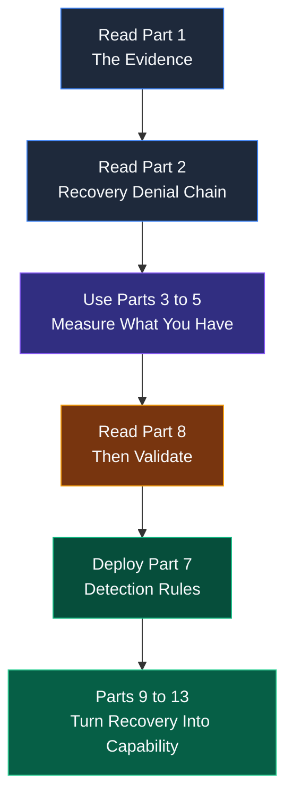
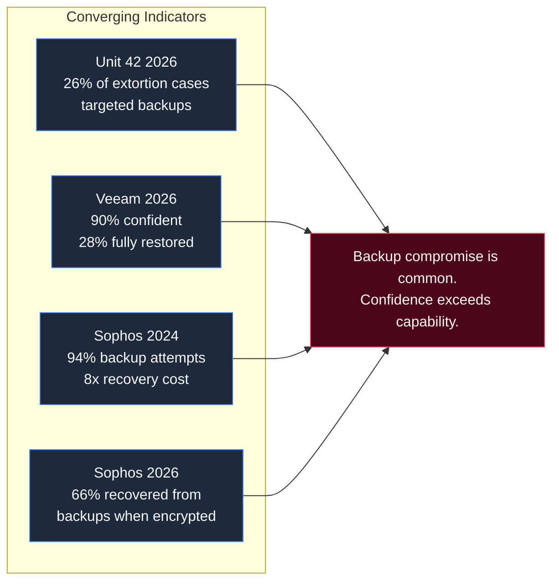
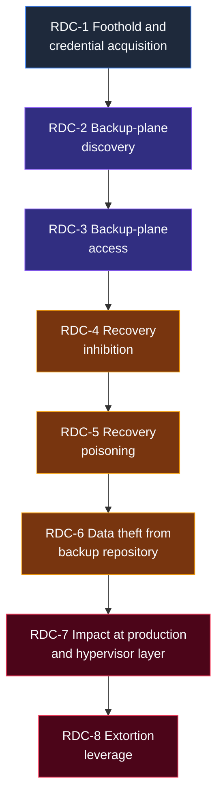
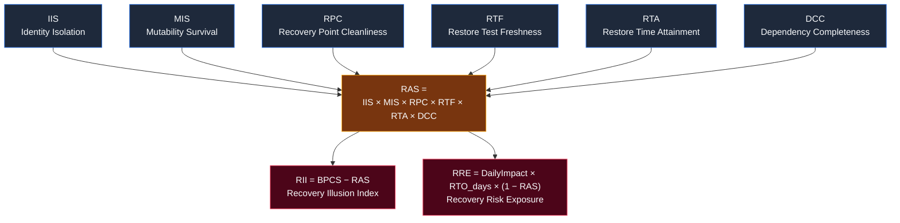
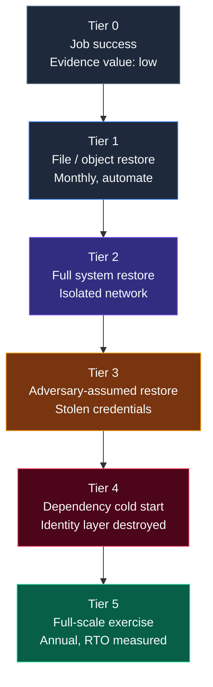
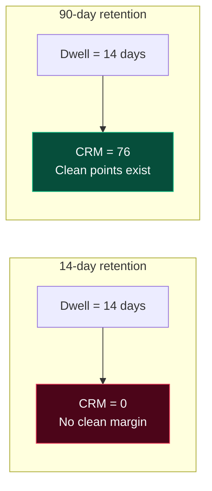
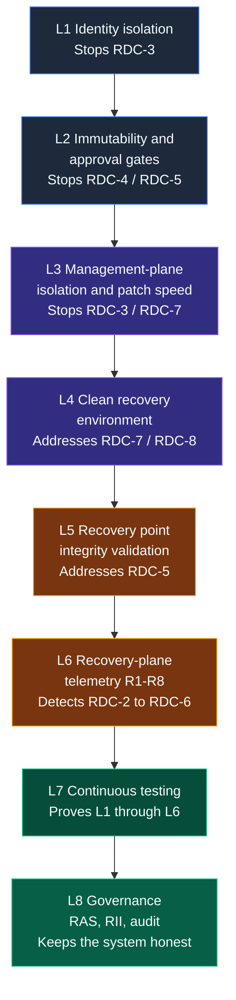

# THE RECOVERY PARADOX

## When Documented Backup Controls Fail During a Real Cyber Incident

### A Recovery Assurance Playbook

---

**Author:** hiro001-eth (Manjil Katuwal)

**Series:** What I Learned Today on SOC+GRC - Paper 17

**Version:** 1.0 (Prose rewritten for professional publication; diagrams added)

**Date:** 24 October 2026

**Preceding paper:** Paper 16 covered how attackers engineer long dwell time after initial access. This paper covers what happens when recovery is finally needed and the backup controls on the dashboard turn out to be an untested hypothesis.

**Status:** Parts 1 and 2 rest on published, cited sources. The Recovery Assurance Model in Part 4 is a proposed model with starting values that require local calibration. The worked example is hypothetical. Detection rules in Part 8 are engineered starting points, not drop-in production content.

**Classification:** Internal Research, Defensive Use Only

---

## Abstract

Organizations report green backup jobs as proof they can recover from a cyber incident. The 2026 data says otherwise. Unit 42 found attackers targeted backups in 26% of extortion cases. Veeam found 90% of leaders confident in recovery, yet only 28% of ransomware victims fully restored all affected data. Sophos found median recovery cost eight times higher when backups were compromised. This paper treats that gap as a measurement failure, not a technology failure. It presents the Recovery Denial Chain (eight stages of how attackers remove restore capability before they encrypt), the Recovery Assurance Model (six multiplicative components that convert restore assumptions into scored quantities), eight detection rules with a lab-only validation protocol, a six-tier restore test ladder, and an eight-layer recovery safety architecture. The central claim is deliberately uncomfortable: a backup that has never been restored under the assumption that the adversary already held the keys to it is an untested hypothesis. Reporting it as a control is a governance error.

---

## How to Use This Playbook

This is not a policy document and it is not a product recommendation. It is a field playbook for the people who will be in the room when a restore is needed and the backup console is either gone, untrusted, or lying.



Read Part 1 for the evidence. Read Part 2 for the attacker's sequence. Use Parts 3 through 5 to measure what you actually have. Deploy Part 7 only after you have read Part 8 and run the validation protocol. Use Parts 9 through 13 to turn recovery from a compliance artifact into an operational capability.

---

## Part 1. The Evidence: What the Data Actually Shows

Four datasets converge on the same picture. They are not directly comparable because they use different populations and methods, so treat them as converging indicators, not a single trend line.



### 1.1 Unit 42, 2026 Global Incident Response Report

**Population:** more than 750 major incident response engagements across 50+ countries. These are cases that reached an IR firm, so the sample skews toward severe incidents.

In 26% of extortion cases, attackers targeted backups directly. Encryption appeared in 78% of extortion cases, down from levels near or above 90% in the preceding years. The decline in encryption does not mean recovery got easier. It means attackers increasingly skipped encryption and moved straight to data theft and disruption, which a restore does not neutralize.

The 41% figure that appears in some summaries, referring to victims who could restore without paying, is consistent with the report's findings, but the exact denominator should be checked against the primary document before it is cited in a board paper. The directional finding is not in doubt: a large share of victims could not simply restore their way out of the incident.

### 1.2 Veeam, Data Trust and Resilience Report 2026

**Population:** 900+ senior IT, security, and risk leaders. Vendor-commissioned survey.

90% of organizations expressed confidence in their ability to recover from a cyber incident. Among organizations that had actually experienced a ransomware incident, only 28% fully restored the entirety of affected data. On average, organizations recovered 72% of affected data.

This is the closest published measurement of the paper's core claim. Confidence in recovery and proof of recovery are different capabilities.

### 1.3 Sophos, The Impact of Compromised Backups on Ransomware Outcomes (2024)

**Population:** 2,974 IT and security professionals whose organizations were hit by ransomware in the prior year. Self-reported survey.

94% reported that attackers attempted to compromise their backups. Median recovery cost was $3M when backups were compromised versus $375K when they were not, an eightfold difference. Ransom was paid by 67% of organizations with compromised backups versus 36% of those without.

### 1.4 Sophos, State of Ransomware 2026

**Population:** survey conducted January to March 2026.

56% of attacks succeeded in encrypting data. 66% of organizations with encrypted data recovered it from backups, up from 54% the prior year. 48% of those with encrypted data paid the ransom. These categories overlap. Recovering from backup does not mean the organization did not also pay.

### 1.5 The backup plane and the hypervisor plane are active targets

Huntress case data shows hypervisor ransomware's role in malicious encryption rising from 3% in the first half of 2025 to 25% in the second half, driven largely by Akira. The recurring precondition in Veeam exploitation is a backup server joined to the production domain, where any low-privileged domain account is a path to the recovery system.

CVE-2023-27532, an unauthenticated credential disclosure in Veeam Backup & Replication, was exploited by EstateRansomware. CVE-2024-40711, a deserialization vulnerability with a CVSS of 9.8, was exploited by Akira and Fog operators for remote code execution and credential access. Both are in CISA's Known Exploited Vulnerabilities catalog and both appear in the Akira advisory AA24-109A.

### 1.6 What the evidence does and does not prove

It proves that backup compromise is common, that recovery confidence is far higher than demonstrated recovery capability, and that the backup and hypervisor planes are deliberate targets. It does not prove a specific causal model, the weights in Part 4, or that any given organization sits at the average. That is why the validation protocol exists.

---

## Part 2. The Recovery Denial Chain

The professional error in backup security is treating the repository as the target. In observed intrusion chains, the repository is the last target. The adversary first removes the organization's ability to execute a restore, then destroys or holds the recovery points. Detection at the repository layer is often detection too late.

The chain has eight stages. Stages 2 through 6 are where recovery assurance is won or lost, and where most detection programs have little or no coverage.



**RDC-1 Foothold and credential acquisition.** Phishing, VPN or edge-device credentials, infostealers, vulnerable edge services. Identity abuse dominates. ATT&CK: T1078, T1566, T1190.

**RDC-2 Backup-plane discovery.** Locate backup servers, repositories, hypervisor managers, and cloud vaults. AD queries for backup service accounts and SPNs, network scans for backup console ports, cloud API enumeration of vaults and recovery points, reading the backup server's own configuration. ATT&CK: T1018, T1087, T1069, T1580.

**RDC-3 Backup-plane access.** Routes: domain credentials valid on the backup server; exploitation of a vulnerability in the backup software; reuse of credentials stored by the backup product; cloud identity with backup-admin rights; hypervisor management credentials. ATT&CK: T1078, T1210, T1555, T1021.

**RDC-4 Recovery inhibition.** Delete or shorten recovery points; delete backup jobs, repositories, or whole vaults; disable soft delete or remove a vault lock; remove hypervisor snapshots; delete shadow copies and system state backups. ATT&CK: T1490, T1485, T1562, T1070.

**RDC-5 Recovery poisoning.** The quieter variant. Instead of deleting, the adversary leaves backups in place but makes them unusable or untrustworthy. Retention is altered so clean points age out. Job scope is modified to exclude critical systems. Encryption keys or the catalog are tampered with. Backups run through the dwell period so every retained point post-dates the compromise. A poisoned recovery point looks like a success. ATT&CK: T1565, T1491, T1553.

**RDC-6 Data theft from the backup repository.** Backup repositories contain complete copies of regulated data and are often less monitored than production. Exfiltration from them bypasses production DLP. ATT&CK: T1530, T1567, T1048.

**RDC-7 Impact at production and hypervisor layer.** Encryption or destruction of VMs and datastores, often through the hypervisor so guest EDR never sees it. ATT&CK: T1486, T1529, T1561.

**RDC-8 Extortion leverage.** Because recovery was denied at stages 4 and 5, or because data theft at stage 6 removes the value of restoring, the victim negotiates.

**Key asymmetry:** For the attacker, stages 2 through 5 are cheap once a privileged identity is held. For the defender, each stage requires telemetry from systems that are frequently outside the SIEM's onboarded sources. That is the detection gap applied to the recovery plane.

### The immutability bypass

Immutable backup is a control description, not a security guarantee. The attack surface of immutability is the management layer that enforces it. If the immutability setting is applied by the backup application, it depends on the backup application remaining trustworthy.

Documented bypass patterns include time manipulation to push WORM retention windows into the past, API-level flag clearing, platform-level credential reach through hypervisor authentication weaknesses, and the difference between governance mode (which a sufficiently privileged identity can bypass) and compliance mode (which cannot be bypassed by anyone until the retention date expires). If immutability is intended to survive a credential compromise, governance mode is the wrong implementation.

The professional conclusion is uncomfortable: immutability at the application layer is an availability control, not a compromise-resilience control. Compromise resilience requires that the enforcement point sit outside the blast radius of the identity plane that was compromised.

---

## Part 3. Why a Green Backup Job Proves Almost Nothing

A backup job reports success when it completes its read and write cycle. Recovery succeeds only when all of the following are also true at restore time:

```mermaid
flowchart TD
    GREEN["Green Backup Job<br/>Dashboard shows success"] --> A1["Recovery point exists<br/>and was not deleted"]
    GREEN --> A2["Not corrupted<br/>key available"]
    NEED["Actual Restore Success<br/>Requires All of These"] --> B1["Point pre-dates compromise<br/>or verified clean"]
    NEED --> B2["Catalog and config DB<br/>available"]
    NEED --> B3["Restore identity trusted<br/>not the compromised AD"]
    NEED --> B4["Target capacity and<br/>bandwidth exist"]
    NEED --> B5["Dependencies in order:<br/>IdP, DNS, PKI, secrets, hypervisor"]
    NEED --> B6["Restored system clean<br/>and consistent"]
    NEED --> B7["Completes inside RTO"]
    NEED --> B8["People can execute under stress<br/>runbook offline"]

    style GREEN fill:#064E3B,stroke:#10B981,color:#F8FAFC
    style A1 fill:#1E293B,stroke:#3B82F6,color:#F8FAFC
    style A2 fill:#1E293B,stroke:#3B82F6,color:#F8FAFC
    style NEED fill:#4C0519,stroke:#F43F5E,color:#F8FAFC
    style B1 fill:#78350F,stroke:#F59E0B,color:#F8FAFC
    style B2 fill:#78350F,stroke:#F59E0B,color:#F8FAFC
    style B3 fill:#78350F,stroke:#F59E0B,color:#F8FAFC
    style B4 fill:#78350F,stroke:#F59E0B,color:#F8FAFC
    style B5 fill:#78350F,stroke:#F59E0B,color:#F8FAFC
    style B6 fill:#78350F,stroke:#F59E0B,color:#F8FAFC
    style B7 fill:#78350F,stroke:#F59E0B,color:#F8FAFC
    style B8 fill:#78350F,stroke:#F59E0B,color:#F8FAFC
```



1. The recovery point exists and was not deleted or truncated.
2. It is not corrupted and not encrypted with an unavailable key.
3. It pre-dates the compromise, or it has been verified clean.
4. The backup catalog and configuration database are available.
5. The identity and access needed to run the restore are available and trusted. A restore that needs the compromised AD is circular.
6. The restore target exists with enough capacity and bandwidth.
7. Dependencies are restorable in the right order: identity, DNS, PKI, secrets, hypervisor management, then applications.
8. The restored system is consistent and not re-infected.
9. All of it completes inside the RTO.
10. People know the procedure and can execute it under stress, with the runbook available when the wiki and file shares are down.

A green job asserts only part of item 1 and item 2. Everything else is an assumption. The Recovery Assurance Model converts those assumptions into measured quantities.

---

## Part 4. The Recovery Assurance Model

### 4.1 Design principles

Measure tested outcomes, not policy statements. Use a series structure, because recovery fails if any necessary precondition fails, so the components multiply. Decay evidence with time, because a test is a snapshot of an environment that keeps changing. Score per service, not per organization, because a fleet-wide average hides the one service that cannot be restored.

### 4.2 Components

Each component is scored from 0.0 to 1.0, per service, at a point in time.



**Identity Isolation Score (IIS).** The share of administrative paths to the backup plane that do not depend on production identities. Measured as backup-plane privileged paths that survive loss of the production IdP or AD divided by all backup-plane privileged paths. Paths to count include the backup console, repository host OS, hypervisor management, cloud vault admin, storage admin, backup database, and key store. Evidence includes an access path inventory plus a live test that a production Domain Admin credential cannot administer the backup plane.

**Mutability Survival Score (MIS).** The share of tier-relevant recovery points that remain intact when the backup administrator credential is assumed stolen. Measured as recovery points protected by immutability or an approval gate that the backup admin cannot bypass, divided by the recovery points required to meet the service's RPO and retention. Evidence is an attempted deletion by a privileged test account on a test vault, repository, and datastore.

**Recovery Point Cleanliness (RPC).** The share of selected restore points that passed integrity and clean-point validation: malware scan of restored data in isolation, hash or catalog consistency, ransomware-canary survival, and comparison to a pre-compromise baseline.

**Restore Test Freshness (RTF).**

$$RTF = \exp(-\text{age\_days} / \tau)$$

Age is days since the last passing test at the required tier for the service. Tau is the e-folding time, default 45 days, set to roughly the median interval between material changes to the backup or production environment. If the last passing test pre-dates a material change (a new backup admin, a repository migration, a hypervisor upgrade, an AD or forest change, a retention policy change, or a backup software upgrade), cap RTF at 0.5 until a new test passes.

Reference values at tau = 45: 14 days is 0.733; 30 days is 0.513; 45 days is 0.368; 90 days is 0.135; 180 days is 0.018.

**Restore Time Attainment (RTA).**

$$RTA = \min(1.0,\ RTO_{target} / RTO_{measured})$$

RTO_measured comes from the last full-tier test at representative scale, not a single-VM test.

**Dependency Completeness Coverage (DCC).** The share of the service's recovery dependencies that were present and exercised in the last full test: identity, DNS, DHCP, PKI, secrets, licensing, encryption keys, backup catalog, hypervisor management, network and firewall configuration, and runbook access.

### 4.3 The score

$$RAS = IIS \times MIS \times RPC \times RTF \times RTA \times DCC,\quad range\ 0.0\ to\ 1.0$$

**BPCS** is the Backup Policy Compliance Score: what GRC reports today, such as the share of in-scope assets with a successful backup in the last 24 hours or the control-test pass rate.

**RII**, the Recovery Illusion Index, is BPCS minus RAS. A high RII means the dashboard is green and recovery is unproven. This is the headline number for the board.

**RRE**, Recovery Risk Exposure, is DailyImpact × RTO_days × (1 − RAS). It is a heuristic ceiling used to rank services and compare remediation options. It is not a loss forecast.

### 4.4 Weakest-link gate

Any single component below 0.50 forces the service to RED regardless of the product, because a multiplicative index can hide a near-zero component behind good ones, and because a near-zero identity-isolation score is a structural problem, not a tuning problem. The component that is lowest is reported as the Binding Constraint.

### 4.5 Why multiplicative, and its honest limits

Series logic matches how recovery fails, because each necessary precondition is a single point of failure. The cost is that if components are positively correlated, the product understates joint success, and if negatively correlated, it overstates it. RAS is an index for ranking, gating, and trending, not a calibrated probability.

A uniform score of 0.90 on all six components yields RAS = 0.531. A uniform score of 0.95 yields 0.735. A uniform score of 0.80 yields 0.262. That is deliberate. High assurance requires high scores on every dimension at once.

### 4.6 Banding, starting values

| Service Tier | GREEN | AMBER | RED | Cadence |
| :--- | :--- | :--- | :--- | :--- |
| Tier-0 / Tier-1 | RAS ≥ 0.70 and no component below 0.50 | RAS 0.40-0.70, or any component 0.50-0.70 | RAS < 0.40, or any component < 0.50 | Monthly |
| Tier-2 and below | Same bands | Same bands | Same bands | Quarterly |

---

## Part 5. Worked Example (Hypothetical)

The organization is invented. The inputs are made up. The outputs were computed by running the formulas in Part 4 with tau = 45 days.

### Service A: ERP

Business impact $400,000 per day. RTO 24 hours (1.0 day). Reported BPCS = 0.99. All jobs green, policy documented.

**Before remediation:** IIS 0.40 (backup server domain-joined; 6 of 10 admin paths depend on production AD). MIS 0.30 (only 30% of required recovery points protected from a stolen backup-admin credential). RPC 0.80. RTF 0.135 (last passing full test 90 days ago). RTA 0.333 (target 24 hours; measured restore 72 hours). DCC 0.50 (test assumed AD and DNS were available).

| Metric | Value |
| :--- | :--- |
| RAS | 0.0022 |
| RII | 0.9878 |
| RRE | ≈ $399,100 |
| Binding constraint | MIS 0.30 (structure); RTF 0.135 (lowest) |
| Below 0.50 gate | IIS, MIS, RTF, RTA |
| Status | **RED** |

**After 90 days of hypothetical remediation:** IIS 0.90, MIS 0.95, RPC 0.90, RTF 0.733 (test 14 days ago), RTA 0.80 (30-hour measured restore), DCC 0.85.

| Metric | Value |
| :--- | :--- |
| RAS | 0.3834 |
| RII | 0.6066 |
| RRE | ≈ $246,700 |
| Status | Still **RED** (RAS below 0.40) |
| Binding constraint | RTF (cheapest fix: schedule and automate the next full test) |

### Service B: Customer portal

Impact $150,000 per day. RTO about 8 hours. BPCS 0.97. IIS 0.90, MIS 1.00, RPC 0.85, RTF 0.641, RTA 0.80, DCC 0.75.

| Metric | Value |
| :--- | :--- |
| RAS | 0.2943 |
| RII | 0.6757 |
| RRE | ≈ $34,900 |
| Status | **RED** |
| Note | No component below 0.50; six mid-range scores still multiply below 0.40 |

**Lessons.** A 0.99 compliance score coexisted with a 0.0022 assurance score. Twelve weeks of real improvement moved ERP from 0.002 to 0.38, still red. The model punishes shallow fixes and rewards fixing the binding constraint first. Freshness and time are the cheapest levers. Identity isolation and immutability are the highest-value levers, but they require architecture change.

---

## Part 6. Where Restore Tests Lie: Ten Failure Modes

These are common reasons a restore test passes and a real restore fails. They are listed as hypotheses to check in your environment, not as measured frequencies.

| # | Failure Mode | Maps To |
| :---: | :--- | :---: |
| 1 | Test ran with production admin credentials; never exercised "backup admin compromised" or "AD is gone" | IIS, MIS |
| 2 | Restored one VM or database, not 300 systems competing for the same repository throughput | RTA |
| 3 | AD, DNS, DHCP, and PKI were available during the test; in a real event they may be the first things destroyed | DCC |
| 4 | Encryption keys, license files, or the backup catalog lived on the server that was encrypted | DCC |
| 5 | RTO was extrapolated from a small test; restore throughput does not scale linearly | RTA |
| 6 | Hypervisor management was down or untrusted; nowhere safe to restore to | DCC |
| 7 | Application consistency never checked; files restored, database would not start | RPC |
| 8 | Restored system carried attacker persistence (tasks, WMI, backdoored accounts, forged certs, compromised krbtgt) | RPC |
| 9 | Runbook, contacts, and break-glass credentials were stored in the systems that were destroyed | DCC |
| 10 | Test done once, passed, filed as evidence, never repeated; evidence expired, audit file still says tested | RTF |

---

## Part 7. Telemetry Dependency Matrix

A detection is only as good as the log source feeding it. This matrix lists the sources the recovery plane needs and what is blind without each one.

| Log Source | What It Covers | Blind Without It |
| :--- | :--- | :--- |
| Backup server EDR | Process create, parent/child, command line | Backup software abuse and recovery inhibition |
| Backup server OS security log | 4624/4625 logon, 4672, 4720, 4732 | Unauthorized admin logon and account creation |
| Backup application audit log | Job deleted/edited, retention changed, repository removed, restore performed | Job and retention tampering |
| Backup catalog / database access | Connection and query logs | Catalog tampering |
| Repository storage / object store | Delete, overwrite, lock change, object-lock events | Object-lock bypass and repository destruction |
| Hypervisor logs | ESXi shell.log, hostd, auth, vCenter; Hyper-V host operational | Snapshot removal, SSH enablement, lockdown/VIB changes |
| Cloud audit logs | CloudTrail (AWS Backup), AzureActivity, GCP audit | Vault deletion, soft delete disablement, lock removal |
| Identity provider logs | Sign-ins, role assignments, PIM activations | MFA bypass and privilege escalation to backup roles |
| Network flow to backup ports | Source, destination, port, bytes | Backup-plane discovery and repository exfiltration |
| Restore test results | Structured and signed: service, tier, result, RTO, validation | Freshness and time attainment measurement |
| ITSM change records | Change ID, retention and scope changes | Authorized vs unauthorized change correlation |
| Backup-plane log forwarding health | Heartbeat per source | Silent log loss |

**Survivability rules.** Backup-plane logs must be forwarded off the backup infrastructure in near real time to a store the backup admins cannot modify. Logs on the host that gets wiped are not evidence. Each source needs a heartbeat. If the backup application stops emitting audit events for a defined interval, that is itself an alert. Retention of backup-plane audit logs should exceed the longest recovery point retention so investigators can reconstruct what changed.

---

## Part 8. Detection Content: Rules R1 to R8

These rules are written from documented attacker behavior. Table and field names are common defaults and must be validated against your data model before deployment. Thresholds are starting points. Tune with your own baseline, then keep the validation suite as a regression test so tuning cannot silently remove coverage. Every rule should produce an alert that creates or updates a risk-register entry, not only a SOC ticket.

### R1 Cloud backup destruction or protection removal (AWS)

**ATT&CK:** T1490, T1485, T1562.008. **Severity:** Critical.

**Signal:** deletion of recovery points, vaults, vault lock, or access policy by a principal that is not the AWS Backup service itself.

```spl
index=aws sourcetype="aws:cloudtrail" eventSource="backup.amazonaws.com"
eventName IN ("DeleteRecoveryPoint","DeleteBackupVault",
"DeleteBackupVaultLockConfiguration",
"DeleteBackupVaultAccessPolicy","PutBackupVaultAccessPolicy",
"DeleteBackupPlan","UpdateRecoveryPointLifecycle")
| where 'userIdentity.type' != "AWSService"
| stats count min(_time) as first max(_time) as last
values(eventName) as actions values(sourceIPAddress) as src
by userIdentity.arn, recipientAccountId
| where count >= 1
```

**Escalation:** if DeleteBackupVaultLockConfiguration is followed by DeleteRecoveryPoint or DeleteBackupVault by the same principal within 60 minutes, treat as an active anti-recovery sequence.

### R2 Cloud backup protection removal (Azure Recovery Services)

**ATT&CK:** T1490, T1562. **Severity:** Critical.

**Signal:** soft delete disabled, protected item deleted with stop protection and delete data, vault deleted, backup policy weakened.

```kql
AzureActivity
| where TimeGenerated > ago(1h)
| where CategoryValue == "Administrative"
| where ActivityStatusValue in ("Succeeded","Success","Started")
| where OperationNameValue has_any (
"MICROSOFT.RECOVERYSERVICES/VAULTS/BACKUPCONFIG/WRITE",
"MICROSOFT.RECOVERYSERVICES/VAULTS/BACKUPFABRICS/PROTECTIONCONTAINERS/PROTECTEDITEMS/DELETE",
"MICROSOFT.RECOVERYSERVICES/VAULTS/DELETE",
"MICROSOFT.RECOVERYSERVICES/VAULTS/BACKUPPOLICIES/WRITE",
"MICROSOFT.RECOVERYSERVICES/VAULTS/BACKUPPOLICIES/DELETE")
| summarize Ops = make_set(OperationNameValue), Count = count(),
First = min(TimeGenerated), Last = max(TimeGenerated)
by Caller, CallerIpAddress, ResourceGroup, _ResourceId
| order by Count desc
```

Validate the exact operation name strings in your tenant. Soft delete retains deleted backup data for an additional 14 days by default, and multi-user authorization through Resource Guard can protect disabling soft delete. R2 is the detective control behind those preventive controls.

### R3 Backup server spawning admin tooling

**ATT&CK:** T1210, T1136.001, T1059. **Severity:** Critical.

**Signal:** the backup application's service process launching net.exe, cmd.exe, or PowerShell, consistent with the exploitation behavior documented for CVE-2024-40711.

```kql
DeviceProcessEvents
| where Timestamp > ago(1d)
| where InitiatingProcessFileName in~ ("Veeam.Backup.MountService.exe",
"Veeam.Backup.Service.exe",
"Veeam.Backup.Manager.exe")
| where FileName in~ ("net.exe","net1.exe","cmd.exe","powershell.exe",
"pwsh.exe","whoami.exe")
| project Timestamp, DeviceName, AccountName, InitiatingProcessFileName,
FileName, ProcessCommandLine
```

```spl
index=endpoint (sourcetype="XmlWinEventLog:Microsoft-Windows-Sysmon/Operational"
EventCode=1)
ParentImage="*\\Veeam.Backup*.exe"
Image IN ("*\\net.exe","*\\net1.exe","*\\cmd.exe","*\\powershell.exe")
| table _time host User ParentImage Image CommandLine
```

Adapt process names for other backup products. The general rule is that a backup service process should not spawn an interactive shell or account-management tool on a production backup server.

### R4 Hypervisor recovery inhibition and control weakening (ESXi)

**ATT&CK:** T1490, T1562, T1021.004. **Severity:** High to Critical.

**Signal:** snapshot mass removal, SSH enabled or lockdown disabled outside change, VIB acceptance level changed, shell log tampering.

```spl
index=esxi (source="*shell.log" OR sourcetype="vmw:esxi:shell")
("vim-cmd vmsvc/snapshot.removeall" OR
"/VMFS3/AcceptanceLevel" OR
"execInstalledOnly" OR
"lockdown" OR
"esxcli system maintenanceMode")
| eval signal=case(
like(_raw,"%snapshot.removeall%"),"snapshot_mass_removal",
like(_raw,"%AcceptanceLevel%"),"vib_acceptance_change",
like(_raw,"%execInstalledOnly%"),"exec_policy_change",
like(_raw,"%lockdown%"),"lockdown_change",
true(),"other")
| stats count values(signal) as signals by host user
```

```kql
Syslog
| where TimeGenerated > ago(1d)
| where SyslogMessage has_any ("snapshot.removeall","AcceptanceLevel",
"execInstalledOnly","lockdown")
| project TimeGenerated, HostName, ProcessName, SyslogMessage
```

Pair with a separate rule for SSH service enabled and root logon from a non-management source. Backup and consolidation tools delete snapshots legitimately, so correlate with the backup application's own job log and the change ticket.

### R5 Windows system recovery inhibition

**ATT&CK:** T1490. **Severity:** High.

**Signal:** shadow copy deletion, backup catalog deletion, recovery disabled.

```kql
DeviceProcessEvents
| where Timestamp > ago(1d)
| where (FileName =~ "vssadmin.exe" and ProcessCommandLine has_all ("delete","shadows"))
or (FileName =~ "wbadmin.exe" and ProcessCommandLine has_any
("delete catalog","delete systemstatebackup","delete backup"))
or (FileName =~ "bcdedit.exe" and ProcessCommandLine has_any
("recoveryenabled no","bootstatuspolicy ignoreallfailures"))
or (FileName =~ "wmic.exe" and ProcessCommandLine has_all ("shadowcopy","delete"))
or (FileName in~ ("powershell.exe","pwsh.exe") and
ProcessCommandLine has_all ("Win32_ShadowCopy","Delete"))
| project Timestamp, DeviceName, AccountName, FileName, ProcessCommandLine,
InitiatingProcessFileName
```

```spl
index=endpoint EventCode=1
| search (Image="*\\vssadmin.exe" CommandLine="*delete*" CommandLine="*shadows*")
OR (Image="*\\wbadmin.exe" CommandLine="*delete*")
OR (Image="*\\bcdedit.exe" CommandLine="*recoveryenabled*no*")
| table _time host User Image CommandLine ParentImage
```

### R6 Backup job, retention, and scope tampering

**ATT&CK:** T1490, T1565.001. **Severity:** High.

**Signal:** retention shortened, jobs deleted or disabled, assets removed from scope, backup size collapsing against baseline. Slow poisoning shows up here before it shows up anywhere else.

```spl
index=backup sourcetype="backup:job"
| bin _time span=1d
| stats sum(bytes_processed) as bytes dc(asset) as assets
by job_name _time
| streamstats window=30 current=f avg(bytes) as mu stdev(bytes) as sd
avg(assets) as mu_assets by job_name
| eval z=(bytes-mu)/sd
| where (z < -3) OR (bytes=0) OR (assets < mu_assets*0.8)
```

```spl
index=backup sourcetype="backup:audit"
action IN ("retention_changed","job_deleted","job_disabled",
"repository_removed","asset_removed_from_job")
| lookup approved_changes change_ref OUTPUT change_id
| where isnull(change_id)
| table _time user action job_name old_value new_value
```

### R7 Restore test freshness heartbeat (the rule that fires on absence)

**Severity:** High, governance. Maps to RTF.

**Signal:** no passing restore test at the required tier within the allowed window for a service.

```kql
let Required = datatable(Tier_s:string, MaxAgeDays:int)
["T1",30,"T2",90,"T3",180,"T4",180];
RestoreTest_CL
| where Result_s == "PASS"
| summarize LastPass = max(TimeGenerated) by Service_s, Tier_s
| join kind=rightouter (
RestoreTest_CL | distinct Service_s, Tier_s
) on Service_s, Tier_s
| extend AgeDays = datetime_diff('day', now(), LastPass)
| lookup Required on Tier_s
| where isnull(LastPass) or AgeDays > MaxAgeDays
| project Service_s, Tier_s, LastPass, AgeDays, MaxAgeDays
```

```spl
index=recovery sourcetype="restore:test" result=PASS
| stats max(_time) as last_pass by service tier
| eval age_days=round((now()-last_pass)/86400,0)
| lookup restore_policy tier OUTPUT max_age_days
| where age_days > max_age_days
```

### R8 Unauthorized administrative logon to the backup plane

**ATT&CK:** T1078, T1021. **Severity:** High.

**Signal:** interactive or remote logon to a backup server by an account that is not in the approved backup-admin set, or from a source that is not a privileged access workstation.

```kql
let BackupServers = _GetWatchlist('BackupServers') | project Computer;
let BackupAdmins = _GetWatchlist('BackupAdmins') | project Account;
SecurityEvent
| where TimeGenerated > ago(1d)
| where EventID == 4624 and LogonType in (2, 3, 10)
| where Computer in (BackupServers)
| where Account !in (BackupAdmins)
| where Account !endswith "$"
| project TimeGenerated, Computer, Account, LogonType, IpAddress,
WorkstationName
```

```spl
index=wineventlog EventCode=4624 Logon_Type IN (2,3,10)
[| inputlookup backup_servers.csv | rename host as Computer | fields Computer]
| lookup backup_admins.csv Account OUTPUT is_admin
| where isnull(is_admin) AND NOT like(Account,"%$")
| table _time Computer Account Logon_Type Source_Network_Address
```

**Note on R3 and R8 together:** the recurring precondition for backup-server exploitation is a domain-joined backup server reachable by ordinary domain users. R8 detects the use. The IIS component of the model measures whether the exposure exists in the first place.

---

## Part 9. Validation Protocol (Lab Only)

**Purpose:** prove that each rule fires, within a defined time, on realistic telemetry, and that tuning has not silently removed coverage.

### Safety rules (mandatory)

Run only in an isolated lab or a dedicated test tenant, subscription, or account, with dedicated test vaults, test repositories, and sacrificial VMs that hold no data of value. Never run destructive simulations against production backup infrastructure or production recovery points. Use a change ticket and tell the SOC the test window so alerts are labeled as tests but still pass through the full alerting pipeline. Record every test: operator, start time, command or API call, expected rule, observed alert, and time to alert.

### Test cases

| ID | Rule | Test | Pass Criteria |
| :---: | :---: | :--- | :--- |
| V1 | R1 | In a test AWS account, delete a test recovery point and attempt to remove vault lock on a test vault | Alert within 5 minutes |
| V2 | R1 | Attempt to delete a recovery point in a vault with compliance-mode lock using a privileged test role | Deletion denied; alert still fires |
| V3 | R2 | In a test Azure vault, disable soft delete and stop protection with delete data on a test item; repeat with MUA enabled | Alert within 5 minutes; MUA blocks without second approval |
| V4 | R3 | On a lab backup server, launch net.exe as a child of a test service process that mimics the parent name | Alert within 5 minutes |
| V5 | R4 | On a lab ESXi host, run snapshot removal on a sacrificial VM and toggle SSH and lockdown | Alert within 5 minutes |
| V6 | R5 | On a disposable Windows VM, run the monitored shadow-copy and catalog deletion commands | Alert within 2 minutes |
| V7 | R6 | In a test job, shorten retention and remove an asset from scope without a change ticket | Alert within one evaluation cycle |
| V8 | R7 | Mark a service's last passing test as 31 days old | Heartbeat alert fires |
| V9 | R8 | Log on to a lab backup server with a non-admin domain test account | Alert within 5 minutes |
| V10 | All | Stop forwarding one backup-plane log source for 15 minutes | Source-silence alert fires |

**Measurements to record per rule:** detection rate over repeated runs (target 100%); median time to alert and 95th percentile; false positive count over a 30-day baseline in the lab mirror; coverage drift by re-running the suite after each rule or log-pipeline change.

### Calibration protocol for the model

Run the test ladder in Part 10 on three to five services of different tier. Record component values from measured evidence only. After each real change event, retest and note how often a previously passing restore now fails. The observed failure-after-change rate is the empirical basis for choosing tau. Compare the RAS ranking of services against ranking by lab restore success. If they disagree, revise component definitions before relying on the bands. Publish the raw measurements with the model so others can reproduce.

---

## Part 10. The Restore Test Ladder (Tiers 0 to 5)

Each tier proves something the previous tier cannot. Report the highest tier passed per service. A backup test at Tier 0 or Tier 1 does not count as recovery assurance for Tier-0 or Tier-1 business services.



**Tier 0, job success.** Proves data was read and written. Evidence value is low. This is what most dashboards show.

**Tier 1, file-level or object restore.** Proves a recovery point is readable and a file or table can be extracted. Run monthly and automate it.

**Tier 2, full system restore to isolated network.** Proves a whole VM, database, or workload boots from the recovery point in an isolated recovery environment, the application starts, the consistency check passes, and restored data is malware-scanned before any reconnection. Measures RTO for one system.

**Tier 3, adversary-assumed restore.** Proves recovery works when the attacker holds privileged credentials. Scenarios include: production Domain Admin credentials assumed stolen (confirm they cannot administer the backup plane); backup administrator credentials assumed stolen (confirm recovery points survive through immutability or approval gates); malicious configuration change such as retention shortened, job scope reduced, or repository detached (confirm detection fires and the last known-good state is recoverable); corrupted or poisoned recovery point (restore from the selected point, fail validation, fall back to the previous point, and document how the clean point was chosen).

**Tier 4, dependency cold start.** Proves the recovery path works with identity, DNS, DHCP, PKI, secrets, licensing, keys, and hypervisor management also destroyed. Includes restoring Active Directory per a forest recovery procedure, then applying post-restore eradication steps such as double krbtgt reset, certificate review, and persistence review before reconnecting systems. Uses offline copies of runbooks and break-glass credentials.

**Tier 5, full-scale exercise.** Proves the organization can restore the Tier-0 and Tier-1 set at representative parallelism, within RTO, with decision-makers exercising the incident command and communication plan. Includes measured restore throughput and a documented bottleneck analysis. Run annually at minimum. DORA Article 11 expects continuity testing to include cyber attack scenarios for in-scope financial entities.

### Required minimums (starting values)

| Service Tier | Tier 1 | Tier 2 | Tier 3 | Tier 4 | Tier 5 |
| :--- | :--- | :--- | :--- | :--- | :--- |
| Tier-0 services | Monthly | Quarterly | Twice a year | Annually | Annually |
| Tier-1 services | Monthly | Quarterly | Annually | Every two years | N/A |
| Tier-2 services | Quarterly | Annually | N/A | N/A | N/A |

### Evidence packet for every test

Test ID, service, tier, date, scope, who ran it, and who approved it. Recovery point ID and timestamp, and how it was selected. Credentials and identity path used. Start and end timestamps with measured RTO. Validation outputs. Deviations from the runbook and unresolved defects. Sign-off by the service owner and the backup platform owner. Result written to the structured restore test log that feeds R7 and the model.

---

## Part 11. Poisoned Recovery Points: Dwell Time Versus Retention

The most underappreciated recovery failure is not deletion. It is a retained, immutable, perfectly intact backup that contains the attacker. Paper 16 showed how long dwell is engineered; this part shows why that dwell destroys the value of short retention.

### Clean Recovery Margin

$$CRM = \text{oldest retained recovery point age (days)} - \text{estimated compromise age (days)}$$

If CRM is negative, every retained recovery point post-dates the compromise and none is known clean.

**Why it matters.** Dwell time is long for many intrusions. A service that retains only 7 to 14 days of recovery points can hold zero clean points when the intrusion is discovered at the median dwell time. Immutability makes this worse in one specific way: it locks in the contaminated points for their full retention period.

**Illustration.** Retention is 14 days. The intrusion is discovered on day 14 after initial access. Oldest recovery point age is 14 days. Compromise age is 14 days. CRM is zero. There is no margin. Recovery points from before the intrusion may be expiring at the moment of discovery. With retention of 90 days and the same dwell, CRM is 76 days.



### Controls

- **Tiered retention:** keep a small number of long-retention points (monthly or quarterly) in addition to the short daily set, specifically as clean-point insurance.
- **Compute CRM per service** from the retention policy and from the dwell estimates in your own IR data. Add CRM as a diagnostic next to RAS.
- **Clean-point validation:** scan restored data in isolation, compare to a known-good baseline, and check for persistence artifacts such as scheduled tasks, WMI event subscriptions, new service accounts, ADCS certificates, and Shadow Credentials before declaring a point usable.
- **Canary data:** place integrity-monitored canary files and records in protected datasets so a corruption or encryption event is visible in the recovery point.
- After any restore of identity infrastructure, treat the restored directory as untrusted until eradication steps are complete.
- Treat a retention reduction as a security event, not an optimization.

---

## Part 12. Governance: From Technical Signal to Business Risk

### 12.1 Control-to-evidence matrix

The question for each control is not whether a policy exists. The question is what operational evidence proves it works, and what a failure of that evidence triggers.

| ID | Control | Evidence | Cadence |
| :---: | :--- | :--- | :--- |
| C1 | Backup identities isolated from production identity | Export of backup-plane admin paths; log of failed attempt with production admin credential; PAW and MFA sign-in evidence | Quarterly |
| C2 | Recovery points immutable against compromised backup admin | Repository/vault config export; log of denied delete on test vault | Monthly |
| C3 | Destructive backup actions need a second approver | Resource Guard or approval-gate config in separate tenant/subscription; log of blocked unauthorized disable | Quarterly |
| C4 | Restore tested up the ladder | Evidence packet from Part 10 per service and tier; signed restore test log | Per tier |
| C5 | Backup software and hypervisors patched on accelerated SLA | Version inventory vs vendor advisories and KEV; time from advisory to patch | Weekly |
| C6 | Hypervisor management hardened and segregated | Config export: lockdown, SSH disabled by default, execution policy, management ACLs | Monthly |
| C7 | Isolated recovery environment exists | Build log, last-used date, access list, capacity statement | Semi-annual |
| C8 | Recovery-plane detections live and validated | Validation suite results with time to alert; log-source heartbeat report | Monthly regression |
| C9 | Runbooks, contacts, break-glass available offline | Hash and verification date of offline copy; proof copy is not on production identity | Quarterly |
| C10 | Third-party backup/recovery independently verified | Vendor immutability attestation plus your own test of it | Per vendor cycle |
| C11 | Backup-plane exceptions tracked; decay measured | Exception decay scores for AV exclusions, firewall rules, privileged service accounts, patch deferrals | Monthly |

**Control failure principle:** a control with no operational evidence inside its cadence window is treated as not operating for risk reporting, regardless of the policy document.

### 12.2 Ownership

| Function | Responsible | Accountable |
| :--- | :--- | :--- |
| Backup-plane identity isolation | Backup platform | CISO |
| Immutability and approval gates | Backup platform | CISO |
| Restore tests Tiers 1 and 2 | Backup platform | Service owner |
| Restore tests Tiers 3 to 5 | Backup platform and SOC | Service owner |
| Recovery-plane detection | SOC | CISO |
| Detection validation | SOC | CISO |
| RAS calculation and reporting | GRC | CISO |
| Risk register entries from RAS | GRC | CISO |
| Independent verification of evidence | Internal audit (evidence review) | Internal audit |

### 12.3 Mandatory remediation workflow

| Trigger | Severity | Action |
| :--- | :--- | :--- |
| R1 or R2: vault lock removed, soft delete disabled, or recovery points deleted outside change | P1 | Treat as hostile until proven authorized. Freeze backup admin credentials, snapshot remaining points to a separate trust domain, notify the CISO. |
| R3 or R8: backup software abuse or unauthorized backup-plane logon | P1 | Isolate the backup server, assume stored credentials are exposed, rotate them, and check R1, R4, R5, and R6 for the same actor. |
| R4 or R5: hypervisor or OS recovery inhibition | P1 to P2 | Contain the host and verify recovery point integrity before any restore. |
| R6: retention or scope reduction with no change ticket | P2 | Revert, verify change authority, and review the clean recovery margin. |
| R7: restore test overdue | Governance finding | Auto-create a risk-register entry, recompute freshness, give the service owner 10 working days to schedule the test or sign a time-boxed risk acceptance. |
| Restore test failure at Tier 2 or above | Risk-register High | Root cause within 5 working days, remediation plan with dates, retest required to close. |
| RAS RED for a Tier-0 or Tier-1 service | Executive risk | Report to the risk committee at the next cycle. No new exceptions approved for that service until it reaches AMBER. |

### 12.4 Risk acceptance rules

A risk acceptance that waives restore testing or immutability for a Tier-0 or Tier-1 service must be time-boxed to a maximum of 90 days, name the compensating controls, and carry an exception decay score from the start. Acceptances expire automatically. Renewal requires a new restore test result, not a new signature. The accepting executive receives the current RAS and RII for the service.

### 12.5 Closed-loop integration

A failed restore test or a recovery-plane detection updates the risk register automatically. It lowers the affected component in the model, flags related exceptions for review, and appears in the next governance cycle. This is the mechanism that turns a technical signal into measured business risk and a mandatory workflow, rather than a ticket that closes without consequence. It is the same closed-loop principle introduced in Paper 10, applied to the recovery plane.

---

## Part 13. The Eight-Layer Recovery Safety Architecture

Layers are ordered by what they stop in the Recovery Denial Chain.



**L1 Identity isolation.** Backup plane uses a separate identity trust boundary: a dedicated identity provider or tenant, or at minimum a dedicated, non-trusting forest. Where the product supports it, do not domain-join the backup server. Phishing-resistant MFA and privileged access workstations for every backup-plane administrative path. No production Domain Admin on the backup plane. No backup admin in production admin groups. Service accounts used by backup jobs have only the rights needed for read and snapshot operations. Stops RDC-3.

**L2 Immutability and approval gates.** Immutable repositories (hardened Linux repositories or object lock in compliance mode) and cloud vaults with locks that cannot be removed by the backup admin. Azure soft delete, immutable vault, and multi-user authorization with the Resource Guard placed in a separate subscription or tenant so a compromised backup admin cannot approve their own destructive action. At least one recovery copy outside the production trust domain and outside the hypervisor management plane. Stops RDC-4 and RDC-5.

**L3 Management-plane isolation and patch speed.** Backup servers and hypervisor management on dedicated management networks, not reachable from user subnets. Accelerated patching for backup software and hypervisors. ESXi lockdown mode, SSH disabled by default, dedicated local accounts, MFA, and execution-installed-only policy. Stops RDC-3 and RDC-7.

**L4 Clean recovery environment.** A pre-built isolated recovery environment with its own identity service, tooling, and network, separated from production. Offline copies of runbooks, dependency maps, contact lists, license files, encryption key material or escrow, and break-glass credentials, stored where production identity compromise cannot reach them. Backup of the backup-system configuration and catalog itself. Addresses RDC-7 and RDC-8.

**L5 Recovery point integrity validation.** Verify the integrity of backups and restoration assets before use, consistent with NIST CSF 2.0 RC.RP-03. Staged restore: restore to quarantine, scan, validate, then promote. Never restore directly into production. Clean-point selection procedure with clean recovery margin computed per service. Addresses RDC-5.

**L6 Recovery-plane telemetry.** Rules R1 to R8, forwarded off-box, with source heartbeats. Backup-plane logs in a store the backup admins cannot modify. Alerts that create risk-register entries. Detects RDC-2 through RDC-6.

**L7 Continuous testing.** The test ladder, the validation suite, randomized timing so the test cannot be gamed, and event-triggered retests after material change. Proves L1 through L6 and keeps them proven.

**L8 Governance.** RAS and RII reported per service, weakest-link gate, mandatory remediation workflow, time-boxed acceptances, and independent verification of evidence by internal audit. Keeps the system honest.

**Defense-in-depth logic:** assume an attacker defeats any one layer. L1 and L2 mean a stolen backup admin credential does not equal lost recovery. L5 means a poisoned point is caught before restore. L6 means the attempt is seen. L7 and L8 mean the whole arrangement cannot quietly rot.

---

## Part 14. Framework Mapping

Verify wording against the current texts before citing in an audit response.

| Framework | Relevant Requirement | How This Paper Maps |
| :--- | :--- | :--- |
| **NIST CSF 2.0** | PR.DS-11: backups created, protected, maintained, and tested. RC.RP-03: integrity of backups and restoration assets verified before use. | RC.RP-03 is the clearest framework statement of this paper's thesis. |
| **NIST SP 800-184** | Guide for Cybersecurity Event Recovery | Planning, playbook building, metrics, testing, and improvement. |
| **CISA StopRansomware** | Offline, encrypted, tested backups | Aligns with L1-L5 and the test ladder. |
| **ISO/IEC 27001:2022** | Annex A 8.13 (information backup); A 5.30 (ICT readiness for BC); A 8.14 (redundancy) | Regular testing per agreed policy; continuity readiness. |
| **DORA (EU) 2022/2554 Art. 12** | Art. 12(2): periodic testing of backup and restoration. Art. 12(3): restore using systems physically and logically segregated from the source. | Clearest regulatory statement of this paper's thesis. |
| **NIS2 Art. 21(2)** | Business continuity measures, including backup management and disaster recovery | Continuity and backup as mandatory measures. |

---

## Part 15. Limitations and Open Questions

The cited datasets differ in population, method, and year. Unit 42 reflects IR-engaged cases. Sophos and Veeam are surveys. Veeam's report is vendor-commissioned. Treat them as converging indicators, not a single measurement.

Self-reported recovery does not establish that recovery was complete, clean, or within RTO.

The model multiplies six components with equal weight and a single decay constant. Different services may need different tau values, and some components may deserve higher weight. This requires local calibration.

The product treats components as independent. Real-world correlation (a single identity failure damaging identity isolation, mutability survival, and dependency completeness together) means the score is an index, not a probability.

The bands, test cadences, and SLAs are starting values chosen to be defensible, not proven optimal.

Detection rules use common field names. They must be mapped to each environment and tested before coverage is claimed.

Tier 4 and Tier 5 exercises are expensive. Risk-based scoping is required, and the model helps decide where the exercises pay off most.

This paper does not present an ROI multiple. The only cost differential cited is Sophos's 2024 finding that median recovery cost was eight times higher when backups were compromised, which is survey data. An organization-specific figure should come from its own business impact analysis.

**Open research questions:** what tau best predicts restore failure after change; how strongly the score correlates with measured full-scale restore success; what is the minimum tier of testing that detects each of the ten failure modes in Part 6.

---

## Part 16. Conclusion

The 2026 data converges on one uncomfortable picture. Attackers reach the backup plane in a large share of ransomware and extortion incidents. Roughly two in five victims in Unit 42's dataset could restore without paying, while survey data shows leaders who are overwhelmingly confident they can recover and a minority who actually fully do. Backup software and hypervisors are being exploited as entry points to the recovery path itself. And because data theft now carries extortion on its own, a successful restore no longer ends the incident.

This is not a backup technology problem. It is a measurement problem. The organization reports backup policy compliance because that is what is easy to measure, and treats it as recoverability, which is not.

The Recovery Assurance Model replaces that substitution with six measured components, a weakest-link gate, an illusion index that makes the gap visible to a board, and a test ladder that includes the conditions in which real recoveries fail: stolen credentials, malicious configuration change, poisoned recovery points, and a destroyed identity layer. The detection rules and governance workflow connect a failed or altered recovery operation to a mandatory risk-register action instead of a closed ticket.

**The practical commitments, in order of cost and value:**

1. Schedule and automate Tier 1 and Tier 2 restore tests and write signed results to a structured log. This is cheap and it raises freshness and time attainment.
2. Enforce the weakest-link gate and report the illusion index per service to the CISO.
3. Deploy R1 to R8 with source heartbeats, then run the validation suite as a regression test.
4. Isolate the backup identity plane and put recovery points behind immutability and an approval gate the backup admin cannot bypass. This is the highest value and the highest effort.
5. Run a Tier 3 adversary-assumed restore for every Tier-0 service within the next two quarters, and a Tier 4 cold start within the year.

The closing principle applies unchanged: recovery controls do not break suddenly. They decay quietly until the day they are needed. The only choice is whether the decay is measured first.

---

*END OF PAPER 17*
